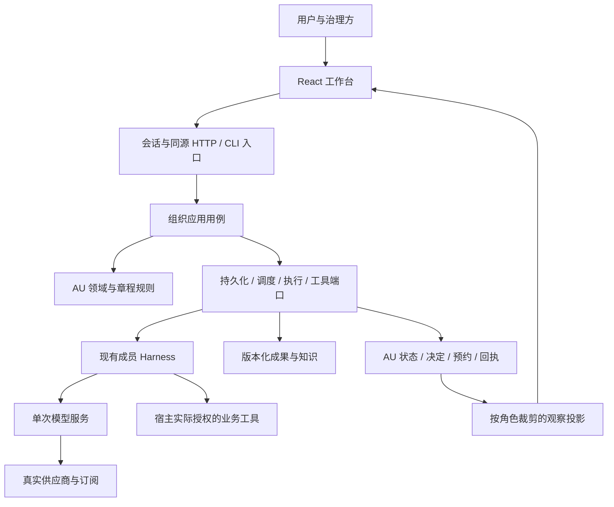

# UNION 重写总体架构提案

日期：2026-11-04。状态：**Proposed，供053评审；不是已落地架构，也不替代已确认的产品边界。**

需求入口是 [PRD v0.7](PRD.md)。[ADR-0004](decisions/0004-rewrite-delivery-contract.md)记录已经采用的开发方法；[ADR-0005](decisions/0005-au-runtime-boundaries.md)与[ADR-0006](decisions/0006-charter-policy-adoption.md)记录待采用的关键架构选择。当前运行实现仍以代码、对应迭代和证据为准。

## 1. 设计目标与依据

重写同时解决原则贯彻和工程组织问题：让产品中的组织、成员、岗位、章程、资源、工作、成果具有明确语义与归属，让每次变更从需求到用户结果都有可验证路径。不能仅把大文件分小，也不能为了新的目录或框架重做已经有效的能力。

已确认约束：ai-union与平台分轨；董事会保留最终控制；治理边界依有效章程与修订程序；成员按单AU作用域；岗位驱动职责、权限与上下文；复用已有Agent循环；保留React工程；实际宿主授权和资源边界独立存在。

本次对照运行时基线 `ddd76e0` 的源码入口、019契约、028运行计划、048模型服务和052安装工程。以下是文档及有界代码读取支持的结构事实，不是对全部运行行为的重新审计：

| 已有所有者 | 已承担职责 | 本次规划处理 |
| --- | --- | --- |
| `ai_union/engine.py` | 章程固定字段校验、组织状态、决定、任职、成果、资源与事务 | 逐行为建立应用入口和领域边界；不一次替换所有状态与历史 |
| `ai_union/runner.py`、`harness.py`、`agent_protocol.py` | 派发、成员会话、组织工具、提议编译与上下文 | 保留有效执行循环，明确组织决定与单次成员/模型调用的边界 |
| `ai_union/console.py`、`server.py` | 会话、同源命令/回执、观察和React静态服务 | 入口只做身份绑定、输入/输出与应用调用；现有HTTP兼容优先核对 |
| `ai_union/model_service.py`、`services/modeld/` | AU采用、单次模型请求、供应商协议与凭据、事件与查询 | 承接048；不再叠加第二个完整Agent循环或第二个凭据刷新者 |
| `ai_union/workspace.py`、`support_requests.py`等工具入口 | 实际工具绑定、隔离执行、申请和回执 | 业务动作与模型推理分开核对；能力由组织目标和实际授权决定 |
| `web/console/`、`ops/release/` | 正式工作台、固定构建与代码采用/回滚 | 在垂直切片中迁移调用；保留052已有工程，数据恢复仍须另验 |

既有审计中的日期限制、历史测试数和待实现描述不能直接当成当前事实。每片开工要在实际采用提交上重新核对相关代码和证据。

## 2. 推荐的系统边界

保留当前语言和工程作为迁移载体，推荐把组织运行时组织成有边界的模块化应用；模型服务继续单独承担其既有职责。数据库、分布式调度和新的部署单元不随重写自动引入。此工程选择仍待ADR-0005评审。

箭头表示调用或数据依赖，不表示授权继承。平台管理员、AU治理方和成员的权限不能沿箭头相互替代。

| 层/建议落点 | 拥有的决定 | 不承担的职责 |
| --- | --- | --- |
| `ai_union/domain/`（提案） | AU对象不变量、有效任职、章程规则、工作与成果关系、领域结果 | 不依赖HTTP、React、供应商SDK、系统环境或数据库连接 |
| `ai_union/application/`（提案） | 创建/启动/提议提交/交接/修章/核对等用例，事务与副作用编排 | 不自行实现供应商协议或把角色显示名当鉴权 |
| `ai_union/application/ports.py`（提案） | 必要的持久化、执行、工具与时钟契约；由实际切片证明必要性 | 不为尚无用例的假想插件建立抽象层 |
| `ai_union/adapters/`（提案） | SQLite、成果文件、现有Harness、模型服务、实际工具的契约实现 | 不另建业务规则、状态主账或隐式重试策略 |
| 现有CLI/HTTP入口与装配位置 | 宿主绑定身份、请求解析、依赖装配和回执投影 | 不反向控制领域规则；具体装配文件由S00契约核查确定 |
| `web/console/src/` | 用户流程、表单、状态、回执与资料展示 | 不拥有授权判断、运行状态真相或离线写队列 |
| `services/modeld/` | 账号认证、单次原生模型请求、协议事件、用量与原请求查询 | 不执行组织决策、业务工具或修改AU账本 |
| `ops/release/`与启动入口 | 可追溯构建、配置校验、进程生命周期与代码版本采用 | 不以代码回滚替代数据迁移或备份恢复 |

代码路径是后续实现提案，不表示目录已创建。每个切片迁移一个实际用例，并删除该用例的旧重复业务实现；未迁移用例继续由原所有者负责。禁止新旧服务同时写同一业务事实。

## 3. 领域模型与事实归属

| 对象 | 身份与关系 | 正式事实的所有者 |
| --- | --- | --- |
| AU | 稳定AU ID，目标、阶段、有效章程、资源和组织关系 | AU持久状态 |
| Member / Position / Assignment | 成员是`(au_id, member_id)`；岗位承载职责；任职连接成员和岗位并保存有效期/版本 | AU组织状态；会话不产生新成员身份 |
| Charter / GovernanceDecision | 章程正文、可执行条款、修订依据和有效版本；按原有效程序采用 | AU治理记录；控制主体描述不是鉴权来源 |
| Work / Dependency | 目标、验收、负责任职、依赖和状态；同AU关系不能越界 | AU工作状态；调度队列是其投影 |
| Artifact / Knowledge | 工作/组织归属、内容摘要、版本、来源与访问依据 | 资产内容及AU登记；个人会话仅为草稿/上下文 |
| Decision / Event / Receipt | 有效提议、输入来源、原请求与采用结果 | AU事务记录；失败决定不能消费输入事件 |
| Execution / Attempt | 工作、会话、连接版本、请求/尝试身份、状态和后续核对 | 组织执行日志；供应商状态由其明确回执支撑 |
| Reservation / Usage | 每次尝试的资源预约、用量、币种、费用依据及未知项 | AU资源账本；供应商原始usage是证据，不直接改授权 |
| ToolBinding / SupportRequest | 实际能力绑定与显式申请/响应；申请不授予能力 | 宿主绑定与AU申请记录分别拥有相应事实 |

领域对象、存储字段、HTTP DTO及模型工具输入分别建模。不要把整个数据库状态作为模型协议；模型给出业务提议，宿主补齐身份、版本、引用与事务结果。S00需冻结第一片的字段和错误契约，而不是在此虚构已实现的完整Schema。

## 4. 命令、事务与副作用契约

1. 入口绑定真实调用身份和AU范围，保存稳定命令ID及内容指纹；相同ID不同内容拒绝。前端只保留恢复所需的非秘密请求身份。
2. 应用层读取当前规则、任职、状态和资源，在事务内复核版本及授权；只有成功提交才登记正式决定、状态、事件消费和命令回执。
3. 必须执行外部动作时，先持久保存执行意图、请求/尝试ID和资源预约，再派发。外部成功不是本地事务成功；崩溃后通过原ID和回执恢复。
4. 适配器返回的状态不能直接覆盖领域状态。重复事件按稳定身份去重；旧任职、旧连接版本或已结束尝试的迟到结果隔离并可核对。
5. AU与模型服务数据库各自事务；048的outbox、原请求查询、事件序号和回放共同连接它们，不承诺跨库原子性或端到端exactly-once。
6. 命令接收、正式采用、明确拒绝和结果未知分开。具体HTTP字段和错误码先在S00/S01与既有客户端对照确定；不能仅换内部名称就破坏旧回执恢复。

首批继续评估SQLite单AU串行写入与文件资产这一已有实现。是否需要新存储或并发worker必须有真实负载、锁/恢复证据和迁移方案，不由“正式重写”这个名称决定。

## 5. 章程、身份与能力边界

PRD F03/F07/F09约束实际行为。ADR-0006提出把章程采用、规则求值与当前治理身份适配分开：正文及执行条款属于同一版本，修改遵循旧程序，条款不能给自己授权。

允许一次行动需要同时满足：实际调用身份、当前有效任职/治理程序、有效章程、实际宿主或工具绑定及资源限制。成员姓名、岗位描述、controller_ref、模型回复、SKILL.md及AGENTS.md均不能替代上述授权。

首批兼容适配器仍使用实际`legacy_board`校验。新的治理字段或展示不能被标成已经接通企业SSO、上级AU继承、完整董事会投票或任意规则语言。支持不了的条款必须给出明确差距，保留提案而不是宣称它已经生效。

宿主可维护程序不等于普通成员可修改程序。未来组织通过工作成果建设平台时，代码采用、发布、网络与资源仍各有实际权限及责任。

## 6. 生命周期与故障处理

| 场景 | 持久依据与行为 | 用户可见结果 |
| --- | --- | --- |
| 创建/筹建中断 | 稳定创建回执、草案与调用记录；按原AU恢复 | 草案和正式成员分开；不重复创建或清零占用 |
| 普通成员任务 | 依赖成果、任职、会话和实际工具回执 | 进度、结果、失败及证据可定位 |
| 反馈/到期 | 事件有来源和稳定ID，成功决定后消费 | 反馈如何变成后续工作可追溯；没有新事时不调用模型 |
| 暂停/撤权/交接 | 停止新派发；在途执行按原身份留痕并核对 | 暂停请求、已暂停与远程取消分开 |
| 本地崩溃/外部超时 | 执行意图、尝试、预约和原请求查询；不重放未知业务动作 | 明确待核对的原因、证据和有权处理入口 |
| 模型流恢复 | 保留native envelope、工具配对、事件序号及单一刷新所有者 | 恢复原请求与新推理尝试分开；后者重新预约且计量 |
| 旧连接/迟到结果 | 接受点重验有效版本，必要时隔离结果 | 原成果和费用不抹掉，失效授权不重新生效 |
| 升级/回滚 | 先校验兼容与未决执行，显式迁移，验证副本恢复 | 构建版本、数据格式和回滚限制可见 |

实际运行窗口、负载和支持环境由PRD Q-04补齐。结构设计和测试不能代替该窗口内的真实运行证据。

## 7. 迁移、保留与退役

| 现有资产 | 处理 | 退役/切换条件 |
| --- | --- | --- |
| 组织ID、章程/任职/决定历史、成果摘要、预约、未决执行 | 保留原含义；迁移前创建一致副本和核对清单 | 仅在明确的数据迁移协议、回滚/恢复演练及授权范围内切换 |
| Engine等既有业务实现 | 每个用例在迁移前仍是唯一写入所有者 | 新用例通过正常、反例、持久化、迟到和回归后重绑所有调用者，移除该用例重复实现 |
| HTTP/CLI、回执与React流程 | 保留被使用的行为和恢复语义 | 兼容变化须显式版本/迁移说明，不能靠宽泛fallback掩盖差异 |
| 模型服务与现有Harness | 保留048单次模型/工具循环分工 | 新路径采用后才按048退出旧手写协议路径；无双重工具执行或凭据刷新 |
| 052发布包 | 复用已有构建与代码采用机制 | 补齐跨schema迁移和备份恢复后再声称完整升级能力 |
| 历史PRD、spec/evidence、PLAN/OPS/ENG/U编号 | 保留为历史，明确日期与范围 | 不做历史删除或把旧done改成新能力已验 |
| 旧独立HTML、未知来源/其他人的本地文件 | 继续遵守退役决定，保留Git历史与已有本地状态 | 不由本规划清理、纳入提交或重建 |

本轮没有采用新Schema、迁移业务数据库、扩大权限或替换运行时。候选架构不能被当作这些动作已经完成的证据。

## 8. 执行和评审入口

后续按 [053 plan](../specs/053-union-rewrite/plan.md) 先进行S00评审，确定PRD来源、ADR-0005/0006的采用/修改结论和首片精确契约，再推进 [垂直切片](../specs/053-union-rewrite/tasks.md)。模块目录及切片内部文件变化由该片的TDD和实际所有者核查约束，不按文档批量创建空壳。

评审必须回答：每个产品要求由谁负责、哪个有效版本决定行为、成功与失败如何落盘、恢复是否重复动作、前端如何解释结果，以及什么证据足以关闭该切片。未决项保留在PRD，不用代码假定答案。
