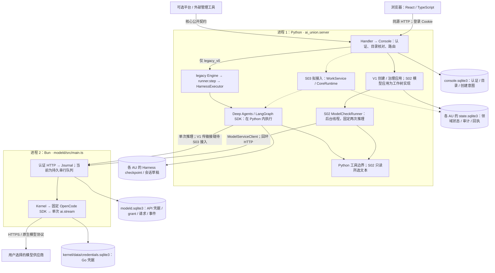
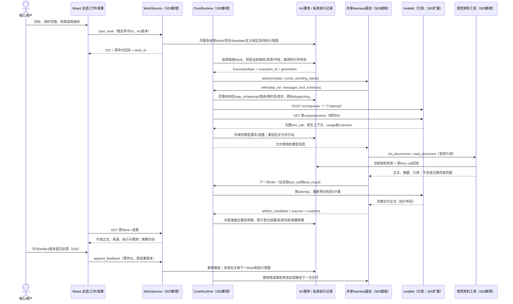

# UNION 重写总体架构：Chapter V1 基线

日期：2026-11-06。需求：[Chapter V1](UNION_CHARTER_v1.0.md)、[采用记录](CHARTER_ADOPTION.md)、[PRD v1.0](PRD.md)。本文区分已选工程方向与尚未实现的目标架构。运行事实仍以源码和相应证据为准。

开发入口：[进程与存储](#runtime-deployment) → [目标到首份交付的时序](#first-delivery) → [接口与恢复](#execution-contracts) → [模块改造表](#module-changes)。用户先看 [U-072 的具体操作和演示](../TASKS.md#u-072)，准确代码、接口与完整验收见 [开发附录](../specs/053-union-rewrite/tasks.md#u-072-development)。本次核查基准为 `c31bf0e` 及原会话留下的 S02 工作树，来源和未通过项见 [058 设计核查](../evidence/058-s02-model-tools/design-readback.md)。**“工作树已有”不表示已提交或已验收；“拟新增”不是当前可调用接口。** 后续 S03/S04/S06 的设计说明不授权执行这些卡。

[ADR-0004](decisions/0004-rewrite-delivery-contract.md)采用用户指定的交付方法；[ADR-0005](decisions/0005-au-runtime-boundaries.md)采用增量模块化与独立核心边界；[ADR-0006](decisions/0006-charter-policy-adoption.md)采用治理根、受支持规则和分阶段兼容方向。采用设计不等于代码已经迁移。

2026-11-05 的 [S01 实现](../evidence/056-s01-core-creation/README.md)已迁出创建纯规则、应用流程及 catalog/legacy/V1 存储适配器，并由 `identity_schema.py` 统一拥有显式身份升级。[S05](../specs/053-union-rewrite/s05-contract.md)在此基础上实现受支持的本地治理、责任及内部文字结果。稳定 principal 由核心认证签发，AU state 中不可变 `governance_root` 保存初始来源，`governance.current_principal_id` 及有效规则决定当前权威；catalog 只定位并保留原创建意图。新建仍是准备态，显式采用/激活本地治理不会启用模型、资源或自主业务。

## 2026-11-13：V1用户体验的所有者与实施边界

[U-110](product-design.md)冻结完整组织体验，[FRONTEND](FRONTEND.md)固定路由/作用域、真实公开API和责任分工。React视图不拥有领域状态；Workspace管理一个当前作用域，各业务页面消费其合法投影，不再由Layout把不同路由统一换成旧治理控制台。

U-112的业务资料公开发现/授权、U-113的完整工作持久意图、U-114的AI工作责任交接是源码核查出的待补接缝，由原领域/应用/存储owner细化合同并顺序整合；不把它们当成已有接口，也不为UI新建第二个Engine/调度器/账本。本文上方和下方标有2026-11-06的进程图/实现快照保留当时含义，最新可调用API与源码差距见FRONTEND §3–4及各执行卡。

## 1. 产品与部署边界

`ai-union`核心必须能够独立构建、运行、验证并连接模型和工具，包含基础认证、AU权限与审计。AI-Union-Platform通过版本化公开契约提供可选托管、商业账户、集成等增强服务，不直接读写核心私有表或导入内部模块绕过边界。

保留Python、React工作区、现有Harness和模型服务作为增量重组载体。当前并不满足所有目标边界；不能把现有代码改名当成独立核心已交付。开源许可、拆仓库、公开发布和新增部署单元不是本轮动作。

实线描述已存在的对应路径，虚线是后续 V1 接入；图中 S02 节点属于未提交工作树。`npm start` 的 Node 包装器构建 React 后启动 Python，**不会自动启动 modeld**；模型服务由 `npm run start:model-service` 单独启动。图中选用 API/modeld 的 Harness 在 Python 内运行，不需第三个 Agent 服务或额外 OpenCode Agent 进程。保留的其他 legacy profile 可能启动 `CodexExecutor` 的 CLI 子进程或 workspace 的 Docker 容器，不是本图路径的前置。开发模式可另有 Vite watcher；发布包装器的 `run console` / `run modeld` 也分别启动两个组件。

Python 与 modeld 读取同一宿主 `UNION_MODELD_CONFIG`，后者默认监听 `127.0.0.1:4098`。浏览器不能直接访问 modeld；Python 内部 admin/worker token 与 AU principal 是两种身份，不能互相授予权限。当前 modeld `pump()` 一次只运行一个请求，不能把图中的多个调用者理解为已有并行推理。

| 数据 | 实际位置与逻辑写入者 |
| --- | --- |
| 账号、会话、目录、创建意图 | `<console-root>/console.sqlite3`；Identity 与 CreationCatalog 分别拥有自己的表，物理上不是两座库 |
| V1 AU 原创建、当前治理/责任、审计 | `<console-root>/organizations/<创建请求摘要>/state.sqlite3`；CoreAUStore 建立原创建，GovernanceStore 保存后续采用；目录不能代替库内 AU ID |
| S02 请求正文、所选资料、工具回执 | 同一 AU 库的 `model_attempts` / `model_materials` / `model_tool_receipts`；ModelAccessStore 在调用者提供的 AU 事务内写入，不另开账本 |
| 已有 Harness checkpoint | `<au-root>/harness/checkpoints.sqlite3`，SDK SqliteSaver；`agent_sessions` 在旧 AU 库，尚未成为 V1 会话目录；虚拟草稿不等于正式成果 |
| 模型事实与凭据 | 宿主配置的 `<modeld-state>/modeld.sqlite3`、`owner.sqlite3` 和 `kernel/data/credentials.sqlite3`；Journal/上游 Credential 分工，核心不复制其凭据 |
| S03 正式成果（拟新增） | AU 私有内容寻址文件 + 同 AU 库的成果登记；先可靠写内容，再事务登记并采用；孤立文件可回收，不能出现已完成但无可读内容的 Work |

五层是职责分区。以上物理共享不取消逻辑所有权，也不表示跨这些库与文件存在全局事务。

## 2. 所有者、依赖与现有落点

| 所有者 | 目标责任与依赖 | 现有落点与切换规则 |
| --- | --- | --- |
| 核心身份/授权/审计 | 区分账户、治理主体、成员、平台客户；绑定有效身份；授权记录有可信来源 | `identity.py`/`identity_schema.py` 签发稳定 owner/core 主体并拥有显式 auth 0/1→2 升级；普通 core 身份不授 AU、legacy 或平台权限 |
| AU领域 | 目标、Charter、任职/Mandate、承诺、资源账、成果采用及合法状态转换；不依赖具体Runtime/Harness/SQLite | `domain/creation.py`、`governance.py`、`responsibility.py`、`model_access.py`、`model_checks.py` 拥有已迁出的 V1 规则；`engine.py` 继续拥有其余 legacy 用例 |
| 应用/组织Runtime | 命令、事件归属、Agent绑定、工作调度、可靠意图、恢复和执行所有权 | `application/creation.py`/`governance.py` 编排创建与治理，`model_access.py`/`model_checks.py` 编排有界模型检查，Console/HTTP 装配；旧 `runner.py`/`agent_protocol.py` 不取得 V1 派发权 |
| Agent定义/绑定与Harness | 定义版本、责任身份/Work/Mandate绑定、推理工具循环、上下文和原生接续 | 已有 `HarnessExecutor` 仍依赖 Engine；S03 按下方接缝提取 SDK 驱动并注入 V1 的模型/工具/检查点能力，不能直接复用其旧授权与事务 |
| 模型接入 | 原始请求/事件/用量、认证及单一刷新所有者，按能力返回模型结果 | `ModelServiceClient` 是已有回环 HTTP 客户端；`ModelServiceTransport` 构造 Engine，仅供 legacy。S02 工作树直接用 Client，modeld 不执行业务工具或改 AU 状态 |
| 工具/环境适配 | 输入输出、权限、副作用、去重、取消/恢复/成果能力 | `workspace.py`等；真实绑定与章程/任职/资源相交，报告不支持，未知结果不重放 |
| 持久化/资产适配 | 实现事务、序列化、文件与读取契约，不复制领域规则 | `adapters/core_au_store.py`/`governance_store.py` 拥有创建与治理事实，`model_access_store.py` 在同一 AU 事务保存私有模型意图、原事件、资料与工具回执；旧 SQLite/assets 按原用例保留 |
| 观察投影 | 按权限提供成果、进度、能力、unknown/partial及必要汇总 | `observation.py`、React；不能取代权威状态，读取不隐式迁移、不启动执行 |
| 运维与独立监督 | 诊断、隔离恢复、受限监督、外部升级/备份恢复 | 复用052和既有生命周期工程；被监督执行不能静默改删自身监督记录 |
| 平台商业层 | 客户、套餐、商业账单和可选服务 | 与AU资源账分开，S11逐调用者重绑到公开契约；不凭商业身份取得治理权 |

S01精确文件/调用者/测试在[首片契约](../specs/053-union-rewrite/s01-contract.md)。目标目录可按`domain/`、`application/`、`adapters/`组织，但仅在实际责任迁出时创建；不能新增只转发旧巨大Engine的通用服务来假装完成A-02。

## 3. 对象与版本

| 对象 | 身份、权威与必要关系 |
| --- | --- |
| AU / Objective | 稳定AU ID；目标、成功依据、约束与复查条件；组织规模不是部署规模 |
| GovernanceRoot / AU Charter | 可识别初始治理主体、默认创建者绑定依据、有效章程及最终决定/保留/失能程序；描述字段不等于权限 |
| Member / Appointment / Mandate | 成员为持续责任身份；任职驱动职责；授权说明范围、资源、有效条件与再委托边界 |
| Agent Definition / Binding | 独立的定义版本；关联成员、Work、Mandate、上下文；不把模型连接revision当成定义版本 |
| Work / Execution | 工作跨尝试延续；每次执行有独立ID、有效所有权、上述绑定和用途；失败责任仍有主 |
| Commitment / Relation | 双方接受的交付责任与争议/终结；治理/授权、协作与部署边分开，不强制单树 |
| Artifact / Knowledge / Evidence | 正式登记与材料分开；归属、版本、授权引用与来源；纠正影响显式依赖的活动工作 |
| Attention Item | 持久原因、影响范围、处理主体、响应条件，保留事项仅阻塞相关工作 |
| Allocation / Reservation / Usage | 授予、占用与消耗分开；AU/Work/Execution/用途/修订可核对；嵌套不重复计算 |

公共协议版本、持久状态Schema、Agent定义版本、AU状态/章程/任职版本、模型连接revision各自拥有语义，不能复用一个数字。字段与枚举由实际切片冻结，不把本表当成已存在的数据库。

## 4. 命令、事务与外部动作

入口绑定受信身份和范围，稳定请求ID与内容一致性阻止重复采用。应用层在提交边界重验权限、必要版本、引用与资源；领域结果和待执行意图必须原子或等价可靠关联。Outbox和租约是可选实现手段，不是宪章指定机制。

共享 `application/creation.py` 拥有先存分配和原请求、再创建、最后登记的可核对流程；profile 只选择存储适配器。legacy 保留原 board.key/Engine/assets 顺序；V1 不生成 board.key，state/治理根/charter/创建采用记录在同一个 AU 数据库事务中保存。catalog 与 AU 库仍是独立提交，不是跨文件/跨库事务；中断或 unknown 保留原意图、目录和已写字节，不自动重建。创建回执始终按原请求 kind/ID 查询，不因正文出现 AU ID 而改查 AU 命令表。

外部成功和本地提交成功分开；稳定事件/请求/尝试身份用于查询、去重与恢复，不能声称端到端exactly-once。纯推理的新尝试另行准入和计量；有业务副作用的未知动作先核对。迟到结果记录原身份、版本、费用和证据，在接受点校验，不改写历史为其补权。

## 5. 治理与兼容

X-02(a)的初始治理根和适用的最终决定方、保留事项、失能程序是启用条件。S05 的 `local_governance.v1` 支持单一当前治理者/最终决定方、具名保留事项、预先确认的超时继任或单主体超时退出。普通接班由被提名账户自行确认；按已采用期限恢复不要求失能者在线。修章按旧规则验证，任职、目标、Work、Mandate 祖先链和政策版本在行动与接受处都重验。人类内部记录尝试不冒充 AI Execution，未来 S03 仍须绑定实际 Agent Definition 版本。

成功首次采用才把 AU schema 1 升为 2；合法但被规则拒绝的初次命令只留下可查的原回执。`governance_origin` 保留原 state/Charter 字节，创建意图/采用不改；完整命令摘要、连续审计与每个 Charter 快照相连。规则拒绝不改变当前状态；撤权后的迟到文字只保存为 `not_adopted`，回执明确 `effect=evidence_only`。当前 AU 访问与原提交者历史回执权限分开，失去前者仍可查询自己的回执。该完整性检查不抵御有权整体改写数据库及程序的宿主。

身份仍存于独立认证库；采用时在认证事务内验证 actor/目标账号，再提交单 AU 事务，不声称跨库原子提交。当前治理者/后继身份丢失、期限到达等条件在边界求值，投影 `readiness_gaps` 说明具体缺口；读操作不会续期、迁移或恢复。安装器同时校验 auth/catalog 和实际 AU schema，旧代码不兼容时拒绝采用/回滚/启动。

现有`legacy_board`、五字段章程、单宿主身份与旧HTTP仍是需要保护的兼容资产，并非V1完整治理。不得根据controller_ref、board_name、账户重置或模型正文补造治理权。现有数据不在读取时自动升级，迁移必须有原身份/历史/未完责任映射及回退边界。

## 6. 局部恢复、组合和改进

- 每种等待有对象、唤醒及责任；长任务保留新输入入口。未知状态只隔离受影响工作/资源，独立工作继续。监督在执行之外，权限受限、健康可观察。
- 主动观察/研究有目标、探索目的、预算和退避；无已知变化不代表不能主动获取新信息。路由、评审、监督和改进消耗都进入资源账。
- S10让两个AU经公开契约接受/履行承诺，再扩展递归派生与重组；组合投影含授权所需承诺/撤权/用量/未知部分状态，并封装内部会话与知识。撤权有传播反馈和离线有效边界；协作不产生治理继承。
- S07支持低影响授权内直接试用与效果评估分开。实施和评估是可区分职责，不强制不同Agent；候选不更改自己的检查依据、评级或失败记录。重要改变保留窗口和停止条件。

## 7. 迁移、退役与交付

每个用例只有一个写入所有者。切换前固定旧调用者清单、请求/回执/Schema兼容、身份与未决执行、测试和回退；切换时重绑调用者并退出重复逻辑。保留必要兼容入口作为薄适配，不长期双写、双调度或堆叠fallback。

旧软件在不满足新契约处明确标为legacy/未支持；保护数据不等于冻结旧产品定义。旧方案经Git历史追溯，当前入口只使用V1。React、有效执行循环、原AU ID/成果/预约/未知执行和真实证据保留；独立HTML不恢复。

S00检查的是设计与交接；代码、真实集成、用户闭环、独立发布、持续运行分别验收。首个实施单元及后续路线见[053计划](../specs/053-union-rewrite/plan.md)，逐规范覆盖见[追踪表](../specs/053-union-rewrite/charter-traceability.md)。

## 8. 从一个目标到首份交付

场景：用户在自己的 AU 提交“根据我授权的资料生成带引用的项目概览”，随后针对第一版给反馈。**目前完整链未接通。** S02 工作树只验证一份提交文本的模型/工具往返；宿主目录选择、列目录和边界内读文件不是这项能力，随 S03 首份真实工作补齐资料适配器。S03 交首份可读成果及最小完成采用，S04 再交反馈和第二版，不能把成果展示也留给 S04。

模型负责目标解释、必要的分工和行动选择。Runtime 只对已采用的结构/责任/依赖调度，不按行业硬编码岗位；首次小 AU 可采用一个版本化默认 Agent 定义，由受信入口建立最小 AI Member/绑定。若需要规划调用，它也先建立协调 Work/Execution、限额并以 `coordination` 计量；模型的 `propose_work` 结果经同一应用事务采用，不能无责任地先调用模型再补建成员。已经明确责任的简单工作不强制经过额外规划轮。

Runtime 管“谁负责、是否可以做、做哪项、事实如何采用”；Harness 管“本次执行如何推理、使用工具、保有上下文”；modeld 管“合法账号下的一次模型请求及原始事实”。Harness 提交的普通文字不需要组织大 Schema；正式 `propose_work` / `artifact_candidate` 才由领域规则校验，模型不能自行写数据库或宣布正式完成。

## 9. 接缝、事务与中断恢复

### 9.1 已存在的 S02 调用链

`Models()` → `CoreModels / ModelWorkspace` → `modelsApi.command()` → `Handler.handle_api()` → `Console.models.command()` → `ModelAccessService.spawn()` → `ModelCheckRunner.run()` → **`ModelServiceClient.call()`** → modeld `startService()` / `Journal` / `Kernel`。第一次响应中的 `read_document` 由 `ModelAccessStore.tool_result()` 读取已提交文本；第二次带回原工具回执，`complete_reply()` 校验实际 challenge 后保存输出。

这里没有构造 `ModelServiceTransport`，也没有调用 `HarnessExecutor.execute()` 或 `runner.step()`。S02 与旧 `test_tool_connection()` 共用 `tool_roundtrip.py` 的消息/结果规则；两阶段的持久编排在 Python 应用层。HTTP Client 模块仍导入若干旧 helper，是后续解耦点；“不构造 Engine”不等于所有源码依赖都已迁出。

| 已有边界 | 实际输入与输出 |
| --- | --- |
| React → 核心 | `POST /api/v1/models/commands`：`{id,organization_id,base_version,kind,data}`；返回 `{receipt}`，含 `operation_id` 或 `check_id`。受理回执不等于异步保存/推理成功；用 `GET /api/v1/models` 读取结果，用 `/receipts` 查询原命令 |
| 核心 → modeld 注册 | admin：`POST /v1/api-connections`，`{id,au_id,principal_id,name,base_url,api_key,model_id}`，可显式附 `wire_api` 和仅 Responses 支持的 `reasoning_effort`；返回同原操作/主体/模型的 `grant_ref,grant_revision`。未指定协议保持 Chat；unknown 只 GET 原注册；凭据不进入 AU 命令正文 |
| 核心 → 单次推理 | worker：`POST /v1/requests`，`{id,au_id,run_id,connection_id,connection_revision,grant_ref,grant_revision,model_id,messages,tools,generation,deadlines}`。当前 S02 `id=run_id=attempt_id`；Work/Member/用途关系由核心私有记录拥有，不臆造 modeld 已有这些字段 |
| modeld → 核心 | `GET /v1/requests/{id}?au_id=...`：`{id,au_id,request_digest,state,action_authorized,result,error,...}`；`result` 含 `message/usage`。`/events?after=<seq>` 提供原事件，核心按原 attempt/seq 去重并及时保存有效前缀，冲突拒绝；最终有效用量优先，金额/币种成对采用，不与累计流相加。取消、撤权、中断仍保留原事实 |
| 核心 → 当前工具 | `read_document({document_id:check_id})`；返回 `{document_id,name,content,sha256,challenge}`。资料、参数和 tool_call_id 精确配对；不是一个接受任意路径的文件读取接口 |

### 9.2 S03 的具体改造方向（拟新增，实施前冻结）

| 方案 | 结果与取舍 |
| --- | --- |
| 放宽 Engine 使旧传输/Harness 直接处理 V1 | 会把 board、旧资源账及旧会话状态带入 V1，破坏已验收隔离；不采用 |
| 另写完整 Agent 循环或独立 Agent 微服务 | 重复 SDK 推理/工具/检查点能力并新增部署和一致性成本；当前没有必要 |
| 提取现有 SDK 驱动，注入核心执行能力 | 沿 ADR-0005 增量方向；复用机制，显式替换授权/状态/工具所有者；采用此方案细化后续卡 |

拟定的 Python 接缝如下；这些名字目前不存在，不能当作可调用代码。共享调用所有者、游标/采用记录、租约及 S06 多槽位/公平策略属于后续具体方案；ADR-0005 只已采用增量分工方向。实现时在 S03/S06 对应契约及编码前 ADR 细化中冻结 DTO、失败和迁移测试，再迁入实际模块并补局部 AGENTS。

执行所有权的 generation 是内部整数代次；modeld wire 的 `generation` 是 `maxOutputTokens` 等模型参数对象，两者不能混用。`step_ref/fact_id/owner` 也只在核心持久记录中关联，不把内部 spec 直接展开进现有 modeld v1 精确字段契约。

| 接口 / 所有者 | 必要数据与效果 |
| --- | --- |
| `WorkService.command(actor, command) -> receipt` | `start_work` 的 data 为 `instruction,input_refs,definition_ref,connection_id,max_calls,allow_unknown_cost`；实际 principal 从会话取得。领域校验 AU 目标、治理、业务资源授权及资料绑定。不能把 S02 的 `model_check` Mandate 或 `connection_check` 额度当成任意业务授权 |
| `CoreRuntime.tick(au_id) -> DispatchDecision` | 短 AU 事务选择一个 eligible Work，持久化 Execution/意图、工作与环境占用，以及该执行的有限调用父预约；返回执行 ID 或具名等待原因。网络和 Harness 在事务外运行 |
| `CoreHarnessAdapter.advance(spec, cursor, inputs) -> HarnessOutcome` | 从现 `HarnessExecutor._model()`、图构建及 `graph.invoke()` 提取唯一 SDK 驱动。spec 含 `au_id,work_id,work_version,member_id,binding_id,binding_version,mandate_id,mandate_version,definition_id,definition_version,execution_id,generation,session_id,goal/charter/policy版本,connection/grant/resource版本,input_refs,tool_specs`；不含 API Key |
| 注入的 `infer(execution_ref,step_ref,messages,tools)` | CoreRuntime 在派发前将逻辑步骤 `step_ref`、attempt ID、完整请求摘要/正文、用途及父预约中的本次分配同事务登记，再用共享 ModelServiceClient POST/GET。同一步重入只取原 attempt；真正下一轮分配新 step_ref，即使正文相同也不合并。S02 有界验证也重绑这一单次调用所有者；旧 ModelServiceTransport 只保留 legacy 调用者，不生成一个“假 Engine” |
| 注入的 `invoke_tool(execution_ref,step_ref,attempt_id,call)` | 原 tool_call_id、名称、完整参数、资料/环境引用；每次校验 generation、当前授权和资源。工具回执至少按原 attempt + tool_call_id 定域；重复调用读原回执，unknown 副作用先核对。modeld 只输出提议 |
| `HarnessOutcome` → `CoreRuntime.accept(...)` | `progress / waiting / artifact_candidate / failed / unknown`，带 cursor、原模型/工具回执引用；候选成果含内容摘要、来源和依据。先保存 `fact_id/digest`、原阶段 cursor 和 `adoption_pending`，再检查采用资格；旧 generation 的 worker 无权提交采用，新 owner 只能经受信恢复入口重验原事实与当前版本后采用 |
| S04 `append_feedback` / `adopt_feedback` | 稳定 event_id、work_id、artifact_id/version、来源/正文；接收不等于采用。采用决定、后续 Work/意图及事件消费在同一 AU 事务，支持查询原命令 |

V1 会话目录由 Runtime 决定 `session_id` 与执行绑定，SDK 只写其 checkpoint。核心持久游标拥有当前 `step_ref`：进入模型步骤前取得或找回该 token，采用该步后才推进下一 token。SDK checkpoint 落后时按核心原步骤/事实补齐，不能按相同消息猜测去重，也不能为原图节点重入分配新 attempt。检查点不能证明权限或外部请求是否执行；恢复前先查核心 attempt，再查原 modeld request。定义、责任、目标或授权版本改变时，原会话可取证，不能不经重新绑定继续行动。未来新 schema 的执行/会话表由同 AU 事务适配器维护；原创建、S05 人类尝试和 S02 checks 不改名为新业务执行。

### 9.3 调度与恢复的精确范围

当前 `runner.step()` 的全 AU 早退仅留给 legacy；`Console._execute()` 还会在 `start/api_test` 前拒绝任意 unknown，旧 `runner.lock` 在整个运行/等待期间锁住该 AU。S03 新入口直接装配 CoreRuntime，不复用这些准入和锁范围；不得对同一 V1 Work 同时启动两套调度。其选取条件是：Work 未完成、依赖成果已采用、责任/Mandate/定义仍有效、没有该 Work 的活动或未核对 Execution、预算与所需资源可预约。按持久优先级和创建序号选取，结果写入同一个 AU 事务；“有任何 unknown”不再是全局条件。

占用键至少区分 `work_id`、可写环境和交付目标；不同只读资料工作可独立运行，同一 Work 或同一写目标必须互斥。调度每次计算剩余容量；开始网络等待前释放库锁。拟以持久 `owner_id/generation/lease_until` 表达执行所有权；每次调用、工具和结果采用核对 owner、generation 及未过期。Runtime 是续期/到期转换的唯一应用所有者，在 AU 事务内核对原执行；S06 的恢复扫描取得新 generation，Harness 心跳本身不授予续期权。过期只说明旧 worker 无权继续，**不证明远端没有执行**。

AU 的模型次数/费用只有一份资源账。`tick` 的父预约限制本次 Execution 的总调用，`infer` 只把其中一份额度分配给子 attempt，不再次扣减同一份 AU 可用余额；重复步骤不能重复预约。未派发部分可释放，已派发 unknown 继续保留。工作/环境互斥槽位与模型预算分别记账，modeld 的并发槽位只代表宿主容量，不形成第二份 AU 金钱或调用余额。

| 中断点 | 恢复动作与所属卡 |
| --- | --- |
| Work/意图已提交，线程尚未启动 | S03 从已提交意图取回未派发 Execution；S02 的 `spawn()` 启动失败还需清理进程内 running 登记，恢复原 check，不创建新 Work |
| attempt 为 prepared，尚未进入 dispatching | 当前授权有效才发送该原请求一次；S03 统一此规则，保留 S02 正常对照 |
| dispatching 后响应丢失、Python/modeld 重启 | 查原 request ID 和 digest；查不到或仍不确定时只挂起该 Execution，保留原预约/责任，不换 ID 重发 |
| 模型事实/用量已保存，工具或成果采用尚未提交 | 从 `adoption_pending` 和原 `fact_id/digest` 找回阶段；新有效 owner 重验当前权限、必要版本及原事实，再以稳定采用命令提交。已采用返回原回执，不重发原模型。若是尚未执行的工具提议，先保存原工具意图再执行；已有结果只读原回执，已开始/未知的副作用先核对。资格不符保留候选/`not_adopted` 和责任；旧 worker 不能借恢复绕过 generation |
| 核心步骤已保存，SDK checkpoint 尚未写入 | 原 graph 节点重入携同一 step_ref，返回原 attempt/事实及采用回执后补 checkpoint；真正下一轮才分配新 step_ref，不重复调用或用消息摘要合并合法新调用 |
| 工具已返回，下一模型调用未发出 | 从原工具回执和配对的原模型消息继续；不能重新读变化后的资料冒充原结果，副作用未知必须先核对 |
| 成果内容已写，采用尚未提交 | 按摘要核对内容并重验当前资格，原子完成登记；文件存在或模型声称成功不能单独关闭 Work |
| 运行中收到新输入或停止/交接 | S03 先持久接收并在步骤边界交付；撤权即时影响受控边界。S04 拥有反馈采用语义；S06 拥有自动唤醒、租约恢复和真实交接窗口 |

**不能只改 Python 队列就宣称并发问题解决。** 当前 modeld 的 `persistent_serial` 也会让第二个请求等在途请求结束。S03 最小出口先验证终态 unknown 不锁住有独立资源的 B，明确显示共享模型槽位等待；S06 将 `server.ts:pump()` 改为宿主配置上限内的独立请求槽位、按 account/连接公平选择，记录 queued/active 状态与取消回执。并发额度仍须分别在 AU 和 modeld 校验，不能靠增加线程获得模型预算。A 永不返回而 B 使用独立槽位仍交付、同写目标互斥、治理入口仍响应，是 S06 必须实际运行的反例；单个不可中断的 SDK 阻塞是否需要子进程隔离也在该卡以故障证据决定。

## 10. 模块改造与可演示的任务归属

下表是代码责任和后续输入，不是第二份状态账。“新增”仅指拟落点，当前不创建空模块。

| 模块 / 函数或组件 | 保留、修改、新增、退役 | 完整功能与任务 |
| --- | --- | --- |
| `pages/Models.tsx:Models`；`features/models/{CoreModels,ModelFields,ModelCommandForm,ModelRecords,useModels,api,types}` | S02 工作树已有 V1 分流、表单、轮询和回执；修复具体安全/恢复缺口及失败可读性；不重建前端 | U-072：保存→授权→读所选文本→模型继续回答→默认采用→刷新；详见样板卡 |
| `server.py:Handler.handle_api`；`console.py:Console.{__init__,command,_execute,_job,_probe_job}`；`cli.py:main` | 保留身份与 profile 分流；网页 `_job` 直接调旧 step，CLI 走旧 run/watch，连接测试由各自 probe/api-test 进入旧测试，均继续仅服务 legacy。S03 新装配 work/runtime 服务及版本化工作/成果接口，不继承旧 unknown 准入/runner 锁，也不让旧命令获得 V1 权限 | U-067：总览“开始工作”→异步回执→工作页看到真实执行；旧网页/CLI/测试入口保持兼容 |
| `domain/responsibility.py:{binding,chain,validate_state}`；拟 `domain/work.py` | 保留 S05 `kind=human` / `local_submission`；新增 AI Member/Definition/Execution 的明确类型、授权与候选成果采用规则，拒绝借人类尝试冒充 AI 工作 | U-067：一名 AI 成员承担首份工作；需要分工时才增加成员/依赖 |
| 拟 `application/work.py:WorkService`、`application/runtime.py:CoreRuntime` | 新增目标入口、就绪选择、单 Work 所有权、调用/工具准入、采用；不把新业务追加到 Engine/Console | U-067 首份交付；U-070 扩展定时唤醒、独立监督/恢复，不另建第二个调度器 |
| `harness.py:HarnessExecutor.{_model,_tools,execute,_session}`；拟 `adapters/core_harness.py` | 提取同一 SDK 图/消息驱动；旧类保留 legacy guard/session 适配；V1 注入上节端口，替换 Engine、旧工具编译和旧 session 表依赖 | U-067：模型自主多轮使用授权工具直到候选成果；S09逐 profile 验证原生能力 |
| `model_service.py:{ModelServiceClient,ModelServiceTransport}`；`application/model_checks.py:{run,reserve,collect,observe}` | 保留 Client 及 legacy Transport；S03 从有界 runner 迁出通用单次 attempt 编排到拟 `application/model_calls.py`，S02和业务调用同时重绑，退役被迁出的重复分支 | U-072 补结构化诊断与中断用量；U-067 让共享 Harness 调用 V1，绝不调用旧 Engine |
| `adapters/governance_store.py`；`model_access_store.py:{reserve,observe,tool_result,validate}` | GovernanceStore 继续唯一保存采用后的 AU state/审计。S03 按显式 schema 升级扩展私有 Execution/会话目录并抽出共享 attempt/工具回执存储；原 S02 ID/payload/digest和审计字节保留；切换后旧/新调用者指向同一写入实现 | U-067 状态与意图同事务；U-070 重启、迟到、交接可核对。升级 DDL/manifest/回退拒绝随 S03 契约冻结，读取不建表 |
| `workspace.py:{binding,available,execute}`；拟 `adapters/document_tools.py` | 旧 Docker 命令工具保留 legacy，不能伪装成 V1 目录读取。S03 新增宿主登记的只读 root 引用、AU授权、`list_documents/read_document`，工具只收相对/不透明引用，防 `..`、绝对路径、符号链接/junction 越界，限大小并记录版本/摘要 | U-067：Agent 列出并读取授权资料，范围外读取被拒，项目概览带可定位引用；无 shell 或网络工具自动授权 |
| `engine.py:{ready_work,begin_work,finish_work}`；`runner.py:{step,run,watch}` | 规则和正常/失败案例是迁出依据，旧函数继续服务 legacy；V1 不直接重绑到旧函数。某 legacy 用例全部调用者迁出且历史恢复通过后才删除，不能仅因新文件存在退役 | U-067 替换 V1 首次派发；U-070 局部恢复、并发与监督，不改变小说特定基准 |
| `pages/{Overview,Tasks,Artifacts,Activity,Resources}`、`features/details`；拟 V1 work/artifact API | 复用布局、筛选、纯文本和下载；新增 V1 只读投影及摘要校验，先在 U-067 展示首份成果。S04 新增反馈表单、事件采用、两版对比与显式依赖纠正 | U-067 首份可读成果；U-068 反馈后第二版，拒绝仅有反馈记录却无后续执行 |
| `services/modeld/src/{server,journal,kernel,api-accounts}.ts` | S02 修凭据泄露、错误分类和中断用量事实；保留单次推理/凭据所有权。S06 有界队列和独立槽位，S09增 profile；不托管组织工具/业务循环 | U-072 实际 API 往返；U-070 A受阻时B继续；U-075逐 profile 真验 |

2026-11-06：S02 的凭据过滤、中断用量、线程恢复、结构化错误以及浏览器/安装检查已按 [058 工程证据](../evidence/058-s02-model-tools/README.md)验证。所选 Codex 真实请求被拒绝认证，原请求保持待核对；成功真实往返仍是 U-072 的剩余出口。显式 Responses 设置由原 Journal 同事务持久化，modeld schema 支持 0/1，AU schema 支持 1/2/3，不兼容旧候选在采用/运行前拒绝。U-067 的目标链仍须按其独立契约另行授权实施。
