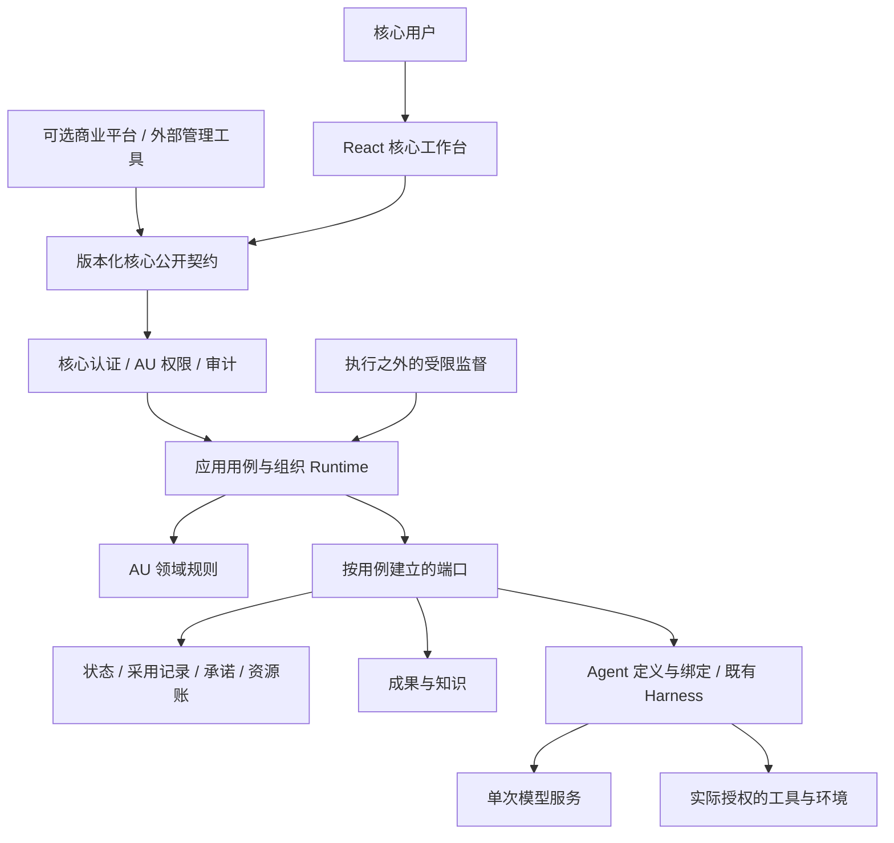

# UNION 重写总体架构：Chapter V1 基线

日期：2026-11-05。需求：[Chapter V1](UNION_CHARTER_v1.0.md)、[采用记录](CHARTER_ADOPTION.md)、[PRD v1.0](PRD.md)。本文区分已选工程方向与尚未实现的目标架构。运行事实仍以源码和相应证据为准。

[ADR-0004](decisions/0004-rewrite-delivery-contract.md)采用用户指定的交付方法；[ADR-0005](decisions/0005-au-runtime-boundaries.md)采用增量模块化与独立核心边界；[ADR-0006](decisions/0006-charter-policy-adoption.md)采用治理根、受支持规则和分阶段兼容方向。采用设计不等于代码已经迁移。

2026-11-05 的 [S01 实现](../evidence/056-s01-core-creation/README.md)已迁出创建纯规则、应用流程及 catalog/legacy/V1 存储适配器，并由 `identity_schema.py` 统一拥有显式身份升级。[S05](../specs/053-union-rewrite/s05-contract.md)在此基础上实现受支持的本地治理、责任及内部文字结果。稳定 principal 由核心认证签发，AU state 中不可变 `governance_root` 保存初始来源，`governance.current_principal_id` 及有效规则决定当前权威；catalog 只定位并保留原创建意图。新建仍是准备态，显式采用/激活本地治理不会启用模型、资源或自主业务。

## 1. 产品与部署边界

`ai-union`核心必须能够独立构建、运行、验证并连接模型和工具，包含基础认证、AU权限与审计。AI-Union-Platform通过版本化公开契约提供可选托管、商业账户、集成等增强服务，不直接读写核心私有表或导入内部模块绕过边界。

保留Python、React工作区、现有Harness和模型服务作为增量重组载体。当前并不满足所有目标边界；不能把现有代码改名当成独立核心已交付。开源许可、拆仓库、公开发布和新增部署单元不是本轮动作。

箭头不赋予权限。五层参考架构是职责分区，不是五个微服务；物理共享进程/存储仍保留逻辑所有权。

## 2. 所有者、依赖与现有落点

| 所有者 | 目标责任与依赖 | 现有落点与切换规则 |
| --- | --- | --- |
| 核心身份/授权/审计 | 区分账户、治理主体、成员、平台客户；绑定有效身份；授权记录有可信来源 | `identity.py`/`identity_schema.py` 签发稳定 owner/core 主体并拥有显式 auth 0/1→2 升级；普通 core 身份不授 AU、legacy 或平台权限 |
| AU领域 | 目标、Charter、任职/Mandate、承诺、资源账、成果采用及合法状态转换；不依赖具体Runtime/Harness/SQLite | `domain/creation.py`、`governance.py`、`responsibility.py` 拥有已迁出的 V1 规则；`engine.py` 继续拥有其余 legacy 用例 |
| 应用/组织Runtime | 命令、事件归属、Agent绑定、工作调度、可靠意图、恢复和执行所有权 | `application/creation.py`/`governance.py` 编排新用例，Console/HTTP 装配；旧 `runner.py`/`agent_protocol.py` 不取得 V1 派发权 |
| Agent定义/绑定与Harness | 定义版本、责任身份/Work/Mandate绑定、推理工具循环、上下文和原生接续 | 复用`harness.py`、执行器和048；普通推理不填组织大Schema，正式变更走受控契约 |
| 模型接入 | 原始请求/事件/用量、认证及单一刷新所有者，按能力返回模型结果 | `model_service.py`、`services/modeld/`及既有API路径；模型服务不再执行业务工具或改AU状态；平台grant不是唯一合法接入方式 |
| 工具/环境适配 | 输入输出、权限、副作用、去重、取消/恢复/成果能力 | `workspace.py`等；真实绑定与章程/任职/资源相交，报告不支持，未知结果不重放 |
| 持久化/资产适配 | 实现事务、序列化、文件与读取契约，不复制领域规则 | `adapters/core_au_store.py`/`governance_store.py` 分别拥有原创建与治理存储；一个 AU 事务关联状态、历史、命令和回执；旧 SQLite/assets 按原用例保留 |
| 观察投影 | 按权限提供成果、进度、能力、unknown/partial及必要汇总 | `observation.py`、React；不能取代权威状态，读取不隐式迁移、不启动执行 |
| 运维与独立监督 | 诊断、隔离恢复、受限监督、外部升级/备份恢复 | 复用052和既有生命周期工程；被监督执行不能静默改删自身监督记录 |
| 平台商业层 | 客户、套餐、商业账单和可选服务 | 与AU资源账分开，S11逐调用者重绑到公开契约；不凭商业身份取得治理权 |

S01精确文件/调用者/测试在[首片契约](../specs/053-union-rewrite/s01-contract.md)。目标目录可按`domain/`、`application/`、`adapters/`组织，但仅在实际责任迁出时创建；不能新增只转发旧巨大Engine的通用服务来假装完成A-02。

## 3. 对象与版本

| 对象 | 身份、权威与必要关系 |
| --- | --- |
| AU / Objective | 稳定AU ID；目标、成功依据、约束与复查条件；组织规模不是部署规模 |
| GovernanceRoot / AU Charter | 可识别初始治理主体、默认创建者绑定依据、有效章程及最终决定/保留/失能程序；描述字段不等于权限 |
| Member / Appointment / Mandate | 成员为持续责任身份；任职驱动职责；授权说明范围、资源、有效条件与再委托边界 |
| Agent Definition / Binding | 独立的定义版本；关联成员、Work、Mandate、上下文；不把模型连接revision当成定义版本 |
| Work / Execution | 工作跨尝试延续；每次执行有独立ID、有效所有权、上述绑定和用途；失败责任仍有主 |
| Commitment / Relation | 双方接受的交付责任与争议/终结；治理/授权、协作与部署边分开，不强制单树 |
| Artifact / Knowledge / Evidence | 正式登记与材料分开；归属、版本、授权引用与来源；纠正影响显式依赖的活动工作 |
| Attention Item | 持久原因、影响范围、处理主体、响应条件，保留事项仅阻塞相关工作 |
| Allocation / Reservation / Usage | 授予、占用与消耗分开；AU/Work/Execution/用途/修订可核对；嵌套不重复计算 |

公共协议版本、持久状态Schema、Agent定义版本、AU状态/章程/任职版本、模型连接revision各自拥有语义，不能复用一个数字。字段与枚举由实际切片冻结，不把本表当成已存在的数据库。

## 4. 命令、事务与外部动作

入口绑定受信身份和范围，稳定请求ID与内容一致性阻止重复采用。应用层在提交边界重验权限、必要版本、引用与资源；领域结果和待执行意图必须原子或等价可靠关联。Outbox和租约是可选实现手段，不是宪章指定机制。

共享 `application/creation.py` 拥有先存分配和原请求、再创建、最后登记的可核对流程；profile 只选择存储适配器。legacy 保留原 board.key/Engine/assets 顺序；V1 不生成 board.key，state/治理根/charter/创建采用记录在同一个 AU 数据库事务中保存。catalog 与 AU 库仍是独立提交，不是跨文件/跨库事务；中断或 unknown 保留原意图、目录和已写字节，不自动重建。创建回执始终按原请求 kind/ID 查询，不因正文出现 AU ID 而改查 AU 命令表。

外部成功和本地提交成功分开；稳定事件/请求/尝试身份用于查询、去重与恢复，不能声称端到端exactly-once。纯推理的新尝试另行准入和计量；有业务副作用的未知动作先核对。迟到结果记录原身份、版本、费用和证据，在接受点校验，不改写历史为其补权。

## 5. 治理与兼容

X-02(a)的初始治理根和适用的最终决定方、保留事项、失能程序是启用条件。S05 的 `local_governance.v1` 支持单一当前治理者/最终决定方、具名保留事项、预先确认的超时继任或单主体超时退出。普通接班由被提名账户自行确认；按已采用期限恢复不要求失能者在线。修章按旧规则验证，任职、目标、Work、Mandate 祖先链和政策版本在行动与接受处都重验。人类内部记录尝试不冒充 AI Execution，未来 S03 仍须绑定实际 Agent Definition 版本。

成功首次采用才把 AU schema 1 升为 2；合法但被规则拒绝的初次命令只留下可查的原回执。`governance_origin` 保留原 state/Charter 字节，创建意图/采用不改；完整命令摘要、连续审计与每个 Charter 快照相连。规则拒绝不改变当前状态；撤权后的迟到文字只保存为 `not_adopted`，回执明确 `effect=evidence_only`。当前 AU 访问与原提交者历史回执权限分开，失去前者仍可查询自己的回执。该完整性检查不抵御有权整体改写数据库及程序的宿主。

身份仍存于独立认证库；采用时在认证事务内验证 actor/目标账号，再提交单 AU 事务，不声称跨库原子提交。当前治理者/后继身份丢失、期限到达等条件在边界求值，投影 `readiness_gaps` 说明具体缺口；读操作不会续期、迁移或恢复。安装器同时校验 auth/catalog 和实际 AU schema，旧代码不兼容时拒绝采用/回滚/启动。

现有`legacy_board`、五字段章程、单宿主身份与旧HTTP仍是需要保护的兼容资产，并非V1完整治理。不得根据controller_ref、board_name、账户重置或模型正文补造治理权。现有数据不在读取时自动升级，迁移必须有原身份/历史/未完责任映射及回退边界。

## 6. 局部恢复、组合和改进

- 每种等待有对象、唤醒及责任；长任务保留新输入入口。未知状态只隔离受影响工作/资源，独立工作继续。监督在执行之外，权限受限、健康可观察。
- 主动观察/研究有目标、探索目的、预算和退避；无已知变化不代表不能主动获取新信息。路由、评审、监督和改进消耗都进入资源账。
- S10让两个AU经公开契约接受/履行承诺，再扩展递归派生与重组；组合投影含授权所需承诺/撤权/用量/未知部分状态，并封装内部会话与知识。撤权有传播反馈和离线有效边界；协作不产生治理继承。
- S07支持低影响授权内直接试用与效果评估分开。实施和评估是可区分职责，不强制不同Agent；候选不更改自己的检查依据、评级或失败记录。重要改变保留窗口和停止条件。

## 7. 迁移、退役与交付

每个用例只有一个写入所有者。切换前固定旧调用者清单、请求/回执/Schema兼容、身份与未决执行、测试和回退；切换时重绑调用者并退出重复逻辑。保留必要兼容入口作为薄适配，不长期双写、双调度或堆叠fallback。

旧软件在不满足新契约处明确标为legacy/未支持；保护数据不等于冻结旧产品定义。旧方案经Git历史追溯，当前入口只使用V1。React、有效执行循环、原AU ID/成果/预约/未知执行和真实证据保留；独立HTML不恢复。

S00检查的是设计与交接；代码、真实集成、用户闭环、独立发布、持续运行分别验收。首个实施单元及后续路线见[053计划](../specs/053-union-rewrite/plan.md)，逐规范覆盖见[追踪表](../specs/053-union-rewrite/charter-traceability.md)。
