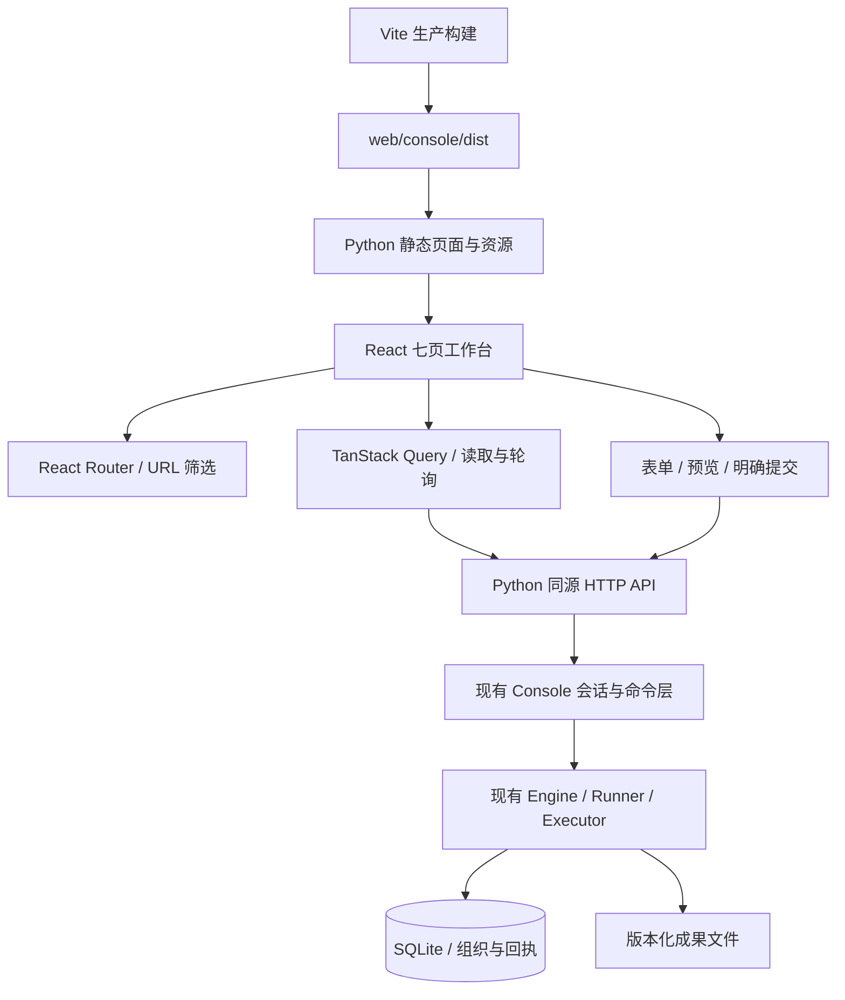

# React 组织工作台工程

2026-10-16 更新：开发主分支 `dev`；小说公司首版已接入网页创建、模型 API 配置并绑定/连接测试、经营周期/章节/账本及缺失用量核对。操作入口按页面职责展示。最新范围和使用步骤见 [NOVEL_COMPANY.md](NOVEL_COMPANY.md)，下文旧迭代记录以此更新为准。

更新：2026-10-14（北京时间）。正式前端位于 `web/console/`，使用 React、TypeScript、Vite、React Router 和 TanStack Query。产品范围见 [005](../specs/005-frontend-engineering/spec.md)，操作及本机会话见 [CONSOLE.md](CONSOLE.md)。

`dev` 已整合真实 API 后端。会话执行器包含 `api`；运行表单正确标识模型 API，仅允许选择已绑定的默认连接，并要求确认有限调用的未知费用。API 配置、绑定和连接测试先通过 [API_MODELS.md](API_MODELS.md) 的 CLI／HTTP 完成，专门的连接管理表单仍待接入。API 回执在设置页显示，恢复只保存请求身份。当前集成验证见 [dev](../evidence/dev-integration/README.md)。

## 安装、启动和验证

使用 `.nvmrc` 的 Node 24.19.0、npm 和 Python 3.11+。从仓库根目录运行：

```sh
npm ci --ignore-scripts
npm start -- --root .union/console --port 8766 --open
```

首次安装后，一条启动命令先类型检查和构建，再启动原 Python 服务。Linux 默认 `python3`，Windows 默认 `python`；可用 `UNION_PYTHON` 指定解释器。已有构建时也可直接 `python3 -m ai_union.server --open`。构建目录不提交，新克隆必须安装并构建。

开发模式：`npm run dev -- --root .union/dev-console --port 8766 --open`。首次构建后 Vite 持续重建，页面重新加载即可看到修改；所有请求仍由 Python 同源提供，无需配置第二个浏览器来源或放宽后端校验。`npm run dev:console` 单独启动构建观察器，供已启动 Python 的开发者使用。开发观察器不持续做类型检查，提交前必须执行完整检查。

```sh
npm run check                 # 历史计划、旧动作测试、前端类型/测试/构建
python3 -m unittest discover -v
python3 scripts/check_console_start.py
UNION_CHROMIUM_PATH=/usr/bin/chromium UNION_PYTHON=python3 npm run test:browser
```

Playwright Core 随锁文件安装。Linux 使用现有 Chromium，或运行 `npx playwright-core install --with-deps chromium` 后不设置浏览器路径。Windows 默认使用标准 Chrome 安装路径，也可通过 `UNION_CHROMIUM_PATH` 指定。浏览器验证使用临时服务和 fixture，测试控制只走私有 stdin；不调用真实模型。

`npm run format --workspace @union/console` 格式化，`npm run format:check --workspace @union/console` 检查格式。CI 的 Linux/Windows 工作流执行完整 `npm run check`，Linux 浏览器任务执行实际 HTTP 流程并上传证据。仓库 CI 配置已更新，远端执行结果需另查。

## 源码职责

| 目录／文件 | 职责 |
| --- | --- |
| `src/api/types.ts` | 会话、组织快照、工作、成果、命令与回执的 HTTP 类型 |
| `src/api/client.ts` | 同源请求、取消和 5 秒超时；POST 无重试 |
| `src/app/workspace.tsx` | 会话交换、组织范围、4 秒轮询、手动刷新、断网与乱序处理 |
| `src/app/url-state.ts` | 路由参数更新，防止快速连续修改恢复旧筛选条件 |
| `src/app/App.tsx`、`Layout.tsx` | 七页路由、导航、组织切换、连接与操作入口 |
| `src/pages/` | 总览、成员、工作、成果、活动、资源、设置 |
| `src/features/commands/` | 操作规则、表单、影响预览、提交与持久请求身份/回执查询 |
| `src/features/details/` | 工作/成员/活动/回执详情、实际成果校验与下载 |
| `src/components/` | 对话框、状态标签、卡片及记录列表 |
| `ai_union/server.py` | 原会话和命令 API；构建资产及明确的 SPA 路由 |
| `scripts/start-console.mjs` | 跨平台构建及 Python 启动入口 |

## 架构和数据流



读取缓存按组织与活动 offset 分开；每次读取重新验证会话、服务实例和返回组织。取消过期请求，并检查快照序号，不用组织版本判断执行或事件有没有更新。切换到曾访问的组织时，可以显示缓存内容，但在新快照完成前禁止提交。

断网立即显示过期、保留最后快照并禁止写操作。恢复联网、页面恢复可见以及手动刷新都会重新读取。查询配置 `networkMode: always`，避免把浏览器离线状态留成已连接；命令同样不进入恢复后自动执行的队列。

操作表单在打开时固定初值，轮询更新不会覆盖编辑。预览绑定组织和基准版本，提交前再核对；服务器仍是权限和版本的最终校验者。POST 前只把请求身份写入 sessionStorage，不保存正文或凭据。超时/断线只查询原 ID，已确认终态不会被晚到响应覆盖。

成果采用 React 纯文本呈现。读取和下载均由原后端校验文件；缓存不代替一次新的校验。浏览器不会接收主机路径、董事会密钥或私有执行日志。

## 页面与交付边界

正式路由：`/overview`、`/members`、`/tasks`、`/artifacts`、`/activity`、`/resources`、`/settings`。组织通过 `organization` 参数选择，工作页支持 `q/status/member`，活动页支持 `type/offset`；链接可刷新和使用浏览器前进后退。

Python 只给明确页面路由返回 SPA，未知资源、源码和私有文件返回 404；页面和资产继续执行主机/来源限制。CSP 仅允许同源脚本、样式和请求，不使用内联执行授权。静态资源公开加载用于建立初始会话，API 保持原权限边界。

`ai-union-dashboard-prototype.html`、`ai-union-progress.html` 和完成报告继续作为单 HTML 演示/报告。`ai-union-console.html` 是 004 的历史实际前端，源码归档至 `design/console-legacy/`，用 `scripts/build_console.py` 可复现；Python 默认服务已切换为 Vite 构建。

当前会话没有可调用的 Sites、Figma、Canva 工具，因此本轮交付是可运行仓库工程和设计实现，没有外部 Sites 站点或设计平台文件。真实模型、外部部署和经营闭环继续按各自条件验收。
