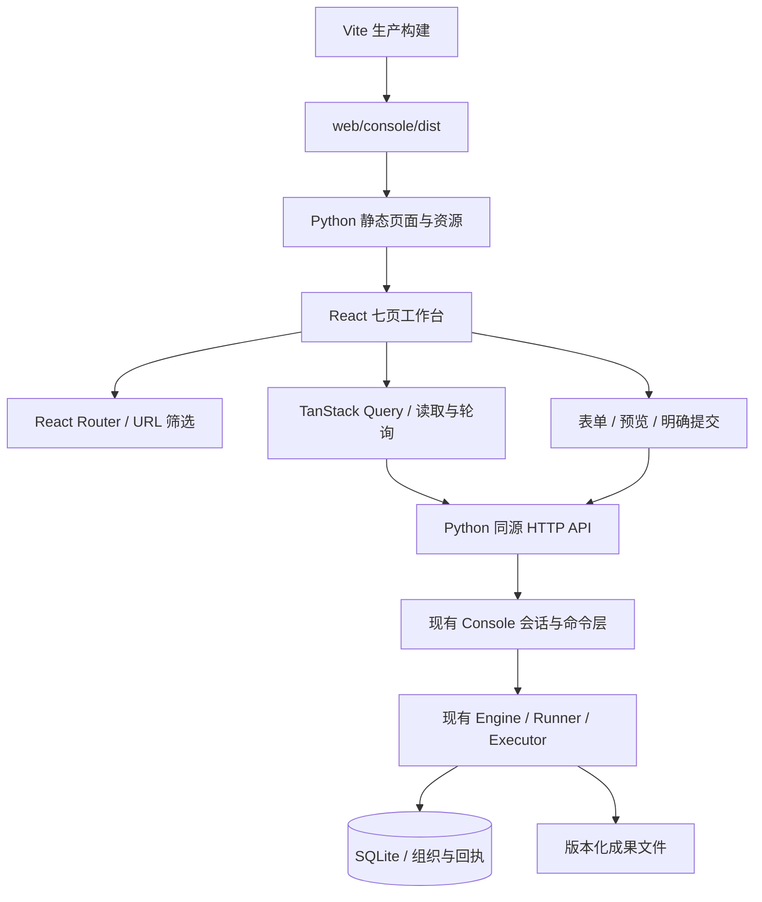

# React 组织工作台工程

> 当前产品依据为[Main Chapter V1](UNION_CHARTER_v1.0.md)、[PRD v1.0](PRD.md)与[053切片](../specs/053-union-rewrite/tasks.md)。本文件保留React工程说明；历史验收和旧界面描述不代表V1能力已经交付。

## 2026-11-08：U-081 核心任务页的 AI 工作读取

U-084 候选在核心任务页增加已登记工作的显式自动执行：无活动尝试时先“准备本轮执行”，再“运行 AI 工作”调用既有 run_loop。原请求身份在提交前保存，断网/刷新仅查询原回执，不重新派发；主体/服务/AU变化隔离状态，撤权清除旧内容。旧手工登记、预约和提交控件保持隐藏。长循环不使用通用五秒读取超时。候选及实际验证范围见 [U-084契约](../specs/053-union-rewrite/s03-page-execution-contract.md)和[证据](../evidence/U-084/README.md)，权限边界仍需另一工程角色复核，不能关闭父卡真实出口。

核心 `/tasks` 的治理路由复用 WorkPanel，只读显示已保存的 AI 工作、责任、预算、工具回执和成果下载，保留原责任工作区。查询按当前主体、服务实例和 AU 分隔，错配记录不显示；“刷新 AI 工作”只重读记录。准备态和 legacy 路由沿原行为，不暴露旧手工记账控件。自动派发控制、原请求恢复及真实成果验收仍由 U-067 的未完成出口承接，不能把本次读取接线称为自主工作闭环。契约见 [U-081](../specs/053-union-rewrite/s03-work-read-ui-contract.md)，验证及未完成条件见 [证据](../evidence/U-081/README.md)。

## 2026-11-06：S02 模型与资料验证

2026-11-06：V1 `/models` 由 `features/models/` 维护，复用核心身份、工作区、同源客户端、预览与回执组件。保存、授权、文本工具验证和默认采用分开；原请求、输入/焦点、身份切换、断网和逐次用量均有实际浏览器证据。结构化诊断只展示受控说明及下一步，浏览器不保存密钥、资料正文或 native 数据。见 [S02 契约](../specs/053-union-rewrite/s02-contract.md)和 [058](../evidence/058-s02-model-tools/README.md)。

直接 API 表单仍表示 Chat Completions；用户选定的 Responses 连接由宿主显式登记后，以本 AU 的精确 `modeld_grant` 采用，不根据模型名或失败切换协议。当前所选 Codex 连接认证失败，不能把受控浏览器 66 项通过称为真实模型已经接通。

## 2026-11-05：S05 本地治理与责任交接

登录页支持“登记核心参与者”，明确账户登记不授予任何 AU 权限。核心参与者可以创建自己的 AU，在账户处取得稳定主体标识，并以自己的登录会话确认被提名的治理/恢复职责。治理页分别显示初始根、当前治理者、最终决定方、保留事项、期限和失能程序；缺失身份等 `readiness_gaps` 直接展示。可用操作来自当前 AU 投影，服务端始终重新校验。

`features/governance` 拥有独立的有类型表单、预览和回执展示，`workspace` 读取版本化 AU 投影。21 种命令统一发送至 `/api/v1/governance/commands`，原回执仅用 `/api/v1/governance/receipts` 查询。注册沿 `/api/auth/register`；S01 创建和 legacy 命令保留各自协议。内部 Work/授权/本地尝试与文字结果可由人类参与者完成，页面明确本地治理激活尚未启用自主业务、模型或资源；操作步骤见 [工作台指南](CONSOLE.md)。

预览前重验主体、服务实例与 AU 版本；取消预检阻止 POST。身份变化清除旧 AU 内容，当前读取权与本人原回执查询分开。HTTP 200 的拒绝回执可持久恢复，明确格式/能力错误保留草稿；网络不确定保留原 ID，只提供查询。`effect=evidence_only` 解释为只收存迟到内容、未采用结果。表单/焦点、乱序响应、重启、四种宽度和键盘的实际证据见 [057](../evidence/057-s05-governance/README.md)。屏幕阅读器、实体设备和真实用户研究仍需各自证据。

## 2026-11-05：S01 准备态 AU 创建与重开

普通创建经 `CommandForm` 发送 `create_v1`，要求服务声明 `core.au.v1` 且登录绑定稳定 principal；不兼容时保留输入并解释原因。`PreparedAU` 读取版本化 AU 接口，展示目标、初始治理主体、保存的章程与资源计划，明确自主业务未启用。旧组织和小说试验继续经显式兼容入口创建，不将其能力投射到准备态 AU。

原请求 kind/ID 决定回执查询路径；unknown 不重新提交。POST 回执必须匹配原请求，采用回执时重新核对当前主体与服务实例；迟到响应不能导航另一账号。同主体的会话续期保留草稿和焦点，提交前验证有效主体；身份预检期间取消会阻止 POST。查询失败显示在当前结果区，200 字符合法名称可完整换行。

[056](../evidence/056-s01-core-creation/README.md)记录 70 项前端检查、30 项实际 Chromium S01 检查与 71 项旧工作台检查，以及[独立评审](reviews/2026-11-05-s01-core-creation.md)。浏览器覆盖 1440/1024/390/320、键盘、断网输入保留、服务重启登录和原回执恢复；屏幕阅读器、真实用户研究和实体设备未在本片验收。服务端 profile/身份隔离由相应 Python 行为测试独立保护。

## 2026-11-02：043身份与模型配置

IdentityBoundary在现有WorkspaceProvider内控制匿名入口（未设置账号时直接显示设置表单，已设置后显示登录页），AccountSettings提供首次认领/改密/退出；成功登录或退出重载页面以清理旧会话缓存。ModelConnectionFields复用原命令体系，新增导入、岗位/备用配置、成本分摊及资料事件。预览前refresh返回最新snapshot，服务端仍检查组织/权限/版本与幂等。`npm run test:model-access`使用私有临时服务、实际重启和回环替身，15项/320px验收。详情见[指南](MODEL_ACCESS.md)、[043](../evidence/043-usable-model-access/README.md)。

## 2026-11-01：订阅认证故障修复（042）

新增authorize_go/complete_chatgpt交互；native_available决定原生账号入口，key_available独立。回调只存request ID、不存输入，后端单次预约防跨ID重放；native attempt的明确终态可只读收口transport unknown。


## 2026-11-01 /models订阅区
SubscriptionConnections.tsx/css/test复用工作台会话/卡片。session_scope为非秘密会话视图标识，分区查询和sessionStorage请求ID；mutation以scopeRef拒迟到写结果。API密钥不进浏览器持久缓存。固定同源/api/subscriptions、subscription-commands、subscription-receipts复用平台管理员与Host/Origin校验；原组织API连接保留。HTTPS演示部署及验收见041。


010（2026-10-17）：总览显示尚未正式成立的筹建成员、任务和协调责任；`continued` 显示进度已保存。网页 API 测试使用两次调用验证工具往返。`npm start` 先检查/准备项目 `.venv` 与固定 Harness 依赖，再构建并启动；`UNION_PYTHON` 指定解释器时需预先安装 `requirements-harness.lock` 及项目。API 启动已接入 Deep Agents。

## 007：整体工作台与模型管理

`/models` 是独立的模型 API 管理页，在空实例、通用组织及小说公司中均可发现。首次使用：总览创建公司 → 模型与 API 添加连接（API 根地址、API Key、模型 ID）→ 保存 → 明确确认一次连接测试 → 总览有限运行。编辑、默认切换、解绑均沿用受信命令和预览；保存不产生模型请求。

统一布局在 `src/app/Layout.tsx`，新视觉层在 `src/workspace.css`；`SetupGuide` 与 `PageStats` 复用于所有页面。`src/pages/Models.tsx` 按服务实例、角色、组织与版本读取公开连接配置；`CommandOptions` 只传公开编辑初值，新增连接标识独立生成。`/` 重定向保留一次性 fragment，完成会话交换后清除，避免初始导航丢失启动凭据。

新增验证 `npm run test:workspace`，使用独立临时服务和回环模型替身。`UNION_WORKSPACE_EVIDENCE` 指定新结果目录。保留 `npm run check`、Python 全量、`npm run test:browser` 及 `npm run test:novel`；原七页与首次 API 表单的历史描述按本节更新。

2026-10-16 更新：开发主分支 `dev`；小说公司首版已接入网页创建、模型 API 配置并绑定/连接测试、经营周期/章节/账本及缺失用量核对。操作入口按页面职责展示。最新范围和使用步骤见 [NOVEL_COMPANY.md](NOVEL_COMPANY.md)，下文旧迭代记录以此更新为准。

更新：2026-10-14（北京时间）。正式前端位于 `web/console/`，使用 React、TypeScript、Vite、React Router 和 TanStack Query。产品范围见 [005](../specs/005-frontend-engineering/spec.md)，操作及本机会话见 [CONSOLE.md](CONSOLE.md)。

`dev` 已整合真实 API 后端。会话执行器包含 `api`；运行表单正确标识模型 API，仅允许选择已绑定的默认连接，并要求确认有限调用的未知费用。API 配置、绑定和连接测试先通过 [API_MODELS.md](API_MODELS.md) 的 CLI／HTTP 完成，专门的连接管理表单仍待接入。API 回执在设置页显示，恢复只保存请求身份。当前集成验证见 [dev](../evidence/dev-integration/README.md)。

## 安装、启动和验证

使用 `.nvmrc` 的 Node 24.19.0、npm 和 Python 3.11+。从仓库根目录运行：

```sh
npm ci --ignore-scripts
npm start -- --root .union/console --port 8766 --open
```

首次安装后，一条启动命令先类型检查和构建，再启动原 Python 服务。Linux 默认 `python3`，Windows 默认 `python`；可用 `UNION_PYTHON` 指定解释器。已有构建时也可直接 `python3 -m ai_union.server --open`。构建目录不提交，新克隆必须安装并构建。

开发模式：`npm run dev -- --root .union/dev-console --port 8766 --open`。首次构建后 Vite 持续重建，页面重新加载即可看到修改；所有请求仍由 Python 同源提供，无需配置第二个浏览器来源或放宽后端校验。`npm run dev:console` 单独启动构建观察器，供已启动 Python 的开发者使用。开发观察器不持续做类型检查，提交前必须执行完整检查。

```sh
npm run check                 # 历史计划、旧动作测试、前端类型/测试/构建
python3 -m unittest discover -v
python3 scripts/check_console_start.py
UNION_CHROMIUM_PATH=/usr/bin/chromium UNION_PYTHON=python3 npm run test:browser
```

Playwright Core 随锁文件安装。Linux 使用现有 Chromium，或运行 `npx playwright-core install --with-deps chromium` 后不设置浏览器路径。Windows 默认使用标准 Chrome 安装路径，也可通过 `UNION_CHROMIUM_PATH` 指定。浏览器验证使用临时服务和 fixture，测试控制只走私有 stdin；不调用真实模型。

`npm run format --workspace @union/console` 格式化，`npm run format:check --workspace @union/console` 检查格式。CI 的 Linux/Windows 工作流执行完整 `npm run check`，Linux 浏览器任务执行实际 HTTP 流程并上传证据。仓库 CI 配置已更新，远端执行结果需另查。

## 源码职责

| 目录／文件 | 职责 |
| --- | --- |
| `src/api/types.ts` | 会话、组织快照、工作、成果、命令与回执的 HTTP 类型 |
| `src/api/client.ts` | 同源请求、取消和 5 秒超时；POST 无重试 |
| `src/app/workspace.tsx` | 会话交换、组织范围、4 秒轮询、手动刷新、断网与乱序处理 |
| `src/app/url-state.ts` | 路由参数更新，防止快速连续修改恢复旧筛选条件 |
| `src/app/App.tsx`、`Layout.tsx` | 七页路由、导航、组织切换、连接与操作入口 |
| `src/pages/` | 总览、成员、工作、成果、活动、资源、设置 |
| `src/features/commands/` | 操作规则、表单、影响预览、提交与持久请求身份/回执查询 |
| `src/features/details/` | 工作/成员/活动/回执详情、实际成果校验与下载 |
| `src/components/` | 对话框、状态标签、卡片及记录列表 |
| `ai_union/server.py` | 原会话和命令 API；构建资产及明确的 SPA 路由 |
| `scripts/start-console.mjs` | 跨平台构建及 Python 启动入口 |

## 架构和数据流



读取缓存按组织与活动 offset 分开；每次读取重新验证会话、服务实例和返回组织。取消过期请求，并检查快照序号，不用组织版本判断执行或事件有没有更新。切换到曾访问的组织时，可以显示缓存内容，但在新快照完成前禁止提交。

断网立即显示过期、保留最后快照并禁止写操作。恢复联网、页面恢复可见以及手动刷新都会重新读取。查询配置 `networkMode: always`，避免把浏览器离线状态留成已连接；命令同样不进入恢复后自动执行的队列。

操作表单在打开时固定初值，轮询更新不会覆盖编辑。预览绑定组织和基准版本，提交前再核对；服务器仍是权限和版本的最终校验者。POST 前只把请求身份写入 sessionStorage，不保存正文或凭据。超时/断线只查询原 ID，已确认终态不会被晚到响应覆盖。

成果采用 React 纯文本呈现。读取和下载均由原后端校验文件；缓存不代替一次新的校验。浏览器不会接收主机路径、董事会密钥或私有执行日志。

## 页面与交付边界

正式路由：`/overview`、`/members`、`/tasks`、`/artifacts`、`/activity`、`/resources`、`/settings`。组织通过 `organization` 参数选择，工作页支持 `q/status/member`，活动页支持 `type/offset`；链接可刷新和使用浏览器前进后退。

Python 只给明确页面路由返回 SPA，未知资源、源码和私有文件返回 404；页面和资产继续执行主机/来源限制。CSP 仅允许同源脚本、样式和请求，不使用内联执行授权。静态资源公开加载用于建立初始会话，API 保持原权限边界。

2026-10-18：用户取消独立单 HTML 演示/报告。根目录四份 HTML、旧设计/单页源码和专用生成、部署、浏览器验收脚本已删除；正式 Vite 入口 `web/console/index.html` 继续使用。只在 `dev` 维护正式 React 工作台，历史证据和 Git 提交保留，见 [退役说明](site.md)。

当前会话没有可调用的 Sites、Figma、Canva 工具，因此本轮交付是可运行仓库工程和设计实现，没有外部 Sites 站点或设计平台文件。真实模型、外部部署和经营闭环继续按各自条件验收。
