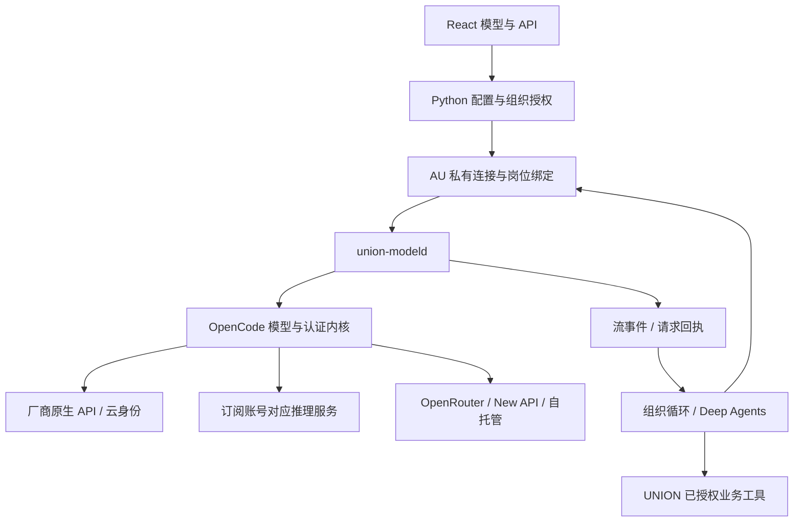

# UNION 正式模型接入方案

日期：2026-11-03。运行时代码基线：`illusionaireal/Union@63d90f6b6bc4189daa8a33b74d984823313a33c0`；提交基线更新至`54f7925b9d5f7f32015f795e3431f05be505f704`并纳入044 Go直连方案。开发主线`dev`。

**设计决定：保留 Python 组织运行时及 Deep Agents / LangGraph，新增独立的 `union-modeld` 模型服务，复用固定版本 OpenCode 的模型与认证内核，补齐 Hermes 级的凭据池、配额调度与故障恢复。API、订阅、网关、自托管模型最终进入同一条员工执行链。**

交付结果是用户在正式工作台完成接入后，AU 能建立团队、调用工具、保存成果、接收反馈并继续工作。模拟响应、目录截图、登录成功和“连接测试通过”都不构成该结果。

本文是实现设计；现有功能与待实现部分分别列明。新增服务和下述接口是本次设计的开发对象，不是现有可调用接口。实现顺序见 [048 plan](../specs/048-production-model-access/plan.md)，完工要求见 [048 spec](../specs/048-production-model-access/spec.md)。

## 1. 当前真正缺在哪里

| 已核对的代码 | 当前行为 | 必须补齐的结果 |
| --- | --- | --- |
| `subscriptions.py:Subscriptions.catalog`；047运行记录 | Go账号、工作区、额度和模型只读展示；选择模型仅复制ID | 选择账号及模型后，创建AU私有连接并真正用于员工调用 |
| `subscriptions.py:AuthBackend` | 接入两个版本的本机账号服务，默认4096/4097；不是通用推理网关 | 固定受管版本及服务契约；认证与推理共享同一凭据生命周期 |
| `model_api.py:APIExecutor` | 四协议均经非流式请求；旧配置总超时上限600秒，调用还受工作包较小值限制 | 流式事件、长任务持续处理、连接/首事件/空闲分别计时 |
| `model_protocols.py` | 将原生响应转为Chat形状；Responses reasoning项和Anthropic thinking/signature没有完整回放通道 | 无损保存并回放原生内容、签名、加密续接项与工具结果 |
| `harness.py:ControlledChat` | 模型消息主要归一为正文与工具；仅Gemini有局部附加字段 | 中立消息结构保留原生扩展，完整贯穿checkpoint与恢复 |
| `model_api.py` 回退 | 有岗位绑定及明确失败回退；5xx、断流、超时均按未知处理 | 区分纯推理未决、计费未决和业务动作未决，分别恢复 |
| `model_context.py`、媒体事件 | 字节估算及历史裁剪；资料事件总大小48KiB | 模型相关token预算、语义压缩、文件资产流转，工具配对不丢失 |
| `catalog.py`、043矩阵 | 版本化离线目录；目录不是账号实际可用模型 | 同时展示目录、账号可见性、实际运行结果，各自注明时间 |

提交前同步到的[044方案](../specs/044-go-subscription-connection/spec.md)进一步记录：Go远端推理地址为`https://opencode.ai/inference/go/openai/v1`，驱动是OpenAI-compatible，还需要`x-opencode-org-id`。因此Go不缺公开推理协议；当前本机账号服务缺推理路由，UNION缺账号解析、组织头及AU采用。044的端点资料是已有只读探测记录，尚不是本轮实际调用结果。

044的受限请求头、目录建连接与AU采用可直接复用为首批接通；一次导出token只能解决当次凭据供应，正式接入必须接到单一认证所有者的动态续期。本文不要求为Go创建完整OpenCode Agent会话，也不把一次极小输出请求当作员工业务完成。U-060保留该现有切片，U-062负责接续完整架构。

旧 `docs/API_MODELS.md` 末尾仍有“不支持Responses/Anthropic”等历史描述；当前四协议实现应以043与最新源码为准。开发时更新使用指南，而不是根据旧文字重新实现已有配置层。

## 2. 技术选型与职责

Python继续拥有组织、章程、岗位、工作、工具权限、业务动作、预算授权和成果。模型服务拥有供应商协议、认证续期、模型解析、流传输和请求诊断。它只返回工具调用，不执行shell、文件写入、组织变更或外部业务动作。

### 2.1 复用到什么层

采用OpenCode当前2.2.5源码中以下部分，锁定本次核查的提交 `805a42ffaa56b29a88baef87c7567f1ab9a40a8f`：

- `packages/ai`：原生供应商适配、统一消息/事件、`ai.stream` / `LLMClient.stream`、用量、媒体和协议续接。
- `packages/core/src/model-resolver.ts`：目录模型、变体、凭据及真实wire model的解析。
- `Integration` / `Credential`及已审核的供应商插件：账号授权、token续期、账号所属远端配置、ChatGPT与OpenCode订阅路由。
- `union-modeld`自己的薄接口：明确的AU授权引用、请求幂等、单次调用、事件保存与查询。

**不是安装一个SDK就自动取得完整能力。** 核查的`@opencode/ai/package.json`版本为2.2.5，但依赖`workspace:*`和`catalog:`；认证插件还依赖Core服务。第一版采用固定源码及其锁文件构建服务，保留MIT许可和修改记录，不假设它们都已有可独立安装的同版本npm产物。

构建产物写入`upstream.lock.json`：repo、commit、源码校验、包版本、锁文件摘要、补丁摘要、许可。源代码使用独立vendor/submodule目录，发布包包含完整构建产物；用户安装不要求自己克隆上游或执行浮动版本安装命令。上游升级通过显式依赖PR推进。

桥接层只调用**单次流推理**，不调用`ai.loop`，不调用OpenCode完整coding session来包装普通模型调用。当前上游`Generate.text`输入只有prompt/model，结果仅为字符串，也不能替代包含完整history、tools、usage、reasoning的接入接口。需要实现下述完整桥接契约。

### 2.2 为什么采用这条路线

| 方案 | 决定 | 原因 |
| --- | --- | --- |
| 继续手写四协议标准库适配 | 保留旧连接迁移能力；停止作为主要扩展内核 | 目前遗漏流式、原生状态、认证续期；持续追赶供应商细节成本高 |
| 一切转成Chat Completions | 不采用 | 会丢失Responses状态、思考签名、缓存语义及专有能力 |
| New API作为唯一入口 | 不采用；作为可选连接 | 不覆盖所有订阅认证及原生行为，也不应成为单机使用前置依赖 |
| 整体替换组织Harness为OpenCode/Hermes | 不采用 | 组织治理与工具循环已经存在；套另一层完整Agent会产生双重工具执行和计费 |
| OpenCode模型内核 + UNION控制层 | 采用 | 直接复用已维护的协议/认证；Python组织循环继续负责工作与工具 |
| Hermes机制 | 纳入实现判据 | 凭据轮换、额度冷却、辅助任务独立路由和恢复策略补齐接入韧性 |

## 3. 四种接入方式，一套使用体验

| 类型 | 用户操作 | 服务端实际使用 |
| --- | --- | --- |
| 厂商API | 选择厂商，填写Key或已授权凭据引用，选模型 | 该厂商原生协议/官方云身份；自定义地址明确绑定协议 |
| 订阅账号 | 点击连接，完成该供应商支持的授权，选账号/工作区/模型 | 同一认证内核解析出的真实推理路由和动态凭据 |
| 网关 | 选择OpenRouter、New API、OpenCode网关或自定义服务 | 网关自身的模型ID、凭据、协议和能力；不套上游厂商ID猜路由 |
| 自托管 | 填写已授权地址、选择服务协议、发现或手填模型 | Ollama、vLLM、llama.cpp等真实服务；无需Key须明确选择 |

优先交付用户已使用的OpenCode Go/ChatGPT，以及OpenAI API、Anthropic、Gemini、GLM普通API/Coding Plan、Kimi普通API/Coding Plan、DeepSeek、OpenRouter、New API、自托管。Bedrock、Vertex及Azure使用已复用内核的原生身份/部署参数，列入同一能力矩阵，不用“兼容OpenAI”冒充云原生支持。后续供应商扩展通过驱动注册，不改组织业务代码。

普通API与Coding Plan是独立profile，分别配置地区、端点、授权方式和计费依据。Claude账号登录、API Key及其他套餐也不混用；授权方式从固定版本的供应商插件取得，不从套餐名称推导可用权益。认证失败显示该账号的修复入口，不静默改走另一付费来源。

### 3.1 订阅打通的具体做法

1. 将当前宿主账号服务的受管版本与`union-modeld`认证内核对齐。旧4096/4097不能仅按端口推定版本，启动时检查协议版本和功能。
2. 保留现有授权记录；迁移通过宿主维护操作使用供应商支持的账户导入，或在工作台重新授权。禁止Python直接打开上游私有数据库抽取token，也不复制refresh token到多个刷新者。
3. 用户选择完整`account_ref`及工作区。服务端根据该账号的integration、credential与remote config解析endpoint、协议、headers和model；这些私密字段不返回浏览器。
4. 平台管理员将该账号的使用权授予当前AU；AU私有连接保存不透明`grant_ref`。另一个AU不会因为宿主登录过就自动获得使用权。
5. 用户点击“采用到当前组织”后，保存连接与默认/岗位绑定；下一次员工调用必须使用这一绑定，并记录真实account/model/route版本。
6. OAuth刷新由单一凭据所有者串行完成；多个调用等待同一次refresh结果，使用CAS更新版本，禁止较旧token覆盖新token。凭据失效撤销grant后，排队及下一次派发立即停止使用它。

同一账号重复登录须按供应商提供的稳定account/workspace标识识别。现有“3个账号”不能按列表数量当作3份额度；连接去重不删除历史使用记录。

模型解析需要执行插件的供应商变换、授权解析及必要请求hooks，包括订阅要求的session/cache归属头。仅复用`ModelResolver`而漏掉这些hooks仍不构成完成。

上游某些插件依赖进程级active connection：桥接层不得在并发请求间修改全局默认账号。实现request-scoped明确连接解析；无法做到无共享可变状态的插件使用按profile隔离的运行实例。所有实例仍由同一个broker拥有和刷新对应grant，避免多进程轮转同一refresh token。

## 4. 连接、账号、模型和岗位的契约

| 对象 | 关键字段 | 归属 |
| --- | --- | --- |
| Provider | `id, driver, protocol_family, regions, capability_source` | 可公开的目录 |
| Account | `id, provider, workspace, auth_method, auth_revision, state` | 宿主私有；页面只见白名单投影 |
| CredentialGrant | `id, account_id, au_id, allowed_routes, revision, revoked_at` | 宿主显式授权，服务端校验 |
| Connection | `id, au_id, revision, backend, profile, grant_ref, model_ref, options` | AU私有；API Key同样通过私有凭据引用 |
| ModelRef | `provider_id, catalog_id, wire_id, variant, capability_revision` | 目录ID与实际上游ID分开 |
| Binding | `au_id, position_id / purpose, primary, fallbacks, policy_revision` | AU；沿用已有默认/岗位/职责继承 |
| InferenceRequest | `request_id, au_id, member_id, work_id, turn_id, attempt_id, connection_revision` | 每次调用及尝试可追溯 |

不建立跨AU共享连接库。目录可以共用，连接、默认选择、岗位绑定、回退顺序和使用记录仍按AU保存。不同AU获得同一宿主账号授权时，得到不同grant并分别计量。

用途支持现有planner/worker/reviewer及实际岗位；增加`compaction`、`vision`、`embedding`等独立辅助用途。辅助用途默认继承明确选定模型；不能因为主模型失败，就扫描宿主环境并使用另一把已登录的Key。

选择模型时综合四个来源：版本化目录、账号模型清单、自定义声明、最近真实调用。状态分别为`catalogued / account_visible / observed_working / temporarily_unavailable`；运行结论绑定连接revision、模型、能力和时间。不能把“普通文本成功”推广成“图片/工具/长上下文都成功”。

## 5. 模型服务接口与请求生命周期

以下为**新增内部协议v1**，由Python调用；浏览器继续访问现有同源Python API。首版服务绑定loopback且有宿主认证，Linux可选Unix socket。服务不直接公开供应商Key或任意代理能力。

| 接口 | 行为 |
| --- | --- |
| `GET /v1/runtime` | 构建/上游版本、协议版本、已注册驱动、能力与持久化就绪状态 |
| `GET /v1/accounts`、`GET /v1/models` | 当前授权范围内的账号/模型白名单；不返回路由凭据 |
| `POST /v1/auth/flows`、`GET /v1/auth/flows/{id}` | 真实认证发起及原流程查询；沿用有效OAuth state/PKCE/nonce |
| `POST /v1/grants`、`DELETE /v1/grants/{id}` | 仅宿主管理员授予/撤销AU使用权，版本化审计 |
| `POST /v1/requests` | 保存请求身份与摘要后返回202；相同ID/相同正文返回原请求，不再调用 |
| `GET /v1/requests/{id}` | 查询状态、尝试、真实路由、用量及错误分类 |
| `GET /v1/requests/{id}/events?after=N` | SSE重放已有事件并继续订阅；不重发模型请求 |
| `POST /v1/requests/{id}/cancel` | 记录取消意图；停止本地接收和新尝试；远端取消需另有确认 |
| `POST /v1/requests/{id}/reconcile` | 用真实供应商状态/宿主决定处理未决，不把本地超时当作取消成功 |

请求包含中立消息、工具定义、输入资产引用、generation配置、授权引用及预算预约ID。`grant_ref`必须绑定当前AU；`request_id`不可替代身份认证。Python与模型服务均校验当前grant revision，不接受客户端自行填一个AU ID就取得权限。

### 5.1 一次调用只有一个调度者

Python在现有组织事务内预约一次attempt并写入outbox，再向模型服务提交。模型服务独立持久化request/inbox后发送上游；事务间通过同一request/attempt ID核对，不假设跨SQLite原子提交。

职责固定：Python拥有业务预算与“是否允许新attempt”的决定；模型服务提供失败分类、可用凭据、`retry_at`及回退建议。**禁用下层SDK透明自动重试**，包括上游`ModelRetry`包装；每次实际网络再发必须取得新的attempt预约。认证refresh本身单独记录，不冒充一次模型推理。

状态为`queued → connecting → streaming → completed`，以及`retry_wait / failed / cancel_requested / interrupted / reconciling`。完成态包含完整可验证结果；断流产生的半个工具JSON只能留作未完成流，不能交给工具执行器。

### 5.2 事件与工具

事件包含`request_id, attempt_id, seq, type, timestamp`，类型至少包括`started, text_delta, tool_call_delta, tool_call_complete, usage, finish, error, interrupted`。按序号去重，先持久化再投递；对UI限速合并文本，对内部完整事件不静默丢弃。

供应商公开提供的推理摘要可按权限显示；签名、加密推理内容和续接元数据保存在私有native字段，作为不透明数据回放。不能将其当作普通正文拼接、解密或作为跨模型通用记忆。

只有一个attempt完整finish、工具名称和参数通过校验、当前权限仍有效后，Python才提交工具调用。每个tool call沿用持久动作ID与现有核对流程。流重连、服务重启、重复事件、备用模型迟到都不能导致重复业务动作。

模型自然语言回答不用整包JSON Schema；schema用于真实工具参数和内部接口校验。筹建提示说明目标、章程、已有资源和可执行动作，模型通过工具逐步形成组织。业务校验失败作为同一会话的工具结果返回，继续执行，不要求用户逐步确认内部schema。

## 6. 原生能力不能在桥接中丢失

中立Message由有序ContentPart组成：文本、工具调用、工具结果、媒体引用、供应商原生续接块。native块绑定`provider/protocol/model/account/format_version`，checkpoint保留其原始结构和顺序。

| 能力 | 必须保留的语义 |
| --- | --- |
| Responses | output items、call_id、reasoning/encrypted续接项、拒绝、不完整原因、usage；支持时使用响应查询/续接 |
| Anthropic | thinking/redacted thinking、签名、tool_use/tool_result配对、stop_reason、缓存读写与期限 |
| Gemini | thought signature、functionCall标识、functionResponse、完整part顺序和usage；签名不只保留在函数调用块 |
| Chat兼容 | reasoning字段按驱动处理、多工具调用、stream usage、不同output limit参数、明确finish原因 |
| 推理与采样 | effort、thinking budget、温度、输出上限按模型能力解析；不支持的显式参数报错，不静默删除 |
| 缓存 | provider特定cache_control/affinity和缓存token口径；不把缓存写入与缓存命中混为一项 |
| 多模态 | 真实文件资产与供应商支持的上传/内嵌方式；图片、PDF、音频/视频输入能力按模型声明及运行记录分列 |

Deep Agents的AIMessage附加字段保存native envelope，序列化/反序列化不能只留`content`和`tool_calls`。跨供应商回退时显式转换可移植的正文和完整工具历史；不能携带另一个供应商的签名/opaque项。无法安全转换则在已完成工具边界使用已有摘要建立新attempt，记录上下文分叉，禁止伪造签名或无声丢失当前工作。

## 7. 长任务、限流和恢复

### 7.1 时间管理

页面命令短时间返回202，浏览器等待超时不取消后台任务。连接默认30秒、首个上游事件默认180秒、事件间空闲默认120秒；均可按provider/model/profile调大或关闭相应空闲限制。心跳只证明连接活性，不计模型输出或有效进展。

取消旧的“任务总时限取min并封顶600秒”。工作deadline由AU运营策略独立设定，可为空；推理模型等待和长工具执行分别管理，已授权长任务可以跨小时并持久接续。长期无业务进展触发可观察状态和显式策略，不靠持续心跳无限占住资源。旧timeout配置迁移需显式说明新含义，不能擅自缩短已配置任务期限。

### 7.2 凭据池与调度

每个被授予AU的profile可包含多把Key或多个真实账号，默认稳定亲和，保留缓存命中；可选择优先顺序或公平分配。并发/速率限制按账号与上游实际窗口共享，AU之间公平排队；单组织现有串行执行无需因此先改成多worker。

超出即时能力的工作进入持久队列；队列容量/资源按宿主及AU配置，不随机拒绝已受理任务。读取页不刷新token、不轮换账号、不发模型调用。配额冷却使用上游reset/Retry-After；缺少时采用有上限的退避和抖动，不高频撞限。

| 真实结果 | 处理 |
| --- | --- |
| 401且OAuth可刷新 | 单航班refresh；成功后新attempt；invalid_grant标记需重新连接，不无限重登 |
| 403或模型无权益 | 禁用该account/model组合；仅使用已配置替代，不改成另一计费方式 |
| 429或额度用尽 | 保存reset时间，排队；允许的凭据池/备用链可接续；不把额度状态当永久登录失败 |
| 请求发出前连接失败 | 可按既定策略预约新attempt重发 |
| 明确格式400 | 返回具体脱敏参数错误；不轮询、不随机换模型掩盖配置错误 |
| 5xx、发出后断流、超时 | 标为推理及计费未决；先查询原请求；根据下节规则决定是否可重新生成 |
| 模型拒绝 | 作为真实终态显示；不使用回退绕过拒绝 |
| 部分文本/工具参数后断流 | 保存partial；禁止工具执行；重连只读原事件或查询原请求 |
| 停用连接、撤销grant、暂停 | 派发前再次校验，阻止后续attempt；在途结果记录但不能绕过当前业务权限 |

### 7.3 把三类“未知”分开

1. **纯推理结果未知**：未执行任何客户端工具，供应商托管的有副作用工具也未启用。先用真实response ID查询；不可查询时保留原attempt。只有连接策略预先允许重新生成并接受可能重复的推理费用，才预约新attempt。每个turn用持久generation/fencing编号，仅当前attempt可提交结果，迟到结果只归档。该策略必须显式迁移，不能改写旧unknown记录。
2. **业务动作结果未知**：已发送外部工具、发布、提交或付款，继续沿用现有动作核对；不得因为换了模型而重新执行。由动作幂等键和真实回执恢复。
3. **费用未知**：保存该attempt、已知token和可能重复计费的事实，等待账单核对；不记0，不伪造退款。是否允许新attempt由已配置的费用策略决定，而不是把所有组织永久锁住。

供应商托管工具默认不启用；要使用时必须明确其副作用、权限及回执能力，并纳入第二类。连接不可仅因“API接口看起来是推理”就被自动归为可安全重试。

## 8. 上下文、文件与成本

上下文预算以模型窗口、输出预算、工具schema、当前任务及原生额外token共同计算；能取得原生token计数则优先使用，否则采用模型相关估算并注明估算来源。预留可配置比例，默认80%触发压缩准备而非等到上游拒绝。

压缩保留系统指令、当前章程/权限、目标、未完成工作、关键事实、文件引用和最近完整工具轮次。原始记录持久保存，摘要带来源区间和版本；由指定compaction模型生成，调用独立预约并计量。压缩失败不静默删除历史；可继续当前可容纳请求，否则等待修复。模型不能通过摘要扩大权限。

大文件进入当前AU的资产存储，通过已有权限过滤后的asset ID引用；不再把业务材料挤进48KiB事件JSON。提供类型/容量约束、分片上传、文本提取和按需读取；模型输出同样以资产保存。服务端只读取已授权资产，不自动跟随模型给出的URL或主机路径。具体上传上限在部署配置给出，不能在页面承诺“无限文件”。

沿用`metered/subscription/owned/unknown`四类basis。每个attempt保留input/output/cache read/cache write/reasoning等供应商给出的原始计数和归一口径，缺失为空。费用记录provider-reported、rate-estimated、period-allocation三种依据，币种及费率版本明确；运算用精确十进制/整数最小单位，不能用浮点累加或重复计算reasoning token。

同一请求重试和切备用分别记账；套餐用量窗口来自真实账号服务，未知不显示0%。订阅周期分摊保留既有独立凭证，不覆盖原调用费用。模型服务记录计量，Python统一写组织账本，`attempt_id`唯一键防止SSE重放重复记账。

## 9. 正式工作台如何变化

`/models`保留现有React工程，形成连贯流程：**选择来源 → 连接账号或填写Key → 选择模型 → 采用到当前AU/岗位 → 执行真实工作**。

- 账号卡：供应商、账号/工作区、套餐窗口、认证状态、重连入口；不要求用户SSH或另开OpenCode管理页完成日常配置。
- 模型选择：优先账号可见模型，显示实际模型ID、上下文、输入模态、工具/推理支持与最近运行结果；可保留手填模型。
- 采用操作：原子保存AU连接与目标绑定，刷新后仍保留。只保存账号/连接不自动启动；用户点击执行工作时按组织既有策略派发，不逐个工具询问。
- 当前生效配置：清楚显示“本组织默认 / 某岗位覆盖 / 某任务显式指定”的实际选择。失败时显示正在排队、额度重置、需要重新连接或待核对。
- 工作详情：实时正文/工具活动、实际供应商与模型、首事件等待、token、费用依据、可恢复状态；刷新接续同一个请求，不另起一次调用。
- New API页：继续负责实例登记及运维；健康状态与某模型最近成功调用分别显示。不能把管理端登录成功当成模型可用。

正常保存采用不强制执行额外收费的健康探测。用户可以直接开始业务工作；只有第一次真实请求完成后更新最近可用性。主动诊断作为辅助入口，绝不是正常使用必须跨过的独立工程流程。

## 10. 对标矩阵与性能目标

对标限定在本任务的**大模型接入能力**，覆盖OpenCode与Hermes两者的核心能力并集；不以目录数量或测试数量宣称全面胜出。031已有判据继续有效，本表补齐其流式、订阅闭环、原生信息保真与运行恢复缺项。

| 能力 | UNION交付要求 |
| --- | --- |
| 主流厂商/自定义网关/本地/云身份 | 对应真实驱动、认证、路由、模型ID；按厂商实际调用留记录 |
| API Key、环境/文件、OAuth、订阅 | 同一连接生命周期；官方支持的授权方法、续期、撤销及账号权益 |
| 多账号和凭据轮换 | 账号隔离、共享额度窗口、稳定亲和、单次刷新、死凭据隔离 |
| 原生流式与工具往返 | 文本及多工具增量、完整结束事件、真实工具结果进入下一轮 |
| 原生reasoning/签名/缓存 | checkpoint后保真回放；正确usage；不将私有推理数据暴露为页面正文 |
| 模型/岗位/辅助用途 | AU默认、实际岗位、任务指定和独立辅助模型，实际路由可追溯 |
| 长上下文与多模态 | 预算、摘要、完整工具配对、文件资产；支持能力不被小事件限额截断 |
| 限流、回退、重启 | 持久队列、reset-aware冷却、已授权回退、断流恢复、动作不重复 |
| 可迁移和可维护 | 固定依赖、公开配置导出、凭据引用、旧连接迁移、可回滚 |
| 组织增强能力 | AU授权/账本、岗位责任、业务动作核对；不污染基础供应商协议 |

性能目标是验收指标而非现有结果：同机桥接的排队外p95附加延迟≤50ms，流事件写盘到交付p95≤100ms，客户端断线不丢已提交任务。与固定版本OpenCode/Hermes按相同账号、模型、区域、prompt和输出预算记录首事件、总耗时、tokens及错误；差异来自上游时保留原记录，不用宣传值比较。用实际持续工作观测排队公平性和内存，不人为制造“通过率”。

## 11. 安装、迁移和交付

第一版是同机部署：Python组织服务、现有React、一个受管模型服务以及各自私有持久目录。不先引入Kubernetes、Redis或另一套组织数据库。单机账号profile有隔离要求时由同一supervisor管理子实例，不变成每名员工一台服务器。

发布包固定Python依赖、模型服务构建、Node/Bun运行条件和upstream lock；`npm start`在开发模式启动实际模型服务，正式Linux由systemd/Docker Compose管理同一发布包。健康接口校验版本、持久目录和驱动，不调用模型。配置不含真实主机地址、端口密码、私有路径或Key。

迁移步骤：备份现有AU数据库与凭据所有者数据 → 创建新凭据引用及v2连接 → 保持模型ID/岗位/回退/历史revision → 新工作使用新服务 → 原在途调用在旧执行器核对结束。跨表迁移使用版本记录与幂等键；不复制尚未完成的任务重跑。旧连接默认关闭新的未决重新生成策略，需显式采用。

回滚保留旧读取/执行路径和历史数据；切换前排空或核对在途请求，不能让新旧执行器同时消费同一工作。新格式native checkpoint不得由旧版本盲读；兼容性检查失败时恢复备份并保留新账本用于核对。

**首个功能切片必须直接打通现有Go订阅到AU真实执行。** 随后同一服务打通ChatGPT与厂商API、原生连续工具、重启和故障恢复，最后完成所有承诺profile的真实使用矩阵。每批交付都落在同一正式产品链路，不再新增模拟工作台或以离线替身为完成依据。

## 12. 本次核查来源

以下链接固定到本次读取的源码；网页说明作为补充。上游后续变化按依赖升级处理。

1. [UNION基线](https://github.com/illusionaireal/Union/tree/63d90f6b6bc4189daa8a33b74d984823313a33c0)、[047订阅断点](https://github.com/illusionaireal/Union/blob/63d90f6b6bc4189daa8a33b74d984823313a33c0/evidence/047-go-account-catalog/README.md)、[现有传输](https://github.com/illusionaireal/Union/blob/63d90f6b6bc4189daa8a33b74d984823313a33c0/ai_union/model_api.py)、[协议转换](https://github.com/illusionaireal/Union/blob/63d90f6b6bc4189daa8a33b74d984823313a33c0/ai_union/model_protocols.py)。
2. [OpenCode单次stream与loop区别](https://github.com/anomalyco/opencode/blob/805a42ffaa56b29a88baef87c7567f1ab9a40a8f/packages/ai/src/llm.ts)、[模型解析](https://github.com/anomalyco/opencode/blob/805a42ffaa56b29a88baef87c7567f1ab9a40a8f/packages/core/src/model-resolver.ts)、[包构建依赖](https://github.com/anomalyco/opencode/blob/805a42ffaa56b29a88baef87c7567f1ab9a40a8f/packages/ai/package.json)。
3. [OpenCode账号插件](https://github.com/anomalyco/opencode/blob/805a42ffaa56b29a88baef87c7567f1ab9a40a8f/packages/core/src/plugin/provider/opencode.ts)、[ChatGPT插件](https://github.com/anomalyco/opencode/blob/805a42ffaa56b29a88baef87c7567f1ab9a40a8f/packages/core/src/plugin/provider/chatgpt.ts)、[Generate接口](https://github.com/anomalyco/opencode/blob/805a42ffaa56b29a88baef87c7567f1ab9a40a8f/packages/core/src/generate.ts)。
4. [Hermes凭据池](https://github.com/NousResearch/hermes-agent/blob/f0d94882e89ab8d4098b5bb2f166adfb9ee0a0ab/website/docs/user-guide/features/credential-pools.md)、[Hermes故障回退](https://github.com/NousResearch/hermes-agent/blob/f0d94882e89ab8d4098b5bb2f166adfb9ee0a0ab/website/docs/user-guide/features/fallback-providers.md)。
5. [OpenCode供应商说明](https://opencode.ai/v2/docs/providers)、[Hermes供应商说明](https://hermes-agent.nousresearch.com/docs/integrations/providers)。本文复用选择、接口、时限和性能数值均为UNION工程设计，不是引用上游作出的性能保证。
