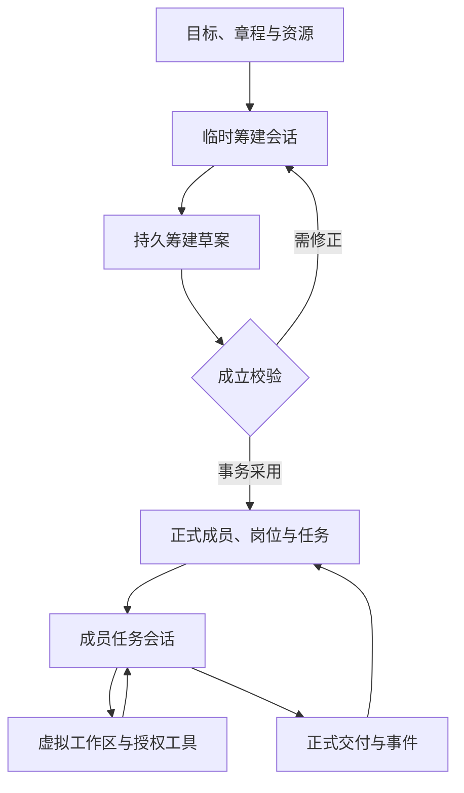

# 组织筹建与成员 Harness

2026-10-18 / 014：真实免费模型已完成两人成立、首批工作及跨进程接续，并根据成果与反馈采用后续依赖任务。发现并修复了模型资料包含宿主存储路径、组织决策被通用文件工作流带偏的问题。新行为与真实限制见 [014](../specs/014-real-loop/spec.md)及其执行证据；本文下述“真实调用0”等内容保留010当时的边界。

当前组织轮次只展示组织工具；成员工作继续使用 Deep Agents 虚拟文件。`schedule_work` 可用成员姓名/ID与工作标题/ID或成果ID安排后续任务，宿主生成工作ID并转换为既有 create_work 操作；缺失/歧义引用、重复标题拒绝。`wait_for_event` 使用原因和1–86400秒间隔，宿主计算时间。旧 `update_organization` 保留，所有提议继续经过现有角色、权限、版本和事务检查。

成果通过工作包的正文共享，不把宿主 `assets/...` 路径发送给模型。任务草稿不属于其他成员会话，最终交付应包含完整正文。组织工具工作流升级会启用新的组织会话键，保留原检查点与正式草案；成员任务文件会话的键保持兼容。SDK必需安全中间件未移除。

需要持续监听时，在正式 start 中提供有限 `max_steps` 和大于0的 `max_seconds`：空闲等待不消耗模型调用，窗口内的新事件可唤醒同一作业。`max_seconds=0` 是有限派发，遇到无待办会结束；重启宿主也不会自动重放原作业。检查点接续、监听窗口和常驻进程是不同事实。累计资源到限仍必须停止。

2026-10-17，010。默认 API 路径采用 Deep Agents Python SDK 0.7.28，底层 LangGraph 及 SQLite 检查点；固定依赖见 `requirements-harness.lock`。这是实际 SDK 集成，真实供应商与业务质量仍需独立验收。

## 从初始设定到正式组织

发起人采用目标、章程和有限资源，配置模型后启动。系统绑定临时筹建身份；筹建 Agent 可调用 `prepare_member`、`arrange_work`、`configure_bootstrap` 保存草案，用 `inspect_bootstrap` 查看，用同名更新或 `discard_bootstrap_item` 修正。成员、岗位和工作在这个阶段还没有生效。

筹建 Agent 单独调用 `activate_organization`。宿主检查至少两名成员、唯一名称、有效协调责任、任务负责人、无循环依赖和当前权限，再通过既有 Engine 事务一起建立正式成员、岗位、任职、策略和首批工作。内部 ID 及版本依据由宿主生成。校验失败保留草案并返回原因，正式组织不会部分成立。旧的 `initialize_organization` 完整安排工具继续兼容。

成立后临时授权结束，调度器自动派发首批任务。正式成员可在自己的虚拟工作区读取、写入、修改文件，通过工具结果继续工作，最终回复完整正文才成为正式成果。工作区草稿与组织成果分开；另一成员只依据其岗位、任务和已交付依赖获取上下文。



## 状态归属与恢复

| 状态 | 持有方 |
| --- | --- |
| 组织身份、章程、成员、岗位、任职、正式任务与成果、经营记录 | UNION Engine / state.sqlite3 |
| 筹建草案及绑定到工作/任职/连接版本的会话登记 | UNION / state.sqlite3 |
| 任务对话、工具结果、虚拟文件和图执行检查点 | LangGraph / harness/checkpoints.sqlite3 |
| 每次模型调用、实际 token、供应商回执与错误 | UNION runs / executions |

成员身份持续存在，任务会话按工作版本、任职、章程和连接版本绑定。修章、交接、改任务或改连接后使用新会话，避免旧会话带回旧权限。已正式提交的任务和决定不恢复成待提交工具。

每次派发最多发起一次 Chat Completions 请求。SDK 完成该响应的工具节点后以同步持久化方式停在边界，记录 `continued`，下一次派发恢复 SDK 图并把工具结果交回模型。一次有限运行可连续派发多次；`max_steps` 因而继续约束真实 HTTP 请求数，而不是任务数。调用额度耗尽时保留草案、虚拟文件和任务进度。

普通组织计划遗漏工具、工具校验错误或工具参数语法错误可在额度内获得一次修正。未能解析的参数不会进入反馈或检查点。模型正文仍是自然语言，不附整包输出 Schema。HTTP 故障、拒绝、截断及未知执行不会自动重发；unknown 保留占用并要求核对，检查点不能替代供应商执行结果核对。

虚拟工作区使用 SDK StateBackend，不映射宿主文件系统。没有 shell、外部发布或支付能力。默认通用子 Agent 被关闭，正式跨成员派发由 UNION 管理；本次关闭自动模型摘要，避免其隐式发起未预约的请求。SDK 仍提供虚拟文件与工具结果管理；会话总输入超过当前容量时明确停止，需要缩小任务或后续引入独立计费的压缩调用。

## 安装与使用

网页：`npm ci --ignore-scripts` 后 `npm start -- --open`。启动器自动建立项目 `.venv` 并安装固定版本依赖。Linux 需要 Python 3.11+ 及 venv；Windows 使用对应 Scripts 解释器。设置 `UNION_PYTHON` 时尊重指定解释器，需要先在其中安装依赖。

CLI / 开发环境：

```sh
python3 -m venv .venv
.venv/bin/python -m pip install -r requirements-harness.lock -e .
.venv/bin/python -m unittest discover -v
```

Windows 后两条将 `.venv/bin/python` 改为 `.venv\Scripts\python.exe`。

原 `run --executor api` 和网页 API 有限运行自动使用新 Harness。创建组织本身不发起模型调用；一次启动可完成筹建并接着工作，额度不足时点击继续可接续已保存进度。当前控制台仍串行派发成员。

网页“测试连接”验证工具往返，需要至少两次剩余额度：模型先调用测试工具，再读取本机返回的随机校验码并回应。两个请求分别记录用量；不会建立组织或改变原暂停意图。CLI 使用 `api-test --tools`；省略 `--tools` 保留一次普通文本探测。

## 选型与验证边界

Deep Agents 复用工具循环、虚拟文件和任务检查点。供应商适配使用自定义 BaseChatModel 连接原有受控传输：保留用户选择的 `max_tokens` / `max_completion_tokens`，不引入 SDK 隐式重试、默认模型、全局认证或外部 tracing。SDK 环境 tracing 在运行中禁用。供应商仍必须真正支持工具调用。

同一宿主模型和筹建工具也通过 LangChain `create_agent` 对照回环。该对照确认工具契约能够替换底座，不是模型质量、性能或成本排名。当前选择 Deep Agents 因为成员工作需要现成的文件草稿和检查点；内部 `base='langchain'` 仅用于工程对照，不新增用户配置项。

官方依据：

- [Deep Agents overview](https://docs.langchain.com/oss/python/deepagents/overview)
- [Customization](https://docs.langchain.com/oss/python/deepagents/customization)
- [Subagents](https://docs.langchain.com/oss/python/deepagents/subagents)
- [LangGraph persistence](https://docs.langchain.com/oss/python/langgraph/persistence)
- [ChatOpenAI compatibility](https://docs.langchain.com/oss/python/integrations/chat/openai)

本地验证使用真实 SDK 与回环 HTTP 替身，包括两成员协作及完整小说 mock 经营回归。没有用户提供的真实供应商连接，真实模型调用仍为 0；尚未证明供应商兼容性、模型自组织能力、正文质量或真实经营结果。
