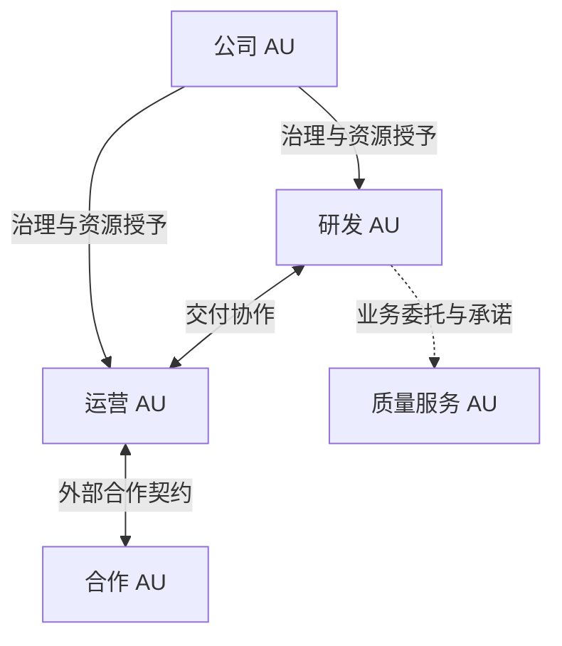
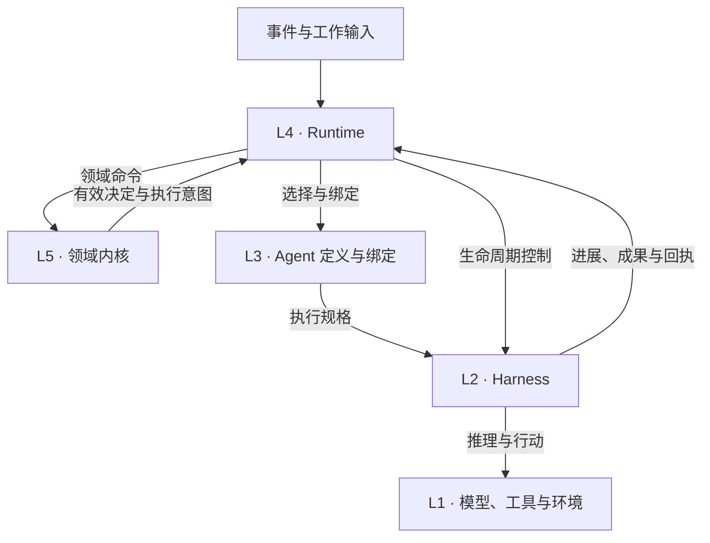

# UNION Project Charter
## 项目宪章 · v1.0

日期：2026-11-04（Asia/Singapore）  
适用范围：UNION 项目的 AU 语义、ai-union 核心、执行适配契约与 AI-Union-Platform 集成边界。  
采用状态与内容哈希只记录在采用记录中，不写在本文件内。

> AI-UNION 是以 AI 为核心、围绕共同目标持续自主行动的组织单元。它能够递归组合成更大的组织，通过实践改进自身，并在既定授权与资源范围内实现无需人类日常介入的运转。

## 概览

本宪章只做三件事：**定调**（UNION 要成为什么）、**守底线**（长期不变的技术性质和少量责任边界）、**给评价依据**（如何判断实现忠于目标）。交付顺序、阶段计划、框架选择和实现机制由规格、ADR 和实施计划决定，不在此规定。

**规范约定。** “必须／不得”为强制要求，“应当”为推荐要求（偏离时说明理由），“可以”为允许选项。编号条款是规范性的，其余正文、图表和 §5 的参考架构仅作说明。编号是稳定标识，不表示优先级。Outbox、租约、代次等具体机制是参考实现，不是规范要求。

各 AU 自己的章程称 **AU Charter**，是领域对象，与本文不同。

---

## 1. 理念与原则

### 1.1 存在的理由

UNION 让以 AI 为核心的集体围绕目标持续组织工作、交付结果、吸收反馈并发展自身。人不应被迫成为工作之间的调度器、上下文搬运者和故障恢复器。

单次回答、完成一项任务和组织长期有效运行，是不同层次的问题。UNION 的核心对象是第三者，以可靠的推理与行动能力为基础。

### 1.2 七项基本特征

| 特征 | 含义 | 工程含义 |
|---|---|---|
| Continuous · 连续 | 跨会话、渠道与任务保持身份、目标和责任 | 持久领域对象、跨渠道关联、可接续的工作记录 |
| Efficient · 高效 | 在质量与资源约束下减少等待、重复和无效协调 | 并发执行、异步交互、局部上下文、确定性快速路径 |
| Proactive · 主动 | 根据目标、环境和内部需要发现并推进工作 | 外部事件与内部目标均可驱动行动，无事项时不空转 |
| Persistent · 持久 | 长期保有工作状态，能从中断与故障恢复 | 状态与进程解耦、持久投递、独立监督 |
| Recursively Composable · 递归组合 | 多个 AU 组成仍遵守 AU 契约的整体 | 一致的外部接口、局部自治、跨边界承诺 |
| Self-improving · 自我改进 | 根据实际效果发现不足、实施改变并保留有效改进 | 证据、版本化变更、评估与撤回 |
| Human-free · 自主运转 | 在既定目标、授权与资源内，无需人类承担日常规划、协调、执行和恢复 | 完整的机器执行路径、可配置的保留事项 |

七项特征是互补维度，不是同一尺度上的评分。Human-free 是运行目标，不排斥人类成员、参与或保留事项，也不以零人类参与作为 AU 的资格条件。

### 1.3 设计原则

* **P-01 结果优先。** 以目标推进、交付质量和资源效率评价价值，不得把会话数、Agent 数或工具调用数本身记作成果。
* **P-02 局部自治。** 有效授权内的判断应当由拥有相关上下文与责任的最小适当单元承担；系统应当承担常规协调与恢复，避免顶层成为转发与审批中心。
* **P-03 责任连续。** 组织与工作责任必须独立于模型、会话和进程存续，执行载体的更换不得抹去责任及其交接。
* **P-04 判断与保障分工。** 模型负责语义判断、规划和行动选择；授权、资源约束和权威状态完整性必须由受控程序边界保障，不得仅依赖模型遵守提示词。研究、写作、规划等普通推理不强制生成组织 Schema，正式状态变更使用可校验接口。
* **P-05 结构服务于目标。** 分工、递归组合和分布式部署应当有目标、责任边界或能力探索的依据，并评价效果与成本。可以为验证关键能力开展有明确问题和退出条件的探索，不以规模或层级数量证明价值。
* **P-06 改进须有证据。** 只有得到效果证据支持的改变才能声明为已验证的改进；复盘和新提示词本身不构成证明。
* **P-07 开源核心独立可用。** 核心采用开源发布方向，其构建、运行与验证不得依赖私有平台的仓库凭据、账户或许可证服务；自部署用户必须能连接模型和工具、设定目标并持续取得成果。具体许可证另行决定，发布状态必须如实声明。
* **P-08 比例原则。** 协调、评估和治理程序的强度应当与影响、风险和可逆性相称。单 Agent 的小 AU 不必为形式而创建组织结构；简化流程不得免除授权、责任归属和必要证据。

---

## 2. 产品边界

| 名称 | 定位 |
|---|---|
| UNION | 本项目统称，覆盖理念、核心产品、商业平台及其契约 |
| AI-UNION / AU | 自治组织概念及其运行实例 |
| ai-union | 实现 AU 的开源技术核心与独立可用产品 |
| AI-Union-Platform | 基于核心公开契约构建的私有商业平台 |

ai-union-corp 是打造和运营这些产品的具体公司场景，其业务需求不构成所有 AU 的资格要求。这张表是名称与定位，不证明仓库拆分、许可发布或独立部署已经完成。

核心与平台的关系由 P-07 和 A-04 约束。商业分工、定价、套餐和托管策略属于产品决策，不在本宪章规定。

---

## 3. 领域模型

### 3.1 对象

| 对象 | 定义 |
|---|---|
| AU | 拥有持续身份、目标、治理、资源边界与自主闭环的组织单元 |
| Objective · 目标 | 持续追求的结果及其成功依据、约束和复查条件 |
| AU Charter · AU 章程 | 规定本 AU 治理、授权、保留事项、修订与退出的组织规则 |
| Member · 成员 | 组织中的持续身份，可由 AI 或人类承担 |
| Role / Appointment · 岗位／任职 | 岗位是一组职责；任职是成员与岗位在一定范围和有效期内的关系 |
| Mandate · 授权依据 | 明确行动范围、资源、有效条件与再委托边界的授予记录 |
| Commitment · 承诺 | 责任主体接受的交付义务及其验收、变更和终结条件 |
| Work · 工作 | 为目标或承诺推进的工作，可跨多个执行尝试 |
| Artifact / Evidence · 成果／证据 | 有归属、版本和访问范围的交付物；支持完成、质量或状态判断的可核查依据 |
| Resource · 资源 | Allocation 为预算、容量等的授予；Reservation 为占用承诺；与实际消耗、结算相区别 |
| Agent Definition · Agent 定义 | 可复用的指令、技能、能力、模型偏好与上下文策略 |
| Agent Binding · 执行绑定 | 将定义版本与责任身份、工作、授权和上下文范围关联的执行规格 |
| Execution · 执行尝试 | 有独立标识、状态和有效所有权的一次工作尝试 |
| Session / Worker / Harness / Environment | 会话（对话与上下文载体）、执行载体（进程或实例）、执行机制（驱动推理与工具循环的软件）、环境（工具行动触达之处） |
| Event / Command / Decision | 已观察的事实；经校验后请求改变状态的操作；被有权主体采用的决定 |
| Attention Item · 关注事项 | 有原因、影响范围、处理主体、响应条件的待处理事项 |

成员、Agent、会话和进程不是同一对象：成员可承担多项工作，一项工作可经历多次 Execution，临时子 Agent 不自动成为成员或子 AU。

“责任”首先指系统内的履约、跟进、交接与处置责任，不自动决定或转移外部法律责任。“正式”指经有权接口采用、作为组织权威状态或对外承诺依据的记录或操作；未被正式采用的探索不是不受管理，其数据访问、工具行动和资源消耗仍受授权与资源约束。

### 3.2 领域不变量

* **D-01 身份与绑定。** 组织、任职、工作、执行和成果必须使用可区分、可追溯的标识。每个 Execution 必须关联责任成员、授权依据、Work 和 Agent 定义版本；并发、换 Agent 或换执行载体不得产生额外授权，也不得抹去责任。
* **D-02 责任不随失败消失。** 执行失败、会话结束或进程退出不得自动解除工作责任；未完成责任必须有可识别的承担者或交接处置主体。
* **D-03 完成有依据。** 工作被正式记为完成，必须有适用的成果与证据，并由有采用权限的接口确认；模型自述不得是唯一依据。
* **D-04 授权变化有效。** 任职、任务范围、授权、目标或停止决定的变化，必须影响后续受控行动和提交资格，并传播到相关再委托与活动执行；启动时的授权快照不得成为撤权后继续行动的依据。已发生的外部动作按 R-05 处置。
* **D-05 资源不重复计算。** 资源授予、预约、实际消耗和汇总必须可相互核对，不得因组织嵌套或重复记录创造额外余额或重复计入同一消耗。

---

## 4. 递归组合与协作

AU 的对外契约描述身份、目标、能力、协作和授权边界。叶子 AU 可以主要由一个 Agent 工作，组合 AU 可以包含多个成员和子 AU。组织规模不决定部署规模。

三种结构分别建模：**治理与授权**（谁能决定什么）、**工作协作**（谁向谁交付）、**执行部署**（由什么进程承载）。层级不意味着消息逐层转发，协作不意味着共享全部知识，进程共用不意味着身份合并。

*实线为治理／资源授予，虚线为业务委托，双向线为合作；后两者不隐含治理权。本图不是部署图。*

* **C-01 同构与封装。** 组合 AU 与组成 AU 必须遵守相同的外部契约，并封装内部组织与执行细节。对有权限的合作方或授予方，必须提供承诺状态、授权及撤销的生效情况、约定的资源消耗汇总；未知和部分完成状态必须如实报告。不要求暴露全部内部谱系、会话或私有知识。
* **C-02 关系分离与授权受限。** 治理、授权、业务协作和执行部署必须可区分。承诺或服务关系不得赋予对方修改本 AU 章程的权力；子 AU 的行动和再委托不得超出上级有效授予的范围，也不得通过修章扩权；平级合作不自动成为治理上下级。
* **C-03 撤权传播与离线边界。** 授权收缩或撤销必须影响依赖它的再委托、活动执行和提交资格；接收方在自身边界内处理并反馈生效范围、未完成处置和未知结果。离线行动必须受授权有效期和重新校验条件约束，实现必须声明无法即时获知撤权时的生效边界，不得同时承诺无限期离线与即时撤权。
* **C-04 承诺有主。** 跨治理边界的承诺必须明确双方责任主体、交付物、验收依据、变更与退出方式以及失败和失联处置。消息发送不等于对方接受；验收分歧必须进入可识别的争议状态，不得静默记为履约或免责；裁决权仅在该承诺范围内有效。同一治理树内的简单工作可直接进入工作管理，不必走协商。
* **C-05 组织变更交接。** 创建、合并、拆分或退出 AU 必须处理未完成承诺、资源、知识、身份和访问权的去向。实现可以限制复杂归属与重组，但必须声明支持范围，不得预设所有 AU 只能属于一棵固定任务树。

---

## 5. 架构

### 5.1 参考架构（说明性，变更走 ADR）

| 分区 | 职责 |
|---|---|
| L5 · AU 组织层 | 组织领域内核：目标、章程、身份、授权、承诺、资源账、成果采用的规则与合法状态转换 |
| L4 · Organization Runtime | 命令编排、事件归属、工作调度、可靠投递、交接、恢复与监督 |
| L3 · Agent 层 | Agent 定义、能力配置及执行绑定 |
| L2 · Agent Harness | 推理与工具循环、会话与上下文、子 Agent、执行进展与接续 |
| L1 · 模型与执行资源 | 推理服务、工具、环境、持久存储 |

五层是职责分区，不是五个服务，也不要求调用逐层经过；分区可共享进程或数据库。下图是运行期交互，不表示源代码依赖方向。

**状态所有权（参考）：** 组织事实、授权、承诺、资源账、成果采用由领域内核拥有；事件接收、调度、执行所有权与恢复编排由 Runtime 拥有；会话与工具历史由 Harness 拥有；原始模型用量由模型接入组件拥有；外部动作结果由工具与环境组件观察；商业客户、套餐与账单由平台拥有。物理存储可以共享，写入权和事实来源不得含糊。

### 5.2 架构约束

* **A-01 状态权威。** 每类权威事实必须有明确的逻辑拥有者，其他组件不得绕过它写入；物理存储共享不得导致未授权跨界写入。界面、摘要和索引不得替代权威事实。
* **A-02 领域独立。** 领域规则不得依赖具体 Runtime、Harness 或存储实现，必须通过接口适配；替换实现不得改变领域语义、授权边界和事实所有权。业务场景的特殊流程不得硬编码为通用运行时的强制步骤。
* **A-03 执行契约。** 组织决策、语义路由、改进和业务执行必须共享身份、授权、用量和结果的语义，可以使用不同 Harness、轻量路径或确定性路由，不强制完整的模型工具循环。适配器必须如实声明启动、输入投递、观察、取消、恢复、成果与回执的支持范围；不支持的能力不得以假成功替代。
* **A-04 集成与兼容。** 平台和外部管理工具必须通过版本化公开契约使用核心，不读写核心内部表，也不导入内部模块绕过边界。核心必须自带基础认证、AU 权限与审计，平台可以提供增强能力。协议、持久状态和 Agent 配置的变更必须可区分、可追溯，并声明兼容范围。

---

## 6. 持续运行

工作可由外部消息、环境变化、目标采用、依赖完成、资源恢复和到期事项触发。已知归属由程序直接路由，语义不明的进入协调判断。事件驱动不排斥定时观察：没有已知状态变化不证明外部世界没有变化，主动查询和研究可以创造新信息。

四类反馈闭环按事件和有效观察周期运行，不要求固定频率调用模型：

| 闭环 | 反馈 | 调整对象 |
|---|---|---|
| 工作执行 | 工具结果与成果证据 | 当前行动与局部计划 |
| 组织经营 | 成果、成本、环境与目标差距 | 工作组合、优先级、委托与资源 |
| 运行监督 | 错误、等待、健康与实际进展 | 恢复、替换、退避与局部暂停 |
| 自我改进 | 多次工作的效果与失败模式 | 版本化的策略、能力、组织与软件 |

* **R-01 状态与意图一致。** 领域状态变化与相应的待执行意图必须原子或等价可靠地关联，不得留下“状态已采用但后续动作无法恢复”或“动作已派发但无领域依据”的缺口。不要求跨 AU 或外部系统的全局事务。
* **R-02 可靠投递与去重。** 可重试的消息与操作必须有稳定标识和重复处理语义，使重投不造成重复采纳或失控副作用；不得假设外部系统天然支持恰好一次。
* **R-03 有效执行所有权。** 实现必须能判定当前有权行动或提交的执行；失效、被替换或被撤权的执行不得覆盖新状态或再次提交无效动作。
* **R-04 局部恢复与监督。** 恢复必须明确影响范围（调用、工作、环境或 AU），单项故障或未知不得默认阻塞全部独立工作。监督必须位于被监督执行之外，有可观察的健康状态和受限权限。
* **R-05 外部结果核对。** 有副作用的操作超时、中断或结果未知时，必须先核对是否已生效，无法确认时保留待核对状态，不得盲目重放。取消请求或内部回滚不得被报告为外部副作用已撤销。
* **R-06 等待与重试。** 每种等待必须明确等待对象、唤醒条件和责任主体；长作业不得使新输入失去处理路径，也不得用统一短超时终止正常长任务；接续不得只依赖易失状态。模型、工具、Harness 和运行时必须各自明确重试范围，避免多层重复启动同一工作。
* **R-07 资源与并发。** 并发行动前必须有资源预约或等价的准入约束，并处理共享环境、工作区和交付目标的冲突；资源变化必须有针对新行动和在途工作的处理方式。
* **R-08 主动与协调资源。** 主动唤醒（含定时探测、查询、研究）必须有目标关联、观察或探索目的、资源约束和退避依据，不得无依据地空转调用模型。路由、决策、监督和评审的消耗必须入账并按用途报告。

---

## 7. 上下文与能力

* **K-01 事实与纠正。** 正式事实、工作材料、知识和成果证据必须可区分；知识保留来源、适用范围和版本，摘要不得替代原始依据。纠正后，旧结论不得再作为当前有效依据，并对显式依赖它的活动工作触发复查；已完成成果不自动失效或全局重算，重大影响形成新的处置事项。
* **K-02 上下文与共享。** 上下文按身份、任职、工作和权限构造，长材料以可授权访问的稳定引用按需读取，压缩不得丢失取得原始证据的路径。AU 组合与岗位交接不得自动合并全部记忆；交接传递必要责任与资料，不以复制聊天记录代替。
* **K-03 真实能力。** 模型、工具和适配器必须如实声明协议、认证、流式、取消、恢复等能力，暴露错误和处置路径，不得静默降级、假恢复或伪造业务结果。工具必须描述输入输出、授权要求、副作用、重复调用处理能力和作业生命周期。供应商重要的原生能力应当保留，或明确声明不支持。
* **K-04 用量到资源账。** 接入组件记录原始用量与实际调用尝试；领域内核维护可核对的组织资源账；平台维护独立的商业账单。记录必须带稳定标识、AU／工作／执行归属、用途和修订依据，使重复投递不重复入账、真实的不同尝试不被错误去重。未核对的用量可以暂记、估算或标为未知，但不得伪造确定费用或形成账外消耗。汇总遵守 D-05。

---

## 8. 自我改进

策略、流程、知识、工具、Agent 配置、组织结构和获授权的软件都可以成为改变对象。代码自修改不是自我改进的前提，单 Agent AU 同样适用。

* **S-01 授权内快速试用。** 在本 AU 既有授权、预算和局部边界内，低影响改变可以直接试用，只需保留版本、必要检查结果和撤回方式。影响较大的改变按适用治理权限评估后采用，并保留问题依据、适用范围和采用决定。记录可复用现有工作与成果。
* **S-02 依据效果保留或撤回。** 依据实际效果决定保留或撤回，分别记录“获准试用”与“已证明有效”，允许结论为无改善或证据不足。实施与评估职责必须可区分，但不强制不同 Agent 或新增成员。候选改变不得自行放宽本次检查依据、降低本次影响评级或删除失败记录。影响程度按权限变化、不可逆性、影响范围、外部承诺、数据与成本风险判定；需要独立判断时，由获授权的评估职责处理，条件不足时保持候选状态。局部优化必须评价对相关 AU、整体目标和总成本的影响。
* **S-03 升级与迁移。** 核心软件升级必须由被更新执行之外的机制完成，保留已知可用版本、数据兼容说明和恢复路径。不可逆的数据或业务变化必须单独说明，不得笼统承诺全部回滚。迁移必须在可识别的安全边界进行，维护身份、历史和未完成责任的映射，保留未知回执；新旧调度或执行机制不得同时派发同一工作。
* **S-04 改进有界。** 重要的策略与组织变更必须有观察窗口、证据条件和停止条件（可按时间、样本或工作周期）；改进活动受授权与预算约束，并继续承担既有工作责任。不得因一次失败全面重组，也不得无新证据反复切换策略。

---

## 9. 信任与治理

本章只规定两条底线。具体隔离技术、威胁模型、审计设施和治理制度由规格与治理文件决定。

* **X-01 信任与授权边界。**  
  (a) 外部消息、网页、文件和工具结果不因进入上下文而获得指令权或授权；经身份验证和权限校验的命令，其权限来自可信的命令路径，不来自正文自称。  
  (b) 高权限或有外部副作用的行动必须由有效身份、明确授权和受控接口保障，不得仅依赖模型识别恶意内容；凭据由受控组件使用，模型不需接触凭据正文。  
  (c) 执行隔离应当与风险相称；多租户托管必须隔离租户的身份、数据、凭据和资源。  
  (d) 被监督的执行主体不得静默修改或删除用于监督自身的记录；更正与保留管理由与其权限区分的主体完成并可追溯。  
  (e) 对人或组织的沟通和代表性行为，必须能识别所代表的组织，不得虚构人类身份；披露方式可依渠道与适用要求配置。  
  (f) 涉及人的数据和参与度量，应当目的明确、最少采集、必要告知并限定保留期，不得默认扩展为对个人的持续监控。

* **X-02 责任、治理与如实声明。**  
  (a) **治理根。** 每个 AU 必须有可识别的初始治理主体（默认为创建者）和章程版本，未绑定不得启用自主业务行动。持有资源、对外承诺或长期运行的 AU，其章程还必须写明最终决定方、保留事项，以及治理主体失联或失能后的继任、恢复或退出方式（恢复不得成为绕过治理的后门）。商业客户、账户操作人、治理主体与宿主管理身份必须区分，付款或托管身份不自动产生治理权。  
  (b) **责任边界。** 系统内的责任分配不自动转移外部法律责任；涉及现实交易、账户或经营活动时，必须另行明确运营和签约主体，不要求每个内部 AU 独立承担。  
  (c) **保留事项。** 有效授权内的日常工作必须有自主推进路径。保留给人类或需要新授权的事项必须形成持久的关注事项，且只阻塞受影响的工作。  
  (d) **如实声明。** 人工依赖应当按“补救介入／日常业务劳动／保留治理行动／自愿参与／不确定”分类披露，依据不足时标“不确定”，重要结论或对外声明应当有独立复核，不得靠重命名身份、隐瞒阻塞或降低目标改善指标。对外声明能力时，必须区分目标、已实现和已验证，并披露已知缺口。  
  (e) **项目治理。** 本宪章的首次采用由项目发起人作出明确决定，采用记录须写明批准主体及其权限依据、文本版本及内容哈希或固定提交、生效条件，以及与既有文档的关系，并指定首任项目治理权持有人。实质修订由该持有人（或其依治理制度的继任者）决定并留下记录；不改变任何义务的勘误可直接修改并保留差异。条文歧义或冲突，先由持有人或其指定的维护者记录解释并据以继续工作，仅当解释改变义务时才进入修订；解释不得扩大授权或削弱责任记录。开源许可与仓库权限不自动转移项目治理权，AU 修改自身章程也不获得修改本宪章的权力。

---

## 10. 验证与推进

### 10.1 证据路径

下表给出评价方向。具体场景、窗口和阈值由验收规格确定；不要求以真实运行之外的检查替代业务成果。

| 特征 | 应当能够演示的行为 | 观察证据 |
|---|---|---|
| 连续 | 跨会话、渠道或执行替换，同一责任继续推进 | 身份与工作关联、交接记录、后续成果 |
| 高效 | 一项工作等待时，另一项独立工作继续完成 | 执行时间线、资源占用、成果质量 |
| 主动 | 无逐步派工，依据目标或环境推进必要工作 | 触发依据、决定、行动与实际产出 |
| 持久 | 中断后恢复责任与执行，拒绝失效执行，核对未知结果 | 持久记录、恢复记录、外部回执 |
| 递归组合 | 两个 AU 履行承诺，组合 AU 对外使用同一契约 | 双方承诺记录、撤权反馈、局部故障处理 |
| 自我改进 | 一次改变依据结果被保留或撤回 | 问题证据、版本、评估与采用记录 |
| 自主运转 | 持续工作中常规协调与故障处置不依赖人工接力 | 分类的人工参与记录、同期有效成果与成本 |
| 核心独立可用（P-07） | 在无平台账户、服务和私有凭据的环境中完成端到端工作链 | 独立构建记录、真实模型与工具产出 |

共同观察维度：有效成果与目标推进、单位成果的资源成本（含协调、监督与改进）、交付时延、失败与恢复时间、重复或遗漏动作、承诺争议与违约、分类的人工参与。组合统计遵守 D-05。盈利或自维持只适用于以此为目标的商业 AU。

### 10.2 适用说明

条款按启用的能力及承担的职责适用。AU 的规模影响流程强度，不改变相应技术约束。

* **共同基础。** 所有 AU 按职责适用 §1 的原则、D 系列及 X-01、X-02。
* **运行与能力。** 启用持续运行、并发执行、工具行动、资源计量或上下文与知识管理时，按对应能力适用 R、K 系列；单 Agent AU 同样适用。
* **组合与改进。** 启用跨 AU 协作、递归组合或组织变更时适用 C 系列；启用自我改进或核心软件升级时适用 S 系列。
* **实现与集成。** 核心实现、适配器与平台按各自职责适用 A、R、K、S 与 X 系列，并以 P-07 为核心独立可用边界。

条件性条款只在对应能力启用时适用，适用范围及理由记录在现有规格或验收记录中；声明部分能力是允许的，但缺口须如实披露。AU Charter 可以细化或收紧要求，不得自行免除适用的项目宪章要求。

### 10.3 推进方式

采用本宪章不以规格或实现完成为前提，也不证明任何实现已完成。实现状态与验证结果复用现有项目管理和验收记录维护，二者分列并允许“未评估”，无需另建独立符合性报告。真实模型与工具产生的纵向成果是能力证据。

交付顺序、阶段范围和数值参数由实施计划与规格决定，工程便利不得静默改变本宪章的规范性边界。修订说明和编号对照作为历史附件保留，日常推进以现有任务和验收记录为准。
