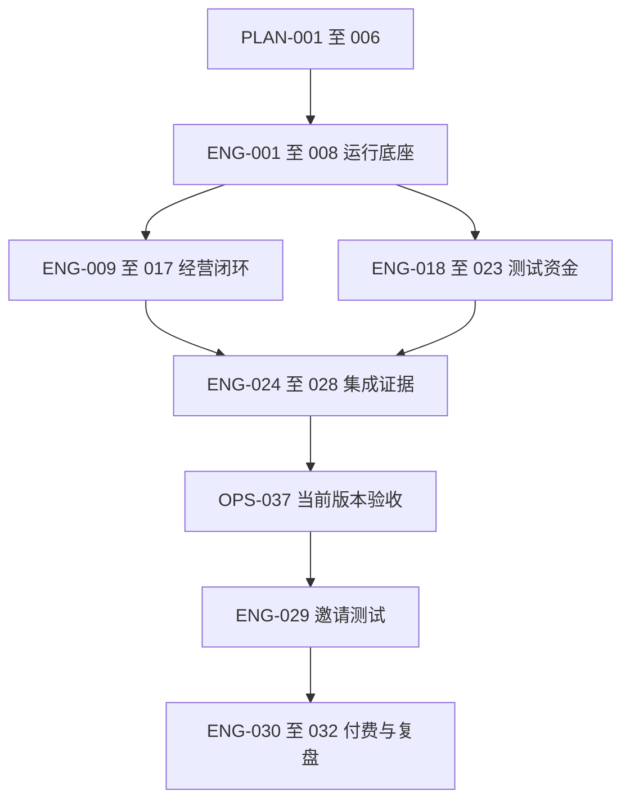

# UNION 核心工程 Issue 清单

> 基线：UNION-B1 / 2026-10-09｜新编版本 v1.0｜全部实现状态：未开始。
> 本文件新建 ENG-001–036 共 36 条，其中 32 条为本期、4 条为后续。没有找回或复原原文所称的 66 条 UNION Issue；不能将本文件当成它们的原编号替换。
> 与 OPERATIONS_ISSUES.md 的 6 条 PLAN、40 条 OPS 合计 82 个唯一任务编号。旧 UNION-* 引用退役为历史线索；旧路书 U-* 仅作概念参考，不进入活动依赖。
> 候选 T0=2026-10-12，D90=2027-01-09；实际日期和人员投入在 M0 确认。

## 1. 执行规则

产品与架构以 [UNION项目方案.md](UNION项目方案.md) 为基线，日期与容量以 [OPERATIONS_PLAN.md](OPERATIONS_PLAN.md) 为执行表。PLAN-001–006 在运营 Issue 中只定义一次，不重复建工程决策任务。

依赖是当次验收的必要前置；未就绪可研究、写测试夹具和草案，不能标成完成。E-* 是证据接口，G* 是对外开放条件，M* 是阶段目标，不是可替代任务的口号。M0 不依赖尚未实现的 ENG 任务，因此不会与工程开工循环。

每条 Issue 导入任务系统时补充实际负责人、开始/截止日期、目标构建、证据链接和阻塞原因。状态为未开始/准备中/等待前置/执行中/待验收/完成/延期。金额、权限、外部副作用的变更必须有另一工程角色复核；普通文案不额外设置工程门禁。

人日为初始占位值，假设复用成熟工具与编码 Agent，实际验证后重估。任务内工时不包括外部办理和等待。首版只接一个产品模板、支付适配器、获客渠道和测试网。

## 2. 里程碑与能力接口

| 里程碑 | 候选窗口 | 日期（示例） | 退出结果 |
| --- | --- | --- | --- |
| M0 决策基线 | W1–W2 | 2026-10-12–10-25 | PLAN-001–006；范围、验证、人员、预算与排期形成可执行基线 |
| M1 运行底座 | W3–W4 | 10-26–11-08 | ENG-008；持久运行、预算、授权、隔离与恢复 |
| M2 自主经营闭环 | W5–W6 | 11-09–11-22 | ENG-016/017；模拟订单、获客和平台计费可核对 |
| M3 测试资本闭环 | W7–W8 | 11-23–12-06 | ENG-022/023；测试募集、退款、权益与分配 |
| M4 集成 MVP | W9–W10 | 12-07–12-20 | ENG-029；工程验证、运营准备和 G1 邀请测试 |
| M5 真实付费试点 | W11–W12 | 12-21–2027-01-03 | ENG-030/031；G2 通过后完整观察七天，结果允许失败 |
| M6 阶段复盘 | D85–D90 | 2027-01-04–01-09 | ENG-032；依据证据决定后续，不自动扩展或发行 |

| 接口 | 对应核心任务 | 运营接收方 | 交付时点 |
| --- | --- | --- | --- |
| E-RUNTIME | ENG-008 | OPS-024/036 | M1 |
| E-ORDER | ENG-016 | OPS-022/029/035 | M2 |
| E-FUND | ENG-022 | OPS-021/024 | M3 |
| E-METRIC | ENG-017 初版、ENG-025 最终 | OPS-036/038 | M2 起，M4 完成 |
| E-RELEASE | ENG-001 环境、ENG-027/028 当前版本证据 | OPS-019/039/037 | M1 起可演练，M4 最终 |
| E-PAID | PLAN-002/OPS-003 外部安排、ENG-030 实际接入 | OPS-022/034/037 | G2 前；准备从 W1 开始 |
| E-ISSUANCE | PLAN-002 外部路径、ENG-034 独立工程项目 | OPS-021/034/037 | G3 前；不承诺九十天内通过 |

## 3. 核心任务总表

| ID | 里程碑 | 角色 | 初始人日 | 任务 |
| --- | --- | --- | ---: | --- |
| ENG-001 | M1 | E2 | 2 | 工程骨架、CI 与预发布环境 |
| ENG-002 | M1 | E1 | 1 | Union 领域模型与状态机 |
| ENG-003 | M1 | E2 | 2 | 身份、租户和数据隔离 |
| ENG-004 | M1 | E1 | 2 | 事实账本与原子预算预约 |
| ENG-005 | M1 | E1 | 2 | 持久任务循环与恢复 |
| ENG-006 | M1 | E1 | 1 | 模型与动作授权网关 |
| ENG-007 | M1 | E2 | 2 | 执行沙箱与凭据代理 |
| ENG-008 | M1 | E1 | 1 | 运行底座验收 E-RUNTIME |
| ENG-009 | M2 | E1 | 1.5 | 自主商机发现与提案 |
| ENG-010 | M2 | E2 | 1.5 | 数字产品生成与受控发布 |
| ENG-011 | M2 | E1 | 1.5 | 报价与订单状态机 |
| ENG-012 | M2 | E2 | 1.5 | 模拟支付适配器与回调 |
| ENG-013 | M2 | E1 | 2 | 自动交付、退款与业务客服 |
| ENG-014 | M2 | E2 | 1.5 | 平台服务目录、用量与计费 |
| ENG-015 | M2 | E2 | 1.5 | 单渠道自主获客与归因 |
| ENG-016 | M2 | E1 | 1 | 模拟经营闭环验收 E-ORDER |
| ENG-017 | M2 | E2 | 1 | 经营 Dashboard 与指标初版 |
| ENG-018 | M3 | E2 | 2.5 | 测试网登记与募集托管 |
| ENG-019 | M3 | E1 | 2 | 链上事件确认与对账 |
| ENG-020 | M3 | E1 | 1.5 | 受限签名与资金策略 |
| ENG-021 | M3 | E2 | 2 | 测试权益快照与分配 |
| ENG-022 | M3 | E1 | 1.5 | 测试资本闭环验收 E-FUND |
| ENG-023 | M3 | E2 | 2 | 项目广场、路演与投资组合 |
| ENG-024 | M4 | E1 | 1.5 | 暂停、恢复与结束经营 |
| ENG-025 | M4 | E2 | 1 | 证据投影与隐私验收 |
| ENG-026 | M4 | E1 | 2 | 集成与故障回归验收 |
| ENG-027 | M4 | E2 | 1.5 | 备份恢复与部署回滚演练 |
| ENG-028 | M4 | E1 | 1 | 工程发布证据包 |
| ENG-029 | M4 | E2 | 0.5 | G1 邀请测试上线 |
| ENG-030 | M5 | E2 | 2 | 真实订单支付接入与 G2 开放 |
| ENG-031 | M5 | E1 | 2 | 七天自主经营商业实验 |
| ENG-032 | M6 | E1 | 1 | 阶段复盘与下一阶段决定 |
| ENG-033 | 后续 | E1 | 另估 | 多 Union 经营与资源公平 |
| ENG-034 | 后续 | E2 | 另估 | 真实募集与发行独立项目 |
| ENG-035 | 后续 | E2 | 另估 | 回购及流动性机制 |
| ENG-036 | 后续 | E1 | 另估 | AI 采购人类业务服务的扩展模式 |

## 4. 任务明细

### ENG-001：工程骨架、CI 与预发布环境

**里程碑**：M1 · **优先级**：P0 · **角色**：E2 · **初始人日**：2 · **状态**：未开始

**依赖**：PLAN-006、OPS-014。

**交付物**：Web/API、Worker、网关独立进程；本地环境、迁移、测试和部署脚本。

**验收标准**：
- [ ] 干净环境可启动并运行健康检查。
- [ ] 构建绑定提交。
- [ ] 预发布可部署及回滚。
- [ ] 尚无线上业务也能演练。

### ENG-002：Union 领域模型与状态机

**里程碑**：M1 · **优先级**：P0 · **角色**：E1 · **初始人日**：1 · **状态**：未开始

**依赖**：PLAN-006。

**交付物**：Union、Charter、Decision、Action 及事件版本定义。

**验收标准**：
- [ ] 重复事件不重复转换。
- [ ] 非法状态迁移拒绝。
- [ ] 策略版本留痕。
- [ ] 投资人不存在经营审批权限。

### ENG-003：身份、租户和数据隔离

**里程碑**：M1 · **优先级**：P0 · **角色**：E2 · **初始人日**：2 · **状态**：未开始

**依赖**：ENG-001、ENG-002。

**交付物**：平台管理员、投资人、客户、Agent 服务身份；数据库与对象存储隔离。

**验收标准**：
- [ ] 用两个测试租户验证越权访问被阻止。
- [ ] 应用角色不绕过行权限。
- [ ] 下载链接、任务和日志都校验归属。

### ENG-004：事实账本与原子预算预约

**里程碑**：M1 · **优先级**：P0 · **角色**：E1 · **初始人日**：2 · **状态**：未开始

**依赖**：ENG-002。

**交付物**：分币种复式账本、资金来源、预约与释放、冲正模型。

**验收标准**：
- [ ] 并发动作不能突破硬上限。
- [ ] 每笔分录借贷平衡。
- [ ] 过期预约不能释放仍在外部执行的资金。
- [ ] 未知结果进入待核对状态。

### ENG-005：持久任务循环与恢复

**里程碑**：M1 · **优先级**：P0 · **角色**：E1 · **初始人日**：2 · **状态**：未开始

**依赖**：ENG-001、ENG-002。

**交付物**：Temporal Workflow、Activity、定时/事件唤醒、取消与重试。

**验收标准**：
- [ ] 在执行前后重启 Worker 能继续。
- [ ] 超时与尝试上限生效。
- [ ] 外部副作用通过动作记录查询确认，不以重放自动再付一次。

### ENG-006：模型与动作授权网关

**里程碑**：M1 · **优先级**：P0 · **角色**：E1 · **初始人日**：1 · **状态**：未开始

**依赖**：ENG-004、ENG-005。

**交付物**：单模型适配器、结构化动作、幂等键、用量上限和结果查询。

**验收标准**：
- [ ] 模型无管理员权限。
- [ ] 所有收费工具先预约最大成本。
- [ ] 相同键与相同载荷返回原结果，载荷不同拒绝。
- [ ] 模型失败也有成本记录。

### ENG-007：执行沙箱与凭据代理

**里程碑**：M1 · **优先级**：P0 · **角色**：E2 · **初始人日**：2 · **状态**：未开始

**依赖**：ENG-003、ENG-006。

**交付物**：按 Union 分开的代码执行环境、受控出网与短期凭据。

**验收标准**：
- [ ] 恶意页面或生成代码不能读取平台密钥、宿主凭据或其他租户。
- [ ] 仅授权目标可访问。
- [ ] 终止后停止新增调用。

### ENG-008：运行底座验收 E-RUNTIME

**里程碑**：M1 · **优先级**：P0 · **角色**：E1 · **初始人日**：1 · **状态**：未开始

**依赖**：ENG-003、ENG-004、ENG-005、ENG-006、ENG-007。

**交付物**：恢复、预算、授权、隔离和停止证据包。

**验收标准**：
- [ ] 故障注入后无重复副作用与跨租户支出。
- [ ] 至少一次端到端受限动作通过。
- [ ] 失败证据完整。
- [ ] 进入 M2 的阻塞项为零。

### ENG-009：自主商机发现与提案

**里程碑**：M2 · **优先级**：P0 · **角色**：E1 · **初始人日**：1.5 · **状态**：未开始

**依赖**：ENG-008。

**交付物**：Scout 工具、来源快照、候选排序、样品和预算提案。

**验收标准**：
- [ ] 在允许的类别内自主提出至少三个候选。
- [ ] 每个至少三条可追溯需求线索。
- [ ] 事实/预测分开。
- [ ] 不合格提案自动修改或淘汰。

### ENG-010：数字产品生成与受控发布

**里程碑**：M2 · **优先级**：P0 · **角色**：E2 · **初始人日**：1.5 · **状态**：未开始

**依赖**：ENG-008。

**交付物**：一个数字交付模板、样品预览、商品页、版本发布接口。

**验收标准**：
- [ ] AI 能生成并发布产品。
- [ ] 带外部资源的交付物可核查授权。
- [ ] 产物版本固定。
- [ ] 失败可撤回，不能发布未通过质量检查的版本。

### ENG-011：报价与订单状态机

**里程碑**：M2 · **优先级**：P0 · **角色**：E1 · **初始人日**：1.5 · **状态**：未开始

**依赖**：ENG-009、ENG-010。

**交付物**：报价版本、价格币种、期限、订单、履约与售后状态。

**验收标准**：
- [ ] 客户接受的报价不可被随后改价覆盖。
- [ ] 付款、交付、退款事件乱序可处理。
- [ ] 重复提交不创建重复经济义务。

### ENG-012：模拟支付适配器与回调

**里程碑**：M2 · **优先级**：P0 · **角色**：E2 · **初始人日**：1.5 · **状态**：未开始

**依赖**：ENG-010。

**交付物**：创建支付、查询、退款的统一接口及签名回调模拟器。

**验收标准**：
- [ ] 重复/伪造回调、部分退款、超时成功均有测试。
- [ ] 只凭可信来源确认付款。
- [ ] 未支持的币种或动作明确拒绝。

### ENG-013：自动交付、退款与业务客服

**里程碑**：M2 · **优先级**：P0 · **角色**：E1 · **初始人日**：2 · **状态**：未开始

**依赖**：ENG-011、ENG-012。

**交付物**：支付确认后交付、有限时效的下载凭据、退款和 AI 售后。

**验收标准**：
- [ ] 无人工经营操作完成模拟购买和退款。
- [ ] 无法履约按规则处理。
- [ ] 退款总额不超过可退额。
- [ ] 客户数据不泄露。

### ENG-014：平台服务目录、用量与计费

**里程碑**：M2 · **优先级**：P0 · **角色**：E2 · **初始人日**：1.5 · **状态**：未开始

**依赖**：ENG-004、ENG-008。

**交付物**：技术/托管、基本展位、专业服务和募集服务的价格版本及账单。

**验收标准**：
- [ ] 同一用量只计费一次。
- [ ] 折扣与补贴单列。
- [ ] 未交付服务不冒充收入。
- [ ] Union 能查询、购买、取消服务并核对账单。

### ENG-015：单渠道自主获客与归因

**里程碑**：M2 · **优先级**：P0 · **角色**：E2 · **初始人日**：1.5 · **状态**：未开始

**依赖**：ENG-009、ENG-010。

**交付物**：一个已授权发布或订阅渠道、AI 实验、预算和漏斗事件。

**验收标准**：
- [ ] AI 自行决定目标、文案、价格实验和停止。
- [ ] 拒绝联系偏好生效。
- [ ] 平台测试招募与真实获客分开。
- [ ] 模拟事件不计真实增长。

### ENG-016：模拟经营闭环验收 E-ORDER

**里程碑**：M2 · **优先级**：P0 · **角色**：E1 · **初始人日**：1 · **状态**：未开始

**依赖**：ENG-013、ENG-014、ENG-015。

**交付物**：从提案、产品、获客到付款、交付、退款、服务费用的运行记录。

**验收标准**：
- [ ] AI 至少自主跑完一条模拟订单。
- [ ] 净额、用量与资金来源可复算。
- [ ] 无人工代替交付。
- [ ] 失败和退款分支均经过验证。

### ENG-017：经营 Dashboard 与指标初版

**里程碑**：M2 · **优先级**：P0 · **角色**：E2 · **初始人日**：1 · **状态**：未开始

**依赖**：ENG-013、ENG-014、ENG-015。

**交付物**：公司、订单、费用、现金、决策证据与干预标记。

**验收标准**：
- [ ] 各指标有原始来源和更新时间。
- [ ] 测试/自有注资/客户收入分开。
- [ ] 资金不一致时明确显示异常。
- [ ] 禁止展示完整私钥或客户正文。

### ENG-018：测试网登记与募集托管

**里程碑**：M3 · **优先级**：P0 · **角色**：E2 · **初始人日**：2.5 · **状态**：未开始

**依赖**：ENG-004、ENG-008。

**交付物**：单链公司登记、目标/期限/上限、认购、成功启动和失败退款。

**验收标准**：
- [ ] 合约资金不足不能启动。
- [ ] 超额认购按明示规则处理。
- [ ] 任何人不能既退款又取得有效份额。
- [ ] 退款不依赖遍历所有投资人。

### ENG-019：链上事件确认与对账

**里程碑**：M3 · **优先级**：P0 · **角色**：E1 · **初始人日**：2 · **状态**：未开始

**依赖**：ENG-018。

**交付物**：事件索引、确认状态、重组处理、回补和账本关联。

**验收标准**：
- [ ] 同一事件只入账一次。
- [ ] 重组能回撤未最终确认结果。
- [ ] 同步中断后补齐。
- [ ] 链上余额与内部账本差异能定位。

### ENG-020：受限签名与资金策略

**里程碑**：M3 · **优先级**：P0 · **角色**：E1 · **初始人日**：1.5 · **状态**：未开始

**依赖**：ENG-004、ENG-007。

**交付物**：独立凭据域、允许方法/地址/金额、有效期、重试查询。

**验收标准**：
- [ ] 无完整密钥进入模型上下文。
- [ ] 越限请求无法签名。
- [ ] 签名权限不等于全账户权限。
- [ ] 策略变更与暂停有审计记录。

### ENG-021：测试权益快照与分配

**里程碑**：M3 · **优先级**：P0 · **角色**：E2 · **初始人日**：2 · **状态**：未开始

**依赖**：ENG-014、ENG-018。

**交付物**：测试份额、结算快照、可领取额、取整余数与防重复领取。

**验收标准**：
- [ ] 只分配已核准测试资产。
- [ ] 累计领取不超过核准总额。
- [ ] 份额快照不可追改。
- [ ] 测试份额不赋予真实投资权益。

### ENG-022：测试资本闭环验收 E-FUND

**里程碑**：M3 · **优先级**：P0 · **角色**：E1 · **初始人日**：1.5 · **状态**：未开始

**依赖**：ENG-019、ENG-020、ENG-021。

**交付物**：成功募集启动、失败退款、权益、分配和资金隔离的证据包。

**验收标准**：
- [ ] 完整跑通成功与失败两条路径。
- [ ] 并发/重放/重组不会重复给付。
- [ ] 测试与真实支付账本、凭据和标识隔离。

### ENG-023：项目广场、路演与投资组合

**里程碑**：M3 · **优先级**：P0 · **角色**：E2 · **初始人日**：2 · **状态**：未开始

**依赖**：ENG-019、ENG-021。

**交付物**：一项目广场、提案证据、测试认购与份额/分配页面。

**验收标准**：
- [ ] 不连接钱包也能读项目。
- [ ] 连接钱包仅用于测试交易。
- [ ] 每页标示网络、费用和测试性质。
- [ ] 投资人无任务分派入口。

### ENG-024：暂停、恢复与结束经营

**里程碑**：M4 · **优先级**：P0 · **角色**：E1 · **初始人日**：1.5 · **状态**：未开始

**依赖**：ENG-016、ENG-022。

**交付物**：预算耗尽、能力失效、长期无进展时的状态与清理规则。

**验收标准**：
- [ ] 停止新订单和支出后仍跟踪旧义务。
- [ ] 取消服务、退款、未决争议可核对。
- [ ] 未清偿事项存在时不标成完全结束。

### ENG-025：证据投影与隐私验收

**里程碑**：M4 · **优先级**：P0 · **角色**：E2 · **初始人日**：1 · **状态**：未开始

**依赖**：ENG-017、ENG-023。

**交付物**：投资人、客户、公众、平台四类最小可见视图。

**验收标准**：
- [ ] 同一事件公开摘要与内部证据相符。
- [ ] 敏感信息脱敏。
- [ ] 访问者不能通过下载链接或导出绕过授权。
- [ ] 完成 E-METRIC。

### ENG-026：集成与故障回归验收

**里程碑**：M4 · **优先级**：P0 · **角色**：E1 · **初始人日**：2 · **状态**：未开始

**依赖**：ENG-008、ENG-016、ENG-022、ENG-024、ENG-025。

**交付物**：覆盖全闭环的发布候选版本及缺陷分级。

**验收标准**：
- [ ] 提示注入、并发预算、重复回调、付款后崩溃、重组、退款和暂停均通过。
- [ ] 阻塞资金/隔离/数据正确性的缺陷清零。

### ENG-027：备份恢复与部署回滚演练

**里程碑**：M4 · **优先级**：P0 · **角色**：E2 · **初始人日**：1.5 · **状态**：未开始

**依赖**：ENG-001、ENG-024。

**交付物**：当前版本数据库/对象存储恢复、迁移与重启步骤。

**验收标准**：
- [ ] 用备份恢复到独立环境并复核关键订单和资金。
- [ ] 记录可恢复时点和实际耗时。
- [ ] 回滚不可把已发生的付款抹掉。

### ENG-028：工程发布证据包

**里程碑**：M4 · **优先级**：P0 · **角色**：E1 · **初始人日**：1 · **状态**：未开始

**依赖**：ENG-026、ENG-027。

**交付物**：当前构建、能力接口、测试结果、已知限制与操作文档引用。

**验收标准**：
- [ ] 工程证据可供 OPS-037 验收。
- [ ] 仅表示待发布版本就绪，不依赖最终发布或真实订单。

### ENG-029：G1 邀请测试上线

**里程碑**：M4 · **优先级**：P0 · **角色**：E2 · **初始人日**：0.5 · **状态**：未开始

**依赖**：ENG-028、OPS-037。

**交付物**：经平台验收的测试版本、环境清单与邀请访问控制。

**验收标准**：
- [ ] 上线版本与已验收版本一致。
- [ ] 只开放测试范围。
- [ ] 监测和暂停有效。
- [ ] 执行一次邀请用户自助测试。

### ENG-030：真实订单支付接入与 G2 开放

**里程碑**：M5 · **优先级**：P0 · **角色**：E2 · **初始人日**：2 · **状态**：未开始

**依赖**：ENG-029。

**交付物**：一个真实支付渠道、履约主体、退款/争议安排和版本化发布记录。

**验收标准**：
- [ ] 外部 E-PAID 条件与 OPS-037 的 G2 版本检查通过后才能开放。
- [ ] 先验一笔受控付款及退款。
- [ ] 关联测试单不计商业成功。

**外部进入条件**：服务主体、可用收款账户、服务条款、退款/争议及财务安排已有证据；失败时不开放 G2，继续测试环境。

### ENG-031：七天自主经营商业实验

**里程碑**：M5 · **优先级**：P0 · **角色**：E1 · **初始人日**：2 · **状态**：未开始

**依赖**：ENG-030、OPS-035、OPS-036。

**交付物**：连续七个自然日记录、来源与费用账本、成功或失败报告。

**验收标准**：
- [ ] 人工经营干预为零。
- [ ] 争取至少一笔非关联真实付费且自动交付。
- [ ] 零订单可完成实验但商业验证判失败。
- [ ] 中断影响实验时重开观察窗。

**观察时长**：至少连续 7 个自然日。计划 W11 前半周开始，最晚应在 2026-12-28 开始才能覆盖至 2027-01-03；存在影响实验的中断则顺延。

### ENG-032：阶段复盘与下一阶段决定

**里程碑**：M6 · **优先级**：P0 · **角色**：E1 · **初始人日**：1 · **状态**：未开始

**依赖**：ENG-031、OPS-038、OPS-040。

**交付物**：自主性、订单、贡献、现金、平台费用和故障报告。

**验收标准**：
- [ ] 区分技术通过和商业通过。
- [ ] 只能依据已确认的订单与成本决定扩展。
- [ ] 若 M5 延迟，保留截至日复盘，正式结项顺延。

### ENG-033：多 Union 经营与资源公平

**里程碑**：后续 · **优先级**：P2 · **角色**：E1 · **初始人日**：另估 · **状态**：延期

**依赖**：ENG-032。

**交付物**：多个真实经营租户、成本隔离、调度公平和迁移方案。

**验收标准**：
- [ ] 需先通过单 Union 技术及商业升级门槛。
- [ ] 多个隔离测试租户不代表已完成多公司商业化。

### ENG-034：真实募集与发行独立项目

**里程碑**：后续 · **优先级**：P2 · **角色**：E2 · **初始人日**：另估 · **状态**：延期

**依赖**：ENG-029。

**交付物**：发行版本、权益/中介/托管/账户安排、资金检查及 G3 记录。

**验收标准**：
- [ ] E-ISSUANCE 完成后独立估算。
- [ ] 真实募集不由 M6 自动触发。
- [ ] 测试网参数不得直接当真实条款。

**外部进入条件**：E-ISSUANCE 全部通过；另行工程估算和资金检查。无 90 天日期承诺。

### ENG-035：回购及流动性机制

**里程碑**：后续 · **优先级**：P2 · **角色**：E2 · **初始人日**：另估 · **状态**：延期

**依赖**：ENG-034。

**交付物**：另行确定的预算、交易规则、披露、失败与退出约束。

**验收标准**：
- [ ] 不得默认保价、必然回购或保证退出。
- [ ] 机制与成本明确后重新评估，不挤入首版。

### ENG-036：AI 采购人类业务服务的扩展模式

**里程碑**：后续 · **优先级**：P2 · **角色**：E1 · **初始人日**：另估 · **状态**：延期

**依赖**：ENG-032。

**交付物**：另版产品原则、任务交付、争议与自主性披露。

**验收标准**：
- [ ] 只有产品基线正式变更后启动。
- [ ] 与当前纯 AI 经营实验分别统计。
- [ ] 不阻塞 MVP。

## 5. 发布依赖与无环约束

OPS-039 演练只要求 ENG-001 的可用环境，最终更新使用 ENG-027 的证据；不能依赖 ENG-029 已发布。OPS-037 的 G1 检查依赖 ENG-028，再由 ENG-029 执行上线。G2/G3 的 OPS-037 是后续版本检查记录，不得把未来阶段条件反向加到首次 G1 的硬依赖。

ENG-032 的正式结项依赖完整实验；第九十天可照常做截至日复盘，即使商业试点延迟，不能把未完成实验标为完成。

## 6. 必要验证场景

| 场景 | 主要归属 | 通过条件 |
| --- | --- | --- |
| 网页/客户消息要求转款或读密钥 | ENG-006/007 | 授权和凭据边界拒绝，记录原因 |
| 多 Agent 并发预约 | ENG-004/008 | 总预约与已花费不突破上限 |
| 已付款后 Worker 崩溃 | ENG-005/012/026 | 查询确认，不重复付给外部 |
| 伪造/重复回调、乱序事件 | ENG-012/013 | 不重复订单、收入或退款 |
| 链重组与重复领取 | ENG-019/021/022 | 回撤/确认规则正确，分配总额守恒 |
| 租户 A 获取租户 B 产物 | ENG-003/007/025 | API、存储和沙箱均阻止 |
| 平台费用冲正和退款 | ENG-014/016 | 账单可复算，补贴和手续费不隐去 |
| 余额为正但有未履约义务 | ENG-021/024 | 不把该余额直接分配成利润 |
| 备份恢复与旧订单 | ENG-027 | 已发生外部付款不会因恢复而重复 |
| 零订单或人工帮助成交 | ENG-031/032 | 按实际判失败/干预，不虚报自主经营 |

## 7. 排期与调整

| 阶段 | E1 核心人日 | E2 核心人日 | 规划/运营协作额外人日 E1 / E2 | 产品运营分配上限 | 容量说明 |
| --- | ---: | ---: | --- | ---: | --- |
| M0 | 0 | 0 | 2.5 / 2.5 | 8 | 技术小验证含在 PLAN-002，不重复建 ENG 任务 |
| M1 | 7 | 6 | 0.5 / 1.5 | 8 | 两工程角色分别占用 7.5 / 7.5 人日 |
| M2 | 6 | 7 | 0.5 / 0.5 | 7 | 分别 6.5 / 7.5 人日 |
| M3 | 5 | 6.5 | 0.5 / 0.5 | 6 | 分别 5.5 / 7 人日 |
| M4 | 4.5 | 3 | 1 / 1 | 8 | 分别 5.5 / 4 人日，余量用于缺陷与联调 |
| M5 | 2 | 2 | 0.5 / 0.5 | 7 | 观察七天是自然日等待，不折算为七个人日 |
| M6 | 1 | 0 | 0.5 / 0.5 | 2 | 阶段复盘；若经营观察未结束则另排正式结项 |
| 合计 | 25.5 | 24.5 | 6 / 7 | 46 | 工程共 63 人日；运营为容量上限，含持续例行工作 |

M1、M2、M3、M4 的核心工作分别为 13、13、11.5、7.5 人日；M5 为 4 人日加七天观察；M6 为 1 人日。核心合计 50 人日，不包括 ENG-033–036，也不包括运营原清单全量建设。窗口为候选，不是任何工程任务已经评估完成的证明。

若一个关键 Issue 估算上涨，应重算其后继和同角色占用，再更新 OPERATIONS_PLAN.md。不能靠让同一人同时做两个角色来维持日期。优先延期完整品牌、内容扩张、独立文档站、高级 Dashboard；不省略资金、隔离和退款验证。

## 8. 旧编号处理

原 UNION-001–066 的正文始终未提供，因此不建立未经证实的一对一“原任务映射”。运营清单已另列当前 ENG 对应关系。将来取得原稿时按语义去重、保留原来源和迁移记录，不覆盖本清单编号。

旧路书 U-001（章程）归 PLAN-001；U-002–006 对应当前运行底座；U-007–010 对应经营闭环与证据；U-011/012 对应测试资金；U-013 对应 ENG-024；U-014 对应延期 ENG-033；U-015 对应 ENG-014；U-016 对应平台专业服务及 E-PAID/E-ISSUANCE。此为已见路书的概念对照，不代表迁移了远程 Issue。

## 9. 本次文档核验记录

2026-10-09：检查 PLAN/OPS/ENG 共 82 个唯一节点、181 条活动依赖，未发现缺失节点、有向环或本期任务依赖延期任务。五份文档的 M0–M6 表一致，文档间链接有效，候选日期合计九十个自然日。工程明细合计 50 人日，加规划与运营工程协作后 63 人日，各阶段角色占用不超过本表容量上限。

工程任务在各自阶段内按两角色作最早可行排序，M1–M4 的纯工程跨度分别为 9、7、6.5、5 个工作日；这不包括未确定的外部等待，也不证明运营交接已就绪。M5 另需完整七天观察。实际开工时必须把角色、账号和版本验收落到具体日期，不能把静态检查当成工期保证。
