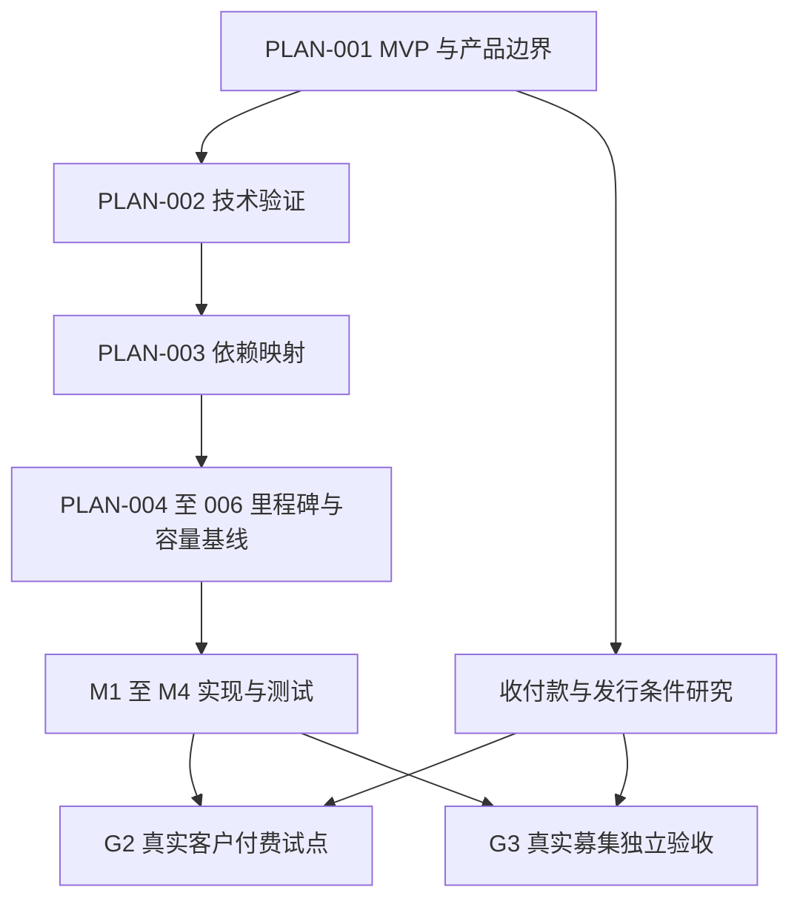
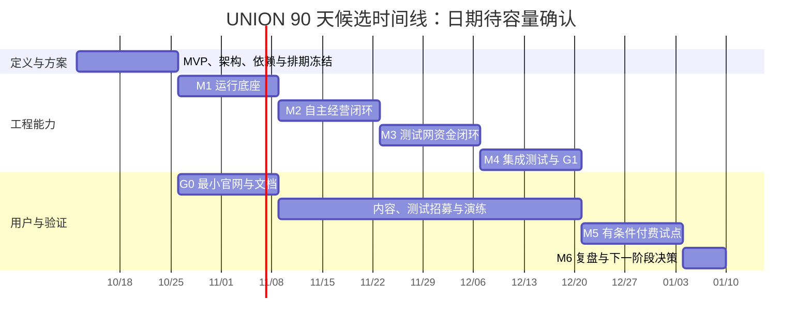

# UNION 运营 Issue 清单（跨文档统一版）

> 基线：UNION-B1 / 2026-10-09｜状态：文档已编制并核验依赖；实际工作仍待执行和验收。
> 本文件定义 PLAN-001–006、OPS-001–040 共 46 个编号；核心 ISSUES.md 新编 ENG-001–036，共计 82 个唯一任务编号。
> 新核心清单有 32 条本期工程任务、4 条后续任务；OPS-023/031 延期。原文提到的 66 条 UNION Issue 正文从未提供，不推断已恢复；旧 UNION-* 仅保留历史引用，不是活动依赖。
> 技术/MVP 见 UNION项目方案.md，核心任务见 ISSUES.md，人员预算和周安排见 OPERATIONS_PLAN.md。日期是候选；本文不表示代码、账号、真实订单或发行条件已经就绪。

## 审阅结论与必须修正的问题

**先确认 MVP 与业务边界，再完成关键技术验证，随后冻结里程碑和容量排期；品牌、官网、社区等工作按发布阶段接入。**

| 严重度 | 原位置 | 问题与影响 | 本次处理 |
| --- | --- | --- | --- |
| P0 | 文首与首批启动项 | 直接进入品牌、域名、运营，缺少技术/MVP/依赖图的明确交付物 | 新增 PLAN-001–006；基线确认前仅允许有预算的小验证和草案 |
| P0 | OPS-023、031、036 等 | 人类接单、排班、人工救场成为经营主线，与已确认的 AI 主体目标冲突 | 承包者任务延期；经营由 AI 执行，平台人员负责基础设施和专业服务 |
| P0 | G3/M6 | 平台化与正式发行被放在同一节点，容易误读为技术完成即可募资 | 真实发行改为独立 G3 条件，不承诺固定日期 |
| P1 | OPS-035、036、039 | 准备工作与后续工程验收绑在一起，可能造成先上线再准备或跨清单循环 | 分开准备、演练和真实执行；历史核心原稿未提供；本次按新 ENG 清单建立依赖并校验 |
| P1 | OPS-025、028、040 | 文档检查、内容草案、周复盘等待大量后期结果，启动偏晚 | 流程及草案前置；实际结果随版本、周次补充 |
| P1 | OPS-009、014、027 | 基础线索结构、仓库建设被域名/邮箱等非必要条件拖住 | 拆除不必要的硬依赖，生产接入仍在发布前验收 |
| P0 | 全文规模与 90 天表述 | 19 个 S、21 个 M，首次建设共 51.5–82 人日，未计持续运营、外部等待和工程 | 采用容量约束和 MVP 子范围；取消“90 天完成全部事项”的隐含承诺 |
| P1 | OPS-021、038 | 资金说明偏重回购，缺少平台服务收费与 Union 业务经济性 | 补入授权/托管、展位、募集及专业服务费用，分开本金、平台收入和 Union 经营收入 |

原文件的 40 个 OPS 节点内部未发现直接有向环；这不代表 OPS 与 UNION 合起来不存在循环。本次已经基于新 ENG 清单完成跨文件静态检查；工程实况仍须 PLAN-003 在实际任务系统中核对。

## 使用规则

- **依赖**列当前 PLAN/OPS/ENG 必要前置，按当次版本验收；**历史核心引用**仅供追溯，不进入活动图；**当前工程关联**列新核心任务，涉及后续真实版本的条件单独注明。
- 同一任务分为准备 A、对应版本验收 B 和持续执行 C。依赖未完成时可研究和写草案，不能将整个任务标为已验收。
- P0 指所属阶段的必要项，不表示全部在第一周做。S=0.5–1 人日、M=2–3 人日、L=4–5 人日为原估算标签；改动范围后应重估。E 为外部等待/持续观察，不折算为零工期。
- 周期性任务验收的是流程及首轮记录，随后按周/月/版本持续建立子任务。零订单时照样复盘；不得编造数据。
- 工作角色是平台建设与服务角色，可由同一人兼任；日历排期必须按真实可用工时计算，不能把兼任角色视为独立并行人力。
- 任务状态统一：未开始、准备中、等待前置、可执行、执行中、待验收、完成、延期。每次移动状态附责任人和证据。

## 1. 产品基线与 MVP 范围

沿用本次对话中已确认的产品原则：**AI 是 Union 的经营主体；投资人只承担出资、观察和收益领取等投资动作；平台提供技术、架构、风险控制、法律与财务基础服务，Union 为这些服务付费。**

平台开发、支持、专业法律财务服务中的人类参与应如实记录；为单个 Union 人工定价、获客、制作交付物或日常经营审批，属于经营干预。AI 无法处理时按预设规则重试、换方案或暂停，不把人工接管后的订单算作自主成果。

| 首版纳入 | 首版验收 | 延后范围 |
| --- | --- | --- |
| 1 个业务类别、1 家 Union | AI 提出有来源证据的机会、生成产品并制定预算 | 多行业通用经营、批量数百项目 |
| 一个主 Agent 与按任务创建的执行 Agent | 任务可恢复、有版本和行动记录，投资人无需操作 | 固定庞大的 CEO/CFO/CTO 编制 |
| 单渠道获客、单产品入口、单支付适配器 | 自动报价、订单、交付、退款和对账能完整测试 | 人类承包者市场、人工销售与交付排班 |
| 平台基础服务与费用表 | 用量、账单、平台收费及 Union 净可用资金可核对 | 复杂多层分佣与平台币经济模型 |
| 单一 EVM 测试网的募集与分配 | 足额启动、未达标退款、权益快照与防重复领取 | 多链、自由交易市场、主网公众发行 |
| 最小 Dashboard | 公司状态、决策证据、资金、费用与订单；清楚标识测试数据 | 完整行业模板商城与高级分析 |

**技术 MVP（M4）**：上述功能在测试资金/模拟业务环境连通，零人工经营干预的测试可复现，重启/重试不会重复付款或越权支出。它不要求已经拿到真实客户。

**商业试点（M5）**：使用获准的真实收付款安排和平台自有实验资金，连续 7 天自主经营，争取至少一笔非关联客户真实付费交付；无订单则如实判定需求/获客验证未通过，不靠测试币或补贴交易达标。

## 2. 技术方案建议与待决事项

以下是建议采用的起点。PLAN-002 用小验证决定采纳或替换，并记录版本、取舍及验证结果；本次仅核查文档，没有运行工程代码。

| 决策 | 建议方案 | 必须先验证的事项 |
| --- | --- | --- |
| 工程结构 | TypeScript；React 页面；模块化 API 服务加独立 Worker | 单仓库启动、部署和回滚流程；先避免不必要的微服务 |
| 状态与存储 | PostgreSQL 保存业务事实和账本；对象存储保存交付证据 | Union 隔离、整数金额、事务与冲正；不能用聊天记录代替状态 |
| 长任务运行 | Temporal 管理定时、事件、恢复与重试 | Worker 重启恢复；支付、发布等外部副作用必须幂等 |
| Agent 适配 | 一种模型和可替换工具调用接口；按任务拉起执行者 | 受控出网、提示注入边界、超时、成本预约与停止条件 |
| 工具与资金 | 独立的工具授权/受限签名网关 | 无完整私钥进入模型上下文；并发不能突破预算 |
| 支付与融资 | 客户订单支付、项目认购、平台收费、收益分配分别建模 | 接收资金不等于确认收入；签名、退款和分配逻辑可核对 |
| Paperclip | 参考 Dashboard、运行记录及适配器，最多 2 工作日集成验证 | 依赖、许可与强制人工流程；Union 账本和投资权益独立保存 |
| Base 服务层 | 服务目录、定价版本、主体/专业服务映射与账单 | 覆盖业务与地域可查询；AI 可读取价格并在预算内购买服务 |

Temporal 的官方文档提供 Workflow、Activity、Worker 和恢复机制；具体选型仍以项目验证为准。Paperclip 官方仓库展示组织与任务管理能力；不能据此推断它提供本项目的投资或法律结构。来源见文末。

### 工程验收接口（已映射到本次新编核心清单）

| 接口 | 对应核心任务 | 运营接收方 | 交付时点 |
| --- | --- | --- | --- |
| E-RUNTIME | ENG-008 | OPS-024/036 | M1 |
| E-ORDER | ENG-016 | OPS-022/029/035 | M2 |
| E-FUND | ENG-022 | OPS-021/024 | M3 |
| E-METRIC | ENG-017 初版、ENG-025 最终 | OPS-036/038 | M2 起，M4 完成 |
| E-RELEASE | ENG-001 环境、ENG-027/028 当前版本证据 | OPS-019/039/037 | M1 起可演练，M4 最终 |
| E-PAID | PLAN-002/OPS-003 外部安排、ENG-030 实际接入 | OPS-022/034/037 | G2 前；准备从 W1 开始 |
| E-ISSUANCE | PLAN-002 外部路径、ENG-034 独立工程项目 | OPS-021/034/037 | G3 前；不承诺九十天内通过 |

这些是能力接口，不是已经完成的工程任务。E-RELEASE 必须是“环境可演练”，不能定义成“已通过最终发布验收”，否则会与 OPS-039/037 循环。

## 3. 里程碑与独立发布条件

**以下 M0–M6 已与本次新编的项目方案、核心 Issue、运营方案统一。实际人员、T0 与预算通过 PLAN-005/006 后才能承诺日期。**

| 里程碑 | 候选窗口 | 日期（示例） | 退出结果 |
| --- | --- | --- | --- |
| M0 决策基线 | W1–W2 | 2026-10-12–10-25 | PLAN-001–006；范围、验证、人员、预算与排期形成可执行基线 |
| M1 运行底座 | W3–W4 | 10-26–11-08 | ENG-008；持久运行、预算、授权、隔离与恢复 |
| M2 自主经营闭环 | W5–W6 | 11-09–11-22 | ENG-016/017；模拟订单、获客和平台计费可核对 |
| M3 测试资本闭环 | W7–W8 | 11-23–12-06 | ENG-022/023；测试募集、退款、权益与分配 |
| M4 集成 MVP | W9–W10 | 12-07–12-20 | ENG-029；工程验证、运营准备和 G1 邀请测试 |
| M5 真实付费试点 | W11–W12 | 12-21–2027-01-03 | ENG-030/031；G2 通过后完整观察七天，结果允许失败 |
| M6 阶段复盘 | D85–D90 | 2027-01-04–01-09 | ENG-032；依据证据决定后续，不自动扩展或发行 |

| 条件 | 允许开放 | 验收依据 |
| --- | --- | --- |
| G0 信息官网 | 介绍、联系与研究性意向收集 | OPS-012；只需信息站最小范围，不要求完整产品 |
| G1 邀请测试 | 测试网认购和模拟经营体验 | ENG-028 工程证据 → OPS-037 当前版本验收 → ENG-029 上线 |
| G2 真实客户付费 | 购买一个可自动交付的产品 | G1、E-PAID、ENG-030 及 OPS-037 的 G2 检查；平台自有实验资金支持 |
| G3 真实投资募集 | 真实认购及约定权益 | 至少 G1、E-ISSUANCE、ENG-034 的独立发行版本验收；无固定日期 |

G2（客户购买）与 G3（投资认购）是不同路径。商业试点可先用平台自有资金；真实发行路径应从 W1 研究，任何阶段都不能把测试网通过视为发行获准。

## 4. 时间图与人力约束

**示例 T0=2026-10-12，D90=2027-01-09，均以自然日计。实际 T0、人员和预算尚未确认。** 这是一条按能力排序的 90 天候选时间线，只有 PLAN-005 完成容量核算后才成为承诺排期。

| 周期 | 日期 | 平台运营最小交付 | 范围限制 |
| --- | --- | --- | --- |
| W1–W2 | 10/12–10/25 | PLAN-001–006、定位、信息结构、仓库私有骨架、预算与服务边界；启动 E-PAID/E-ISSUANCE 可行性核查 | 官网可写草案；不先承诺产品上线/发行日期 |
| W3–W4 | 10/26–11/08 | G0 最小官网与需求入口；README、文档骨架、支持与事故流程草案 | 文档可先放仓库；高级品牌、社区和搜索不阻塞 |
| W5–W6 | 11/09–11/22 | 自建演示、AI 渠道实验、订单操作手册草案 | 演示与真实收入分开；支持自动化先完成测试 |
| W7–W8 | 11/23–12/06 | 测试网资金说明、计费说明、退款及分配文档；预发布演练 | 不能用真实投资资金替代测试资金 |
| W9–W10 | 12/07–12/20 | G1 邀请测试、当前版本手册、事故演练和运行报告 | 只补齐本次开放范围需要的文档和能力 |
| W11–W12 | 12/21–01/03 | 达到 G2 后受控付费实验，至少 7 天观察、订单与成本报告 | 没有真实订单时记录失败原因，不提前计作商业成功 |
| D85–D90 | 01/04–01/09 | M6 复盘，重新估算下一阶段 | 留给观察、纠错与决策，不承诺 6 天内完成平台化 |

Gantt 使用自然日展示，并行条目不代表拥有独立人力。示例团队条件是 2 名全职工程实现者、1 名全职产品/运营，另有按需专业服务；每人每周仅按 4 人日排可计划工作，其余留给沟通、故障和不确定性。两名工程分别负责 E1/E2；若只有一名工程或同一人兼任产品运营，不能照抄这条并行时间线。具体容量见 OPERATIONS_PLAN.md。

原 40 条的首次建设估算为 51.5–82 人日，尚不含新增规划任务、长期维护与本次新编工程任务。当前 ENG-001–032 初估 50 工程人日，另有验证/运营工程协作 13 人日；旧 66 条核心任务不属于已核验输入。即便有一名专职运营，12 周按 4 人日/周也只有 48 人日可计划容量。因此首期只能交付各任务的 MVP 子范围，OPS-002 完整品牌、OPS-011 全面 SEO、OPS-020 完整文档站、OPS-025 多语言、OPS-032 合作扩展及承包者任务应按证据延后。外部审批、账户开通和客户决策时间单列。

若关键前置延迟，首先压缩装饰性内容、渠道数量和非必要页面；不压缩支付安全、权利披露和必要测试。依赖它的任务顺延，无依赖的文档/研究可继续。所有排期变动进入 PLAN-006 的基线变更记录。

## 5. 前置规划 Issue

### PLAN-001：冻结产品原则与 MVP 验收场景

**优先级**：P0 · **建议负责人**：发起人 / 产品 · **规模**：M · **窗口**：W1
**依赖**：无。
**交付物**：MVP 范围矩阵、角色/权限、一个完整用户旅程、明确不做项与验收场景。
- [ ] 写明 AI 经营、投资人只出资、平台服务收费的边界；人工经营干预计数口径明确。
- [ ] 确定首版支持的业务类别、支付与渠道能力边界；由 AI 在边界内提出具体业务机会、产品和经营方案；区别技术 MVP、真实客户试点、真实投资募集。
- [ ] 验收覆盖失败、退款与自动暂停，未确认问题有负责人和决定期限。

### PLAN-002：确定技术方案并完成高风险小验证

**优先级**：P0 · **建议负责人**：技术负责人 / 产品 · **规模**：M，超出则重估 · **窗口**：W1–W2
**依赖**：PLAN-001。
**交付物**：架构图、数据/权限/资金模型、选型 ADR、部署草案与小验证结果。
- [ ] 确认运行架构、模型和工具接入、状态/账本、沙箱、计费、支付与测试链；记录 Paperclip 复用决定。
- [ ] 小验证覆盖恢复、动作幂等、并发预算和模型对工具的授权边界；该验证不冒充完整生产安全检查。
- [ ] 法律财务服务按目标业务和法域列出提供方与覆盖范围；未知项能否阻塞 MVP 有结论。

### PLAN-003：对齐核心 Issue、接口交付和依赖图

**优先级**：P0 · **建议负责人**：技术负责人 / 项目管理 · **规模**：S，清单复杂时重估 · **窗口**：W2
**依赖**：PLAN-001、PLAN-002。
**交付物**：当前 PLAN/OPS/ENG 映射、无环依赖图、E-* 对应任务及实际系统中的缺项列表。
- [ ] 使用本次新编 ISSUES.md、OPERATIONS_PLAN.md、UNION项目方案.md，核对 UNION-B1、36 条 ENG 和统一 M0–M6；文档存在不表示工程完成。
- [ ] 导入实际任务系统时保留 PLAN/OPS/ENG 的唯一映射；旧 UNION 引用正文未提供，不伪造一对一对应，将来取得再做语义去重。
- [ ] 区分准备和执行依赖，检查跨文件循环；演练环境就绪必须先于发布验收。

### PLAN-004：定义里程碑与发布验收条件

**优先级**：P0 · **建议负责人**：产品 / 技术 / 运营 · **规模**：S · **窗口**：W2
**依赖**：PLAN-003。
**交付物**：统一的 M0–M6、G0–G3、验收证据清单与失败处置。
- [ ] 每个里程碑有进入条件、退出证据、验收人和未通过后的动作。
- [ ] G0 可先于完整应用；G2 与 G3 独立；平台化与真实发行不共用完成标记。
- [ ] 技术通路可验收成功，商业实验可以失败，不把预测收入写成工程保证。

### PLAN-005：按真实资源估算与形成时间图

**优先级**：P0 · **建议负责人**：发起人 / 技术 / 运营 · **规模**：S · **窗口**：W2
**依赖**：PLAN-004。
**交付物**：人员投入表、任务重估、关键路径、资源约束后的 Gantt、预算与缓冲。
- [ ] 每项 MVP 工作分配到实际人员或 AI 执行者；人日、AI 运行成本、自然日等待分别记录。
- [ ] 同一人兼任角色不重复计算产能；纳入持续支持、维护和返工。
- [ ] 填写实际 T0，校验里程碑与任务日期；超过容量则减范围或调整日期，不能只改优先级。

### PLAN-006：确认项目基线与变更规则

**优先级**：P0 · **建议负责人**：发起人 / 技术 / 运营 · **规模**：S · **窗口**：W2
**依赖**：PLAN-005。
**交付物**：版本化基线、决策记录、未决事项、周追踪模板。
- [ ] 范围、技术、里程碑、时间图、预算和角色相互一致，所有承诺可追溯。
- [ ] 每次加功能、改技术或改发行范围先评估关键路径、成本和验收影响。
- [ ] 未完成基线前，只有明确边界的小验证与草案可推进；不能把候选日期对外承诺。

## 6. 运营 Issue（保留原编号）

下列“计划窗口”是候选排期，服从版本前置和实际容量。历史 UNION 编号不进入活动依赖；当前实现采用 ENG 编号。准备草案与最终验收分开。

## A：定位、资产与运营基线

### OPS-001：确定项目定位、名称使用和对外表述

**优先级**：P0 · **建议负责人**：发起人 / 产品 / 运营 · **规模**：S · **节奏**：一次建设，定位变化时复核
**依赖**：PLAN-001。
**计划窗口**：W1 草案，M0 前冻结。
**历史核心引用（非活动依赖）**：UNION-001。
**当前工程关联**：无必需工程关联；按本任务证据验收。
**交付物**：定位说明、项目简称与名称使用规范、受众和核心信息表。

**工作内容**：分别说明 UNION 平台与首个 Union 的价值，区分投资人、Union 产品客户、开发者与平台基础服务方；核查拟用名称与主要账号的可用性。

**验收标准**：
- [ ] 有一句话定位、短介绍和完整介绍，能说明当前能做什么、下一步做什么。
- [ ] 投资人能理解所投权益，客户能理解购买的服务；平台服务收费与 AI 自主经营职责明确，平台愿景与当前产品状态清楚区分。
- [ ] 官网、仓库、文档和账号采用一致名称；未提供的功能、未验证收入不写成既成事实。

### OPS-002：制作基础品牌与传播素材包

**优先级**：P1 · **建议负责人**：设计 / 运营 · **规模**：M · **节奏**：一次建设，按需更新
**依赖**：OPS-001。
**计划窗口**：G0 用最小文字标识；完整素材 M4 后按需。
**历史核心引用（非活动依赖）**：无。
**当前工程关联**：无必需工程关联；按本任务证据验收。
**交付物**：标识、字体与颜色规范、头像、封面、网站图标和社交分享图。

**工作内容**：准备能覆盖官网、GitHub、文档和主要官方渠道的最小素材包，保留可编辑源文件与授权说明。

**验收标准**：
- [ ] 常用尺寸和深浅背景下均可用，名称及小尺寸图标清晰可辨。
- [ ] 源文件、导出文件、字体及图片使用权有记录。
- [ ] 初版可先用统一文字标识发布，后续视觉升级有替换清单。

### OPS-003：制定并落实 90 天运营方案

**优先级**：P0 · **建议负责人**：运营负责人 / 发起人 / 财务 · **规模**：M · **节奏**：首次制定，每月修订
**依赖**：PLAN-006、OPS-001。
**计划窗口**：W1 草案，W2 基线落实；每月修订。
**历史核心引用（非活动依赖）**：UNION-003、UNION-008。
**当前工程关联**：无必需工程关联；按本任务证据验收。
**交付物**：[运营方案草案](OPERATIONS_PLAN.md) 的可执行版本、周计划、预算表和职责表。

**工作内容**：依据 PLAN-001–006 的基线，明确技术/MVP验证、官网文档、测试用户、付费试点和复购的阶段目标，给每项工作安排负责人、时间、费用和衡量方式。

**验收标准**：
- [ ] 记录真实启动日期、团队可投入工时、首月预算和每周负责人，关键空项已落实；外部等待和持续支持工时已计入。
- [ ] 目标覆盖有效需求、自主经营、真实付款、交付、复购和全部服务成本；平台专业服务清单与覆盖范围明确，粉丝及访问量作为辅助指标。
- [ ] 明确未达目标、容量不足或预算用尽时的调整措施，90 天日历不替代工程和经营准入条件。

### OPS-004：建立域名、托管和官方资产所有权

**优先级**：P0 · **建议负责人**：发起人 / 运维 · **规模**：S + E · **节奏**：首次配置，按月检查及到期续费
**依赖**：PLAN-006、OPS-001。
**计划窗口**：W2 基线后至 W3；G0 前完成。
**历史核心引用（非活动依赖）**：无。
**当前工程关联**：ENG-001。
**交付物**：域名与托管选型、资产台账、管理员及续费记录。

**工作内容**：确定正式域名、网站与文档托管方式，登记注册人、管理员、费用、到期日和恢复方式。

**验收标准**：
- [ ] 确认实际可用域名和成本后完成团队授权范围内的注册或配置，所有权可核验；实际采购在预算基线确认后执行。
- [ ] 管理账户有多因素认证和恢复安排，域名及托管不依赖无法交接的私人账户。
- [ ] 有续费提醒、备用管理者和移交流程，秘密信息不放进公开台账。

### OPS-005：建立官方邮箱和主要传播账号

**优先级**：P0 · **建议负责人**：运营 / 运维 · **规模**：S + E · **节奏**：首次配置，每月核对
**依赖**：OPS-001、OPS-004。
**计划窗口**：W3；G0 前完成。
**历史核心引用（非活动依赖）**：无。
**当前工程关联**：无必需工程关联；按本任务证据验收。
**交付物**：官方邮箱、选定渠道账号、权限和发布责任表。

**工作内容**：设置通用联系和客服邮箱，选择一个主要内容渠道；按目标受众决定是否使用 X、专业社区或其他平台，避免同时经营过多渠道。

**验收标准**：
- [ ] 邮箱能收发并有明确值守者，域名邮件配置及退信情况经过验证。
- [ ] 已使用账号的简介、头像、官网链接和团队控制权一致且可核验。
- [ ] 发布、回复、账号恢复与人员离职交接有负责人，不共用无记录的私人密码。

### OPS-006：维护官方链接与链上地址目录

**优先级**：P0 · **建议负责人**：运营 / 技术负责人 · **规模**：S · **节奏**：首次建立，每次变更核对
**依赖**：OPS-004、OPS-005、OPS-014。
**计划窗口**：W3–W4 最小目录；每次发布追加实际地址。
**历史核心引用（非活动依赖）**：无。
**当前工程关联**：ENG-018、ENG-023。
**交付物**：官网、仓库、文档、账号、客服及合约地址的官方目录。

**工作内容**：建立所有官方入口的统一信息源，已部署合约按网络和版本列出，未部署内容明确标记状态。

**验收标准**：
- [ ] 每个链接或地址都有用途、维护人和更新时间，官网及仓库能相互核验。
- [ ] 测试网、正式网络、代币与托管地址清楚区分，未发行阶段不展示虚构购买入口。
- [ ] 地址或域名变化经过双人核对并保留记录，旧入口有迁移说明。

## B：最小官网与需求入口

### OPS-007：设计官网结构与访问路径

**优先级**：P0 · **建议负责人**：产品 / 运营 / 设计 · **规模**：S · **节奏**：一次设计，按产品阶段调整
**依赖**：PLAN-001、OPS-001。
**计划窗口**：W1–W2。
**历史核心引用（非活动依赖）**：无。
**当前工程关联**：ENG-017、ENG-023。
**交付物**：站点地图、页面大纲和主要访问流程。

**工作内容**：设计项目介绍、工作机制、首个 Union 服务、进展、文档、仓库、常见问题和联系入口，优先解释实际可用服务。

**验收标准**：
- [ ] 客户能找到需求提交入口，投资人能找到项目与权益说明，开发者能找到文档与仓库。
- [ ] 产品能力、测试入口和未来规划分别标注，访客无需连接钱包就能阅读介绍。
- [ ] 形成最小首发页面范围，应用未就绪时允许使用表单收集平台调研需求；若人工参与 Union 获客，单独标记为干预。

### OPS-008：编写并实现官网首版

**优先级**：P0 · **建议负责人**：运营 / 设计 / 前端工程师 · **规模**：M
**节奏**：首版建设，按需迭代
**依赖**：PLAN-002、OPS-001、OPS-007。
**计划窗口**：W2 草案，W3–W4 实现。
**历史核心引用（非活动依赖）**：无。
**当前工程关联**：ENG-017、ENG-023。
**交付物**：官网文案、页面实现与可审阅预览。

**工作内容**：完成首页及最小必要页面，说明 AI 自主经营、平台基础服务收费、投资权益与真实业务收入之间的关系；回购仅在相应规则已确定时说明，展示当前开发状态。

**验收标准**：
- [ ] 首屏说明项目用途和下一步行动，首个 Union 的具体服务有独立说明。
- [ ] 桌面与手机访问正常，主要链接和表单入口可用。
- [ ] 案例、合作方标识和数据均有依据；尚未具备的能力标明计划或测试状态。

### OPS-009：建立投资关注、客户需求与开发者联系入口

**优先级**：P0 · **建议负责人**：产品 / 全栈 / 平台运营 · **规模**：M · **节奏**：首次建设，每周检查
**依赖**：OPS-007、OPS-027。
**计划窗口**：W2 字段草案，W3–W4 接入。
**历史核心引用（非活动依赖）**：无。
**当前工程关联**：ENG-003、ENG-015。
**交付物**：分角色表单、线索入库、隐私说明及通知流程。

**工作内容**：区分投资关注订阅、产品客户需求、开发者/基础服务方联系；投资意向不等于认购承诺。AI 负责 Union 客户需求的后续经营动作，平台人员处理平台支持。

**验收标准**：
- [ ] 表单提交有确认、通知、失败和去重处理；按用途收集最少必要资料。
- [ ] G0 只做信息收集；测试、订单和真实认购入口在相应条件满足后开放。
- [ ] 不设置承包者接活主流程，不要求买币或提交私钥、助记词；个人资料不公开。

### OPS-010：完善官网信任信息、FAQ 和服务说明

**优先级**：P0 · **建议负责人**：运营 / 产品 · **规模**：S · **节奏**：首次建设，信息变化时更新
**依赖**：OPS-001、OPS-006、OPS-008。
**计划窗口**：W3–W4 完成 G0 内容；M4/M5/发行各自更新。
**历史核心引用（非活动依赖）**：无。
**当前工程关联**：无必需工程关联；按本任务证据验收。
**交付物**：官网 FAQ、阶段说明、责任与联系方式、官方入口页面。

**工作内容**：回答谁运营、AI 经营与平台基础服务的边界、如何验收付款、代币处于什么阶段、出现问题找谁，正式接单前接入适用服务条款。

**验收标准**：
- [ ] 访客能区分介绍、测试和真实服务，并知道当前可申请的事项。
- [ ] 已有规则、责任人和支持入口准确，不能以“AI 自治”代替实际责任安排。
- [ ] 权益和分配方式与当前有效方案一致；技术服务、展位、募集及专业服务费用明确；模拟或预测收益不写成已实现。

### OPS-011：配置官网统计、搜索展示和访问质量

**优先级**：P1 · **建议负责人**：运营 / 前端工程师 · **规模**：S · **节奏**：首次建设，每周观察
**依赖**：OPS-008、OPS-009。
**计划窗口**：G0 前做基本质量检查；详细统计/SEO 在 M4 按需。
**历史核心引用（非活动依赖）**：无。
**当前工程关联**：无必需工程关联；按本任务证据验收。
**交付物**：关键事件表、访问统计、页面标题与摘要、站点地图及分享预览。

**工作内容**：跟踪访问、需求提交、测试申请和文档使用，检查主要页面加载、移动端和基础无障碍体验。

**验收标准**：
- [ ] 能从渠道来源追踪到有效提交，内部测试与重复事件可过滤。
- [ ] 公开页面可索引且分享信息正确，预览环境和私有内容不会被误收录。
- [ ] 统计不采集客户需求正文、身份秘密或钱包敏感信息，必要的告知及退出安排清楚。

### OPS-012：完成官网域名部署与首发验收

**优先级**：P0 · **建议负责人**：前端 / 运维 / 运营 · **规模**：S · **节奏**：首发及重大改版
**依赖**：PLAN-006、OPS-004、OPS-008、OPS-009、OPS-010。
**计划窗口**：W4，达到 G0 时发布。
**历史核心引用（非活动依赖）**：无。
**当前工程关联**：ENG-001。
**交付物**：正式官网、部署记录、验收记录和恢复方法。

**工作内容**：部署到正式域名，配置 HTTPS、重定向、错误页面和发布权限，检查真实联系入口。

**验收标准**：
- [ ] 官方域名可访问，无错误跳转或占位按钮，手机上可完成一次实际表单提交和通知验证。
- [ ] 页面、联系方式、官方仓库及当前产品状态由负责人核对。
- [ ] 部署版本可追踪，发布失败可恢复前版；证书、域名和表单异常有监测负责人。

### OPS-013：建立官网更新与巡检制度

**优先级**：P1 · **建议负责人**：运营 / 前端工程师 · **规模**：S · **节奏**：每周及每次发布
**依赖**：OPS-012。
**计划窗口**：G0 发布后每周。
**历史核心引用（非活动依赖）**：无。
**当前工程关联**：无必需工程关联；按本任务证据验收。
**交付物**：页面维护表、内容变更流程、巡检记录。

**工作内容**：明确谁更新路线图、案例、FAQ 和官方链接，定期检查过期内容、表单、域名与应用入口。

**验收标准**：
- [ ] 每个重要页面有维护人，功能或条款变更能触发对应内容更新。
- [ ] 完成一次周巡检并记录修正结果，紧急错误有快速撤回或更正流程。
- [ ] 资料过期、联系失败和链接失效有处理时限，保持官网与实际服务一致。

## C：仓库、许可与工程发布

### OPS-014：建立官方 GitHub 组织与仓库所有权

**优先级**：P0 · **建议负责人**：发起人 / 技术负责人 · **规模**：S + E · **节奏**：首次配置，成员变化时复核
**依赖**：OPS-001。
**计划窗口**：W1–W2 私有骨架；OPS-016 通过后开放批准内容。
**历史核心引用（非活动依赖）**：无。
**当前工程关联**：ENG-001。
**交付物**：官方 GitHub 组织、首个仓库、管理员和权限台账。

**工作内容**：确定组织及仓库名称、所有者、可见性和维护者，按项目实际规模从一个主仓库开始管理。

**验收标准**：
- [ ] 私有仓库可先建立；G0 时再与官网相互核验，有主负责人及恢复或备用管理安排。
- [ ] 成员、外部协作者及自动化凭证遵循需要的权限，能够移交和撤销访问。
- [ ] 记录仓库可见性及公开范围，未公开客户资料、密钥和缺少授权的交付物。

### OPS-015：完善官方仓库首页和项目导航

**优先级**：P0 · **建议负责人**：技术负责人 / 文档 / 运营 · **规模**：S · **节奏**：首次建设，每次重大更新
**依赖**：OPS-014、OPS-016。
**计划窗口**：W2–W3 最小 README；M4 更新运行说明。
**历史核心引用（非活动依赖）**：无。
**当前工程关联**：ENG-001、ENG-008。
**交付物**：根目录 README、目录说明、路线图及官网与文档入口。

**工作内容**：说明项目定位、开发阶段、当前仓库内容、运行入口、如何参与和如何反馈，关联核心与运营 Issue 清单。

**验收标准**：
- [ ] 新访客能判断当前是方案、开发版还是可运行版本，不把计划列表视为已实现功能。
- [ ] 官网、文档、许可证、贡献及安全报告入口可发现；尚未建立的入口清楚说明状态。
- [ ] 已提供运行命令的部分经过实际验证，没有代码时如实说明并提供现有设计材料。

### OPS-016：确定公开范围、许可证与贡献权利

**优先级**：P0 · **建议负责人**：发起人 / 技术负责人 / 必要时法律顾问 · **规模**：S + E · **节奏**：首次确定，范围变化时复核
**依赖**：PLAN-002、OPS-001、OPS-014。
**计划窗口**：W2，公开代码前完成。
**历史核心引用（非活动依赖）**：无。
**当前工程关联**：无必需工程关联；按本任务证据验收。
**交付物**：公开范围记录、适用 LICENSE、版权及第三方声明、贡献权利规则。

**工作内容**：决定代码、文档、品牌和客户交付物各自的公开及授权方式，确认第三方依赖与外部贡献的处理方式，以及平台技术收费能覆盖的自有代码、授权和托管服务边界。

**验收标准**：
- [ ] 明确哪些内容开源及其许可，公开仓库不被笼统等同于所有资产都可自由使用。
- [ ] 许可证文本与 README 表述一致，第三方声明及必要授权有依据。
- [ ] 外部贡献所需确认清楚，若采用额外贡献协议，理由和签署流程明确。

### OPS-017：配置 Issue、PR、讨论和维护流程

**优先级**：P0 · **建议负责人**：技术负责人 / 项目运营 · **规模**：S · **节奏**：首次配置，每周分拣
**依赖**：OPS-014、OPS-015。
**计划窗口**：W2–W3。
**历史核心引用（非活动依赖）**：无。
**当前工程关联**：ENG-001。
**交付物**：Issue/PR 模板、标签、项目看板、贡献指南和响应安排。

**工作内容**：区分缺陷、需求、文档、运营和安全问题，使用统一字段管理优先级、负责人、里程碑与依赖，将本地待办映射到实际任务系统。

**验收标准**：
- [ ] 保留 PLAN、UNION 和 OPS 内部编号与平台 Issue 编号的映射，迁移后无重复或失联任务。
- [ ] PR 说明变更、相关 Issue 和验证结果，主分支有与团队规模匹配的复核流程。
- [ ] 有分拣负责人、响应目标及关闭理由规范，机密问题引导到私有渠道。

### OPS-018：建立安全漏洞报告与披露渠道

**优先级**：P0 · **建议负责人**：技术负责人 / 安全联络人 · **规模**：S · **节奏**：首次建设，持续响应
**依赖**：OPS-005、OPS-014。
**计划窗口**：W3–W4，G1 前演练。
**历史核心引用（非活动依赖）**：无。
**当前工程关联**：ENG-007。
**交付物**：SECURITY 文档、私有报告入口、分级和披露处理流程。

**工作内容**：明确受理范围、联系方法、响应时间、修复协调和公开通知方式，区分普通功能问题与资金或隐私漏洞。

**验收标准**：
- [ ] 完成一次模拟报告，确认信息到达具备处理权限的负责人。
- [ ] 严重问题有紧急升级及协作方式，修复前不会自动公开敏感细节。
- [ ] 若未设漏洞奖金，不暗示报告者必然获得奖励；所有承诺均有对应资源。

### OPS-019：规范官方版本、变更记录与发布物

**优先级**：P0 · **建议负责人**：技术负责人 / 运维 / 文档 · **规模**：M · **节奏**：首次建立，每次版本发布
**依赖**：OPS-017、OPS-018、ENG-001。
**计划窗口**：W3–W4 制定流程，M4 完整发布演练。
**历史核心引用（非活动依赖）**：UNION-012。
**当前工程关联**：ENG-001、ENG-027、ENG-028。
**工程准入条件**：E-RELEASE（当次构建与部署可验证）。
**交付物**：版本规则、CHANGELOG、发布模板、版本与部署地址映射。

**工作内容**：规定版本标识、维护者、发布验证和部署信息，让用户能确定某份文档、源代码、合约或应用对应哪个版本。

**验收标准**：
- [ ] 先建立流程；在当次 E-RELEASE 可用后演练，能追踪代码版本、发布物、说明及环境。
- [ ] 测试版与正式版本明确区分，破坏兼容或涉及资金规则的变化有迁移说明。
- [ ] 发布账号与自动化权限受控，失败及撤回发布有可执行步骤。

## D：随版本发展的文档

### OPS-020：建设文档站与内容结构

**优先级**：P0 · **建议负责人**：文档 / 前端工程师 · **规模**：M · **节奏**：首次建设，按内容增长调整
**依赖**：OPS-015。
**计划窗口**：W3–W4 仓库文档骨架；独立站/搜索按容量后移。
**历史核心引用（非活动依赖）**：无。
**当前工程关联**：无必需工程关联；按本任务证据验收。
**交付物**：最小版本化文档入口、栏目与术语表、页面模板及内容负责人。

**工作内容**：组织项目说明、投资人使用、客户自助流程、平台基础服务、开发接入、资金与代币机制、FAQ 和版本变化，选定首发语言及后续翻译策略。

**验收标准**：
- [ ] 不同角色能找到适合自己的入口，导航、页面链接或目录索引可用；首版可直接使用仓库文档。
- [ ] 文档源码纳入版本管理，页面能识别维护人、适用阶段和更新时间。
- [ ] 统一 UNION、Union、客户托管、经营结余等术语，未完成文档不会被包装成可用流程。

### OPS-021：编写自主经营、平台收费与投资权益说明

**优先级**：P0 · **建议负责人**：产品 / 文档 / 财务 · **规模**：M · **节奏**：首次编写，规则变更时更新
**依赖**：PLAN-001、PLAN-002、OPS-020、ENG-014、ENG-022。
**计划窗口**：W4 概览，W7–W8 资金/计费说明，M4 版本核验。
**历史核心引用（非活动依赖）**：UNION-006、UNION-008。
**当前工程关联**：ENG-014、ENG-022。
**工程准入条件**：E-FUND / E-METRIC 仅阻塞对应资金与计费内容验收，不阻塞概览草案。
**交付物**：项目概览、章程解释、资金流、平台收费、分配示例、阶段路线图和规则 FAQ。

**工作内容**：将方案转成公众能理解的说明，解释 AI 权限、平台基础服务、费用表、收入证明、准备金及实际投资权益；现金分配和回购分别说明适用条件。

**验收标准**：
- [ ] 资金示例可复算；募集毛额、发行费用、启动净额、平台服务账单、客户收入和未结算款清楚区分。
- [ ] 设计中、测试中和已上线内容分别标明，引用法规或外部协议状态时记录来源与日期。
- [ ] 说明与章程及实际配置一致，代币尚未确定的权利不写成已经授予。

### OPS-022：编写并验证客户使用手册

**优先级**：P0 · **建议负责人**：文档 / 客服 / 产品 · **规模**：M · **节奏**：首次编写，每次客户流程变更
**依赖**：OPS-020、ENG-016。
**计划窗口**：M2 写初稿；G1 前测试版，G2 前真实支付版。
**历史核心引用（非活动依赖）**：UNION-025、UNION-026、UNION-030。
**当前工程关联**：ENG-016、ENG-030。
**工程准入条件**：E-ORDER；真实支付版本另需 E-PAID。
**交付物**：服务选择、需求提交、报价、付款、进度、验收、退款及争议指南。

**工作内容**：以一个完整订单解释操作步骤和双方责任，列出常见付款、网络及交付问题的处理方法。

**验收标准**：
- [ ] 非开发人员按指南能完成一次测试订单及一种异常处理，无需私下补充关键步骤；首版为测试手册，G2 前追加真实支付条件。
- [ ] 费用、资产、时间限制、验收条件和客服方式与当前产品一致。
- [ ] 截图和例子不包含真实客户秘密，测试资产和正式资产明确区分。

### OPS-023：人类承包者手册（延期备选）

**优先级**：P2 · **建议负责人**：产品 / 文档 · **规模**：M · **节奏**：仅在未来明确扩大业务模式时启动
**依赖**：OPS-020、ENG-036。
**计划窗口**：延期：不属于纯 AI 经营 MVP。
**历史核心引用（非活动依赖）**：UNION-027、UNION-028、UNION-029。
**当前工程关联**：ENG-036。
**工程准入条件**：未来承包者能力，不纳入首版。
**交付物**：范围变更决定；若启动则建立接单、交付、报酬与争议手册。

**工作内容**：保留原任务编号，纯 AI 经营 MVP 不建设承包者接单流程。未来如果决定由 AI 采购人类交付服务，应先更新产品基线、成本和自主性披露。

**验收标准**：
- [ ] 当前状态标为延期，不成为 G0/G1/G2 的前置。
- [ ] 未来启动时先完成变更影响评估和所需工程、付款与责任安排。
- [ ] 承包者参与的交付单列，不用于宣称纯 AI 完成整个经营闭环。

### OPS-024：编写开发者和部署维护文档

**优先级**：P0 · **建议负责人**：开发者文档 / 技术负责人 · **规模**：M · **节奏**：首次编写，每次接口或部署变更
**依赖**：PLAN-002、OPS-020、ENG-008、ENG-022。
**计划窗口**：W2 架构草案、M1 启动说明、M4 当前接口手册。
**历史核心引用（非活动依赖）**：UNION-011、UNION-018、UNION-039。
**当前工程关联**：ENG-008、ENG-022、ENG-028。
**工程准入条件**：E-RUNTIME / E-RELEASE；资金接口章节在 E-FUND 后验收。
**交付物**：本地启动、架构、接口、事件、权限、合约地址和部署维护说明。

**工作内容**：架构决策和本地启动文档从 M0/M1 开始；随实现记录实际存在的 API、运行配置、错误处理、身份验证、幂等规则与事件确认策略，为外部贡献及未来集成提供入口。

**验收标准**：
- [ ] 新开发者在干净环境按文档能启动、运行相关检查并复现一个业务例子。
- [ ] 接口示例与当前版本一致，未实现 API 或 SDK 不作为可用功能介绍。
- [ ] 配置示例不含秘密，签名和资金权限边界可查，部署后地址与版本可核对。

### OPS-025：建立文档校验、版本和翻译维护流程

**优先级**：P1 · **建议负责人**：文档 / 技术负责人 · **规模**：S · **节奏**：每次发布及每周巡检
**依赖**：OPS-020。
**计划窗口**：文档骨架建立后立即执行，随每次发布验收。
**历史核心引用（非活动依赖）**：无。
**当前工程关联**：ENG-028。
**工程准入条件**：按当前版本有变更的页面验收，不等待所有角色手册。
**交付物**：文档评审流程、链接检查、版本标记、翻译与过期内容记录。

**工作内容**：文档骨架建立后就运行链接和版本检查，不等待所有文档完成；让产品与规则变更附带文档更新，检查示例、断链和不同语言版本是否一致，优先保证主语言准确。

**验收标准**：
- [ ] 一次流程变更能追踪到受影响的文档、维护人和发布记录。
- [ ] 过期内容标明适用版本并提供迁移入口，不静默展示旧付款或验收规则。
- [ ] 翻译未完成时有状态提示，首发可采用人工复核，但每次发布都留有校验记录。

## E：内容、AI 获客与延期备选

### OPS-026：设计平台获客与 Union 自主获客实验

**优先级**：P0 · **建议负责人**：平台增长配置者 / Union AI · **规模**：M · **节奏**：首轮制定，每两周复盘
**依赖**：PLAN-001、OPS-003。
**计划窗口**：W2–W3 设计；M2 后 AI 执行实验。
**历史核心引用（非活动依赖）**：UNION-002。
**当前工程关联**：ENG-009、ENG-015。
**工程准入条件**：真实渠道动作需已授权工具和预算；真实付费引导另需 G2。
**交付物**：平台关注者渠道计划、Union 获客工具/预算与实验表。

**工作内容**：平台可以推广自身产品；每个 Union 的客户选择、报价、内容和渠道调整由 AI 决定。分别记录两类漏斗，不让平台人员替某家 Union 人工谈订单。

**验收标准**：
- [ ] 每个实验有受众、行动、预算、期限、停止条件和归属。
- [ ] Union 的实际执行者为 AI；任何人工经营协助记为干预，不能伪装自然订单。
- [ ] 区分平台访问、投资关注、Union 有效需求和真实付款；不得把曝光或关注数当作收入。

### OPS-027：建立分角色线索与 AI 跟进状态

**优先级**：P0 · **建议负责人**：产品 / 平台运营 / Union AI · **规模**：S · **节奏**：首次配置，事件驱动更新
**依赖**：OPS-001。
**计划窗口**：W1–W2 字段和权限；G0 接表单后运行。
**历史核心引用（非活动依赖）**：无。
**当前工程关联**：ENG-003、ENG-015。
**交付物**：字段规范、去重规则、权限、自动跟进与停止联系流程。

**工作内容**：先定义数据结构和通知接口，无需等待域名/邮箱实际开通；G0 前再接入生产表单。投资关注、平台商务和 Union 客户分别存放，AI 执行公司业务跟进。

**验收标准**：
- [ ] 字段和访问权限可以在 W1 定义；生产通知在 G0 前验收。
- [ ] Union 客户记录具有下一步动作和自动跟进状态；平台支持有相应责任人。
- [ ] 记录来源、联系许可、拒绝与流失原因；测试和重复记录不算真实增长。

### OPS-028：制定内容主题与首月发布日历

**优先级**：P1 · **建议负责人**：内容运营 / 产品 · **规模**：M · **节奏**：每月排期，每周执行
**依赖**：OPS-001、OPS-003、OPS-026。
**计划窗口**：W3 开始计划；资金内容等 OPS-021 对应版本通过后发布。
**历史核心引用（非活动依赖）**：无。
**当前工程关联**：无必需工程关联；按本任务证据验收。
**交付物**：内容主题表、首月日历、文章或帖子草稿、事实核对与复用规范。

**工作内容**：围绕客户问题、服务案例、交付方法、AI 自主经营、平台基础服务与费用及真实开发进展准备内容，设置明确但适度的需求或测试申请入口。

**验收标准**：
- [ ] 首月日历可先于完整资金手册编写；涉及权益和费用的内容需相应版本核验后发布。每条内容有受众、目的、发布渠道、负责人和预期行动。
- [ ] 发布前核对功能、客户授权和经营数字，不虚构合作、收入或用户评价。
- [ ] 能将长文复用于官网、文档和社交渠道，并记录有效需求而非只统计曝光。

### OPS-029：制作经授权的案例与演示材料

**优先级**：P0 · **建议负责人**：内容运营 / 交付负责人 · **规模**：M · **节奏**：首例及每个适合公开的项目
**依赖**：OPS-001、ENG-016。
**计划窗口**：M2 可用自建演示；G2 后取得实际订单与授权，才制作真实付费案例。
**历史核心引用（非活动依赖）**：UNION-004。
**当前工程关联**：ENG-016、ENG-031。
**工程准入条件**：演示需 E-ORDER；真实案例需可核对的实际订单与授权。
**交付物**：案例页、演示脚本、可公开成果和客户使用授权记录。

**工作内容**：展示需求、工作范围、AI 实际行动、平台服务与任何人工经营干预、交付结果及可公开成本；没有真实客户或相应授权时使用明确标注的自建演示；不得把自建演示误标为商业成果。

**验收标准**：
- [ ] 真实客户案例具有付款与交付依据，客户标识、评价和成果展示取得相应授权。
- [ ] 自建演示、补贴案例和付费订单标记清楚，不能将模拟结果包装为商业订单。
- [ ] 材料能解释客户获得了什么价值，并提供合适的联系或试用入口。

### OPS-030：执行首轮客户招募与需求转化

**优先级**：P0 · **建议负责人**：Union AI / 平台测试运营 · **规模**：M + E · **节奏**：按批次执行，每周复盘
**依赖**：OPS-009、OPS-026、OPS-027。
**计划窗口**：G0 后收集意向；G1 邀请测试；G2 后才能推进真实付费。
**历史核心引用（非活动依赖）**：UNION-005。
**当前工程关联**：ENG-015、ENG-029、ENG-030。
**工程准入条件**：意向收集不需要交易能力；测试需 G1；真实报价承诺/收款需 G2。
**交付物**：目标客户名单、已审阅触达材料、跟进记录和渠道结果报告。

**工作内容**：平台人员招募平台研究与测试参与者；Union AI 自行发现业务客户、触达、沟通需求，并在 G2 后推进真实报价和付费。两类活动分别记录，控制每批人数与接单容量。

**验收标准**：
- [ ] 每批触达有明确目的及执行者，平台招募、Union 自主获客、测试申请和付费订单分别统计；人工转介单列为协助。
- [ ] 不向尚不能服务的客户承诺交付日期；真实收款遵守对应试点的责任与资金条件。
- [ ] 保留回复、拒绝原因、有效需求和实际成本，沉默线索不计作客户或订单。

### OPS-031：人类承包者人才池（延期备选）

**优先级**：P2 · **建议负责人**：产品 / 平台服务负责人 · **规模**：M + E · **节奏**：明确扩展模式后重新排期
**依赖**：OPS-003、ENG-036。
**计划窗口**：延期：不属于纯 AI 经营 MVP。
**历史核心引用（非活动依赖）**：UNION-007、UNION-008。
**当前工程关联**：ENG-036。
**工程准入条件**：未来承包者能力，不纳入首版。
**交付物**：未来承包者招募与付费试做方案。

**工作内容**：纯 AI MVP 不建立人工交付人才池。平台法律、会计、支付等基础服务方安排归 PLAN-002/OPS-003/OPS-034 的基础服务范围，不能与替 Union 执行业务的人才池混用。

**验收标准**：
- [ ] 当前状态标为延期，不阻塞首版交付和事故处理。
- [ ] 未来启用时确认实际需求、预算、责任和自主性展示方式。
- [ ] 不得在尚无业务需求时先招募人员或承诺报酬。

### OPS-032：评估合作、转介绍与联合活动

**优先级**：P2 · **建议负责人**：业务 / 运营 · **规模**：M + E · **节奏**：按单个实验评估
**依赖**：OPS-026、OPS-027、OPS-029。
**计划窗口**：M5 后根据有效需求决定。
**历史核心引用（非活动依赖）**：无。
**当前工程关联**：ENG-032。
**交付物**：候选伙伴、合作提案、费用及归因规则、单次活动复盘。

**工作内容**：选择能带来投资关注者、目标客户或基础服务资源的团队与社区，评估联合演示、专业内容、客户转介绍或工具合作。

**验收标准**：
- [ ] 合作有明确受众、投入、交付、跟进方式和终止条件，双方标识使用取得许可。
- [ ] 付费推广和转介绍奖励有预算、结算及披露规则，不预支尚未确定的代币权益。
- [ ] 以有效需求、交付和实际回款评价结果，名单互换或转发不计作订单。

## F：支持、自动经营与发布运营

### OPS-033：建立社区入口、规则和值守节奏

**优先级**：P1 · **建议负责人**：社区运营 · **规模**：S · **节奏**：首次建设，每周值守与复盘
**依赖**：OPS-003、OPS-005、OPS-018。
**计划窗口**：G0 后按用户量开启；非 G1 的强制新平台建设项。
**历史核心引用（非活动依赖）**：无。
**当前工程关联**：无必需工程关联；按本任务证据验收。
**交付物**：选定社区、栏目、成员规则、值守安排及问题分流说明。

**工作内容**：按实际用户数量选择一个社区或讨论区，区分产品交流、使用问题、贡献和公告，复杂服务争议转入私有客服。

**验收标准**：
- [ ] 新成员能找到官方入口、参与方式及管理者，公告不会淹没在闲聊中。
- [ ] 垃圾信息、假账号和恶意链接有处理流程，资金或个人资料问题转向私有渠道。
- [ ] 有可持续的答疑及进展分享频率，社区人数不作为付费需求的替代指标。

### OPS-034：建立 AI 客服与平台支持升级流程

**优先级**：P0 · **建议负责人**：平台支持 / 产品 / 技术负责人 · **规模**：M · **节奏**：首次配置，按真实服务能力运行
**依赖**：PLAN-001、OPS-005。
**计划窗口**：W3–W4 流程；G1 前测试支持，G2 前真实服务支持。
**历史核心引用（非活动依赖）**：UNION-007。
**当前工程关联**：ENG-013、ENG-030、ENG-034。
**工程准入条件**：支持流程先建；真实资金问题按 E-PAID / E-ISSUANCE 对应职责升级。
**交付物**：AI 售前/售后规则、平台支持边界、时段与事故联系人。

**工作内容**：Union 的报价解释、订单进度和规则内售后由 AI 处理；平台支持处理账户、基础设施和专业服务问题。超出授权的经营动作自动暂停，不能由人工暗中完成并算作 AI 成果。

**验收标准**：
- [ ] 区分业务客服、平台支持、专业服务和需要暂停的争议；责任与覆盖范围清楚。
- [ ] 回复不能越权改合同或直接转移资金；投诉、隐私与重大事件可追踪。
- [ ] 完成普通咨询、付款失败和退款/受阻状态的测试；人工参与的性质与时间有记录。

### OPS-035：建立客户自助使用、AI 回访与复购流程

**优先级**：P0 · **建议负责人**：产品配置者 / Union AI · **规模**：M · **节奏**：每个订单和获准联系的客户
**依赖**：OPS-022、OPS-027、OPS-034、ENG-016。
**计划窗口**：M2 草案、G1 前测试流程；G2 后执行付费/复购观察。
**历史核心引用（非活动依赖）**：UNION-054。
**当前工程关联**：ENG-013、ENG-016、ENG-030。
**工程准入条件**：测试需 E-ORDER；付费执行需 G2；准备不等待 M5 完成。
**交付物**：使用引导、AI 回访规则、反馈与复购指标。

**工作内容**：先在模拟订单验证客户能够自助理解范围、报价、交付和退款，再在 G2 后由 AI 执行真实业务跟进。准备工作不等待付费试点已经完成。

**验收标准**：
- [ ] 按当前手册可独立走完测试流程，付费前理解服务与条件。
- [ ] AI 自动记录首次交付、退款、反馈和再次购买原因；联系遵守客户偏好。
- [ ] 自然复购、折扣、关联与补贴交易分开；没有回复不记为满意。

### OPS-036：建立自动经营巡检、容量与暂停机制

**优先级**：P0 · **建议负责人**：平台技术值守 / Union AI / 财务基础服务 · **规模**：M · **节奏**：事件驱动巡检，每周核对
**依赖**：OPS-034、ENG-008、ENG-016、ENG-025。
**计划窗口**：M2 起准备和测试；G1 前演练，G2 后持续监测。
**历史核心引用（非活动依赖）**：UNION-031、UNION-041、UNION-054。
**当前工程关联**：ENG-008、ENG-016、ENG-025。
**工程准入条件**：E-RUNTIME / E-ORDER / E-METRIC；付费执行需 G2。
**交付物**：自动经营看板、服务容量、预算/义务检查及干预记录。

**工作内容**：AI 检查新订单、执行失败、交付时限、退款义务和可用资源，自动调整、重试或暂停。平台人员维护通用设施，不能用人工交付排班替代自主经营。

**验收标准**：
- [ ] 每个活跃任务有执行 Agent、下一事件、截止时间与失败动作。
- [ ] 接单前自动核对资源、预算和待履约义务；额度不足时拒绝或排队。
- [ ] 完成故障恢复与暂停演练；记录平台人工支持和经营干预，口径不能混用。

### OPS-037：组织测试邀请、公开演示与版本发布验收

**优先级**：P0 · **建议负责人**：运营 / 产品 / 技术负责人 · **规模**：M · **节奏**：每次面向用户的发布
**依赖**：OPS-012、OPS-019、OPS-021、OPS-022、OPS-024、OPS-025、OPS-034、OPS-035、OPS-036、OPS-039、ENG-028。
**计划窗口**：G1 为 W9–W10；G2/G3 另建对应发布记录。
**历史核心引用（非活动依赖）**：UNION-053、UNION-055、UNION-064。
**当前工程关联**：ENG-028、ENG-029、ENG-030、ENG-034。
**工程准入条件**：G1 需 E-RUNTIME、E-ORDER、E-FUND、E-METRIC、E-RELEASE；G2/G3 另加各自条件。
**交付物**：发布计划、演示、邀请说明、公告草稿、反馈入口和当前版本验收记录；G1 实际部署由 ENG-029 完成。

**工作内容**：按测试、付费试点和正式发行分别准备发布材料，核对网站、文档、代码及客服状态，限制首批开放人数。

**验收标准**：
- [ ] 本次发布绑定具体版本、开放范围和退出或暂停条件；测试参与不被描述为真实订单。
- [ ] 发布前由目标用户角色试走流程，AI 售后、平台支持和技术值守能按职责承接问题，不能用人工救场替代自主闭环。
- [ ] G1 验收使用 ENG-028 证据，批准后由 ENG-029 上线；G2/G3 分别记录 ENG-030/034 版本检查，不能让未来发行条件反向阻塞首次测试发布。

### OPS-038：建立平台与 Union 分开的经营报告

**优先级**：P0 · **建议负责人**：平台运营 / 财务基础服务 / 产品 · **规模**：S · **节奏**：W2 建模板，每周内部报告，每月公众报告
**依赖**：OPS-003。
**计划窗口**：W2 模板，基线落实后每周内部报告；M2 起接数据，G0 后按月公众报告。
**历史核心引用（非活动依赖）**：UNION-042、UNION-044、UNION-050。
**当前工程关联**：ENG-017、ENG-025、ENG-032。
**工程准入条件**：模板先建；指标接入需 E-METRIC；公开报告需核对 OPS-006 官方入口；发行数据只在相应能力真实可用后加入。
**交付物**：平台服务报告、Union 经营报告、自主性与费用口径。

**工作内容**：前期即可报告投入、验证和零收入，指标能力逐步接入。平台披露技术/托管、展位、募集和专业服务收费及成本；Union 披露业务客户、订单、收入、费用、现金和权益分配。

**验收标准**：
- [ ] 每个数字有期间、来源及核对方式；本金、模拟、补贴、关联和真实业务分别标记。
- [ ] 展示募集毛额、费用、启动净额与持续服务账单；Union 利润计入全部平台收费。
- [ ] 回购或现金分配以实际条款为准，计划与完成分开；公众资料脱敏，更正有记录。

### OPS-039：制定服务事故与冒充官方事件响应

**优先级**：P0 · **建议负责人**：运营 / 技术负责人 / 资金管理者 · **规模**：M · **节奏**：上线前演练，事件发生时执行
**依赖**：OPS-018、OPS-034、ENG-001、ENG-027。
**计划窗口**：W3–W4 草案，ENG-001 环境可用后初演，ENG-027 当前版恢复验证后完成 G1 前验收。
**历史核心引用（非活动依赖）**：UNION-041、UNION-053。
**当前工程关联**：ENG-001、ENG-027。
**工程准入条件**：初演只需 ENG-001 可用环境；G1 最终记录结合 ENG-027 的恢复证据，不依赖 ENG-029 已上线。
**交付物**：事故分级、内部升级流程、通知模板、受影响用户清单和演练记录。

**工作内容**：覆盖服务中断、错误付款、信息泄漏、官方账号异常及冒充客服，明确谁暂停服务、谁处理资金、谁通知用户。

**验收标准**：
- [ ] 草案不等待部署；预发布环境可用后完成一次桌面或实操演练，G1 前完成验收，能定位负责人、暂停相关动作并保存必要证据。
- [ ] 对外通知区分已知事实、影响和待确认内容，通过可核验官方入口持续更新。
- [ ] 恢复、补救、用户跟进及事后复盘有明确责任，不由客服越权承诺赔付或转账。

### OPS-040：从首周开始复盘、调整预算并回流 Issue

**优先级**：P0 · **建议负责人**：平台负责人 / 产品 / 技术 / 财务 · **规模**：S · **节奏**：每周轻量复盘，每月完整复盘
**依赖**：OPS-003。
**计划窗口**：W1 开始轻量记录；OPS-003 落实后每周复盘，无订单也执行。
**历史核心引用（非活动依赖）**：无。
**当前工程关联**：ENG-032。
**交付物**：范围/进度/成本偏差、实验结果、下周计划与变更 Issue。

**工作内容**：周复盘不等待客户、人才池、付费或经营报告全部完成。W1 从决策、技术验证和依赖问题开始；后续逐步加入订单、费用、留存与自主性证据。

**验收标准**：
- [ ] 未完成与零收入如实记录；外部等待、人员容量和关键路径延迟有明确处理。
- [ ] 预算同时覆盖平台建设、Union 实验与持续服务；不把融资额当经营收入。
- [ ] 每项调整有负责人和验收，改动日期同步更新 PLAN-006 基线及相关任务。

## 7. 首批执行顺序与发布核对

1. PLAN-001 冻结首版角色、业务和验收场景，OPS-001/007/027 写草案。
2. PLAN-002 完成技术选择和小验证，OPS-014 建私有仓库，OPS-016 决定公开与收费授权边界。
3. PLAN-003 核对本次新编的三份文档与实际任务系统，PLAN-004–006 完成实际里程碑、容量和预算确认。
4. 执行 OPS-003/004/005/006/008/009/010/012 的最小范围，发布 G0；同步建立文档、支持、事故和周复盘流程。
5. M1–M3 逐步完成工程接口，运营按真实版本更新手册、演示和计费/资金说明。
6. G1 前验收 OPS-019/021/022/024/025/034/035/036/039 的测试版范围，经 OPS-037 验收后由 ENG-029 上线并记录本次发布。OPS-023/031 不在首版发布条件内。
7. G2 前验证真实服务安排、自动经营监测和客户自助路径，再运行商业实验；G3 始终单独验收。

## 8. 当前跨文档对应与剩余核验

| 接口 | 对应核心任务 | 运营接收方 | 交付时点 |
| --- | --- | --- | --- |
| E-RUNTIME | ENG-008 | OPS-024/036 | M1 |
| E-ORDER | ENG-016 | OPS-022/029/035 | M2 |
| E-FUND | ENG-022 | OPS-021/024 | M3 |
| E-METRIC | ENG-017 初版、ENG-025 最终 | OPS-036/038 | M2 起，M4 完成 |
| E-RELEASE | ENG-001 环境、ENG-027/028 当前版本证据 | OPS-019/039/037 | M1 起可演练，M4 最终 |
| E-PAID | PLAN-002/OPS-003 外部安排、ENG-030 实际接入 | OPS-022/034/037 | G2 前；准备从 W1 开始 |
| E-ISSUANCE | PLAN-002 外部路径、ENG-034 独立工程项目 | OPS-021/034/037 | G3 前；不承诺九十天内通过 |

当前三份新文档已经存在，82 个任务编号及其活动依赖按本次基线检查。旧 UNION-* 的正文没有找回，不再作为开工等待项。将来获得原清单时另做语义合并，不能静默重用编号。

尚需实际核验的是：代码与依赖版本的小验证、工具/账户可用性、真实人员和预算、工程实现与资金测试、适用主体/支付/发行条件。这些不能用文档完整性替代。

## 9. 参考与验证记录

- 原始输入：40 条运营 Issue；修订前全量首次建设估算为 51.5–82 人日。
- 当前基线：UNION-B1，AI 自主经营、投资人只出资、平台按服务收费。
- 本次新编：UNION项目方案.md、ISSUES.md、OPERATIONS_PLAN.md；同步本文件和旧启动路书的排期说明。
- 历史 66 条 UNION Issue 未提供；没有修改远程任务系统、部署或执行真实收付款。
- 组件依据见 UNION项目方案.md；工程可用性与实际业务结果待实现验证。
- 本次静态核验：82 个唯一 PLAN/OPS/ENG 节点、181 条活动依赖，无缺失节点或有向环；本期不依赖延期任务。五份文档的里程碑表一致；真实执行、人员和外部条件不属于本次已完成的验证。
