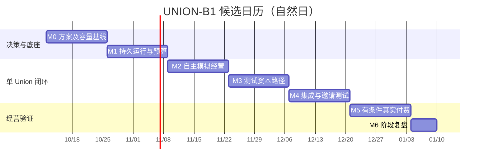

# UNION 运营方案

> 基线：UNION-B1 / 2026-10-09｜版本：v1.0 编制版｜候选周期：2026-10-12–2027-01-09。
> 运营对象是 UNION 平台的上线、支持和公共基础服务；Union 的具体经营由 AI 完成。本文不是人工代运营公司的招募或交付方案。
> 技术/产品见 [UNION项目方案.md](UNION项目方案.md)，工程任务见 [ISSUES.md](ISSUES.md)，规划与运营任务明细见 [OPERATIONS_ISSUES.md](OPERATIONS_ISSUES.md)。

## 1. 本期目标与边界

交付一家可观察、可恢复、独立记账的 AI Union；先完成模拟经营和测试资本闭环，再在真实收付款条件满足后开展七天自主经营实验。对投资人展示资金和证据，对客户提供可自助购买的数字产品。

平台人员建设通用能力、维护官网/文档、提供支持和采购专业服务；不替单个 Union 选客户、谈价格、制作产品或交付。平台测试招募、人工转介、平台补贴与 AI 自主获客分别标记。

| 本期必须有 | 可用最低形态 | 明确后移 |
| --- | --- | --- |
| 对外信息与联系 | 一个官网、一个邮箱、一个渠道、分角色表单 | 完整品牌手册、多个社区与大规模 SEO |
| 可信版本与文档 | 私有骨架先行；按确定范围公开；仓库 Markdown 文档 | 独立文档站、全文搜索、多语言体系 |
| 支持及事故处理 | AI 业务客服、平台支持、暂停与升级联系人 | 人工交付排班、人类承包者市场 |
| 经营证据 | 订单/回执、费用、干预和失败记录 | 大量宣传案例与未验证收益叙事 |
| 服务商业模式 | 基础套餐及用量账单，专项服务单列 | 平台股权默认分成、复杂平台币 |

## 2. 角色与资源

| 角色 | 主要责任 | 不应混入的动作 |
| --- | --- | --- |
| 发起人 F | 平台预算、范围与外部服务决策 | 代替某 Union 作日常经营决定 |
| 产品运营 O（全职） | 本期排期、官网文档、研究/测试招募、发布、平台支持和报告 | 将人工获得的订单计为自主获客 |
| 工程 E1（全职） | 运行、账本、业务流程、恢复与集成验证 | 用人工补账消除无法解释的差额 |
| 工程 E2（全职） | 界面、身份、沙箱、支付/链上接入及发布 | 以测试网通过替代真实支付/发行检查 |
| 专业服务 P（按需） | 实际主体、合同、财务、发行路径与专项安全检查 | 无证据地宣称所有地区和业务均受覆盖 |
| Union AI | 找机会、产品、定价、渠道、交付、售后和调整 | 修改自身硬预算、投资条款或网关权限 |
| 投资人 | 认购、观察、依条款领取/退出 | 配置 Agent、日常审批、经营救场 |

以上为排期假设，不代表已经招聘到人。每名全职人员每周按四人日计划；团队兼任不重复计产能。专业服务办理时间为外部依赖 E，独立跟踪。若只有一个工程人员，应改工期，不照抄双人并行表。

## 3. 里程碑与对外开放

| 里程碑 | 候选窗口 | 日期（示例） | 退出结果 |
| --- | --- | --- | --- |
| M0 决策基线 | W1–W2 | 2026-10-12–10-25 | PLAN-001–006；范围、验证、人员、预算与排期形成可执行基线 |
| M1 运行底座 | W3–W4 | 10-26–11-08 | ENG-008；持久运行、预算、授权、隔离与恢复 |
| M2 自主经营闭环 | W5–W6 | 11-09–11-22 | ENG-016/017；模拟订单、获客和平台计费可核对 |
| M3 测试资本闭环 | W7–W8 | 11-23–12-06 | ENG-022/023；测试募集、退款、权益与分配 |
| M4 集成 MVP | W9–W10 | 12-07–12-20 | ENG-029；工程验证、运营准备和 G1 邀请测试 |
| M5 真实付费试点 | W11–W12 | 12-21–2027-01-03 | ENG-030/031；G2 通过后完整观察七天，结果允许失败 |
| M6 阶段复盘 | D85–D90 | 2027-01-04–01-09 | ENG-032；依据证据决定后续，不自动扩展或发行 |

| 条件 | 允许开放 | 验收依据 |
| --- | --- | --- |
| G0 信息官网 | 介绍、联系与研究性意向收集 | OPS-012；只需信息站最小范围，不要求完整产品 |
| G1 邀请测试 | 测试网认购和模拟经营体验 | ENG-028 工程证据 → OPS-037 当前版本验收 → ENG-029 上线 |
| G2 真实客户付费 | 购买一个可自动交付的产品 | G1、E-PAID、ENG-030 及 OPS-037 的 G2 检查；平台自有实验资金支持 |
| G3 真实投资募集 | 真实认购及约定权益 | 至少 G1、E-ISSUANCE、ENG-034 的独立发行版本验收；无固定日期 |

M5 的商业目标可以失败，技术发布不以制造订单为条件。G3 是独立项目，真实融资不因进入 M6 自动开放。计划 T0 可变，一旦变动，由 PLAN-006 同步四份文件和任务系统；全表使用自然日，工作量另计人日。

## 4. 双周执行安排

| 时间 | 运营任务与最小成果 | 工程交接 | 本段可对外承诺 |
| --- | --- | --- | --- |
| W1–W2 | PLAN-001–006；OPS-001/003/007/014/016/027 草案或最小基线；确认业务范围、费用目录、实际人员及账户路径 | 技术小验证与 ADR；核心实现尚未验收 | 项目愿景与筹备状态，不承诺订单或募资日 |
| W3–W4 | OPS-004–012 的最小官网、联系入口；OPS-015/017–020/025 文档和流程骨架；OPS-034/039 支持与事故草案；OPS-026/028 实验和内容计划 | ENG-001/008；可部署环境与受限运行 | G0 信息与研究性需求收集 |
| W5–W6 | OPS-022/024/029 的模拟案例；OPS-035/036 自动经营流程；OPS-030 记录测试意向；OPS-038 接入早期指标 | ENG-016/017；模拟订单与初版数据 | 明示模拟的演示；未过 G2 不真实接单 |
| W7–W8 | OPS-021 测试资金/费用说明；OPS-024 接口更新；OPS-039 预发布演练；收敛 G1 所需文档 | ENG-022/023；测试资本与投资视图 | 测试计划及已验证能力，不展示真实权益 |
| W9–W10 | OPS-019/021/022/024/025/034/035/036/039 当前版验收；OPS-037 G1 检查；发布邀请与反馈入口 | ENG-025–028；OPS-037 后由 ENG-029 上线 | G1 限定测试范围 |
| W11–W12 | 更新 OPS-022/034/035/036/037 为 G2 版本；AI 运行真实业务实验；OPS-029/038 记录实际结果 | ENG-030/031；真实支付及连续七天观察 | 满足 G2 后才销售；有订单后才能发布对应案例 |
| D85–D90 | OPS-038/040 与 ENG-032 阶段复盘、预算调整和下期任务 | 已确认结果、成本与缺陷 | 已实现事实和下一步决定；不等于已平台化 |

前两周可以完成骨架和规划草案，验收仍需相应证据。一个编号允许按版本持续更新；不得因为“手册已写”就认为后续真实支付版也验收完成。

### 4.1 第一周的具体顺序

1. 第一天：明确 AI/投资人/平台边界、首版类别与成功/失败条件，形成 PLAN-001 初稿和预算假设。
2. 第二至三天：范围通过后验证持久恢复、外部动作幂等、预算与工具边界；Paperclip 复用最多占两工作日，不同时扩张多个框架。
3. 同周并行：发起人核实人员、主体/收款/发行目标地域；O 写官网结构、字段和说明草案；资料结果不代替真实账户可用性。
4. 第二周：根据验证更新选型和任务工作量，完成 PLAN-003/004 的跨文档映射与门槛，再完成 PLAN-005/006 的人员预算和日历基线。

若验证未通过、人员缺位或必要外部路径无解，M0 延长；可继续低成本草案，不能假装已按表进入 M1。

## 5. 容量与工作量控制

| 阶段 | E1 核心人日 | E2 核心人日 | 规划/运营协作额外人日 E1 / E2 | 产品运营分配上限 | 容量说明 |
| --- | ---: | ---: | --- | ---: | --- |
| M0 | 0 | 0 | 2.5 / 2.5 | 8 | 技术小验证含在 PLAN-002，不重复建 ENG 任务 |
| M1 | 7 | 6 | 0.5 / 1.5 | 8 | 两工程角色分别占用 7.5 / 7.5 人日 |
| M2 | 6 | 7 | 0.5 / 0.5 | 7 | 分别 6.5 / 7.5 人日 |
| M3 | 5 | 6.5 | 0.5 / 0.5 | 6 | 分别 5.5 / 7 人日 |
| M4 | 4.5 | 3 | 1 / 1 | 8 | 分别 5.5 / 4 人日，余量用于缺陷与联调 |
| M5 | 2 | 2 | 0.5 / 0.5 | 7 | 观察七天是自然日等待，不折算为七个人日 |
| M6 | 1 | 0 | 0.5 / 0.5 | 2 | 阶段复盘；若经营观察未结束则另排正式结项 |
| 合计 | 25.5 | 24.5 | 6 / 7 | 46 | 工程共 63 人日；运营为容量上限，含持续例行工作 |

工程本期 50 人日，加技术验证与运营工程协作 13 人日，共 63 人日的初始估算。双周每个工程角色最多八个人日；M6 每人预留四个人日的容量。核心任务的依赖路径还需在开工时分配到实际日期，不能仅凭总数足够认定排期成立。

产品运营的 46 人日是本期上限，已经包含规划、资料核对、测试招募、支持及例行工作；不是原 40 个 OPS 全量首次建设的工时重估。原全量为 51.5–82 人日，故必须以 MVP 子范围验收：OPS-002 仅文字标识，OPS-011 仅基础页面质量，OPS-020 仅仓库文档，OPS-025 仅主语言校验；OPS-023/031 延期，OPS-032 首期不启动。

每周从该周四人日中扣除例行工作后，才安排新增工作。首次建设完成后的支持/巡检不重复宣称为“免费”；当例行工作增加，优先减少内容和渠道数量。超过容量时，先减非关键范围，仍超出则顺延；资金与隔离缺陷不靠缩短验收解决。

## 6. 服务目录与收费运营

| 服务项 | 首版安排 | 计费及证据 |
| --- | --- | --- |
| 技术/托管基础服务 | 一个基础套餐 | 价格版本、期限、包含额度与实际开通记录 |
| 模型/外部 API 用量 | 上限内按明确单位计费 | 调用/用量、最大预约、结算、失败及冲正 |
| 展位 | 基本项目展示建议包含于套餐 | 额外展示后续单列，不伪装为独立投资推荐 |
| 募集服务 | 测试网展示费用模型；真实收费暂不启用 | 真实路径允许范围、费用触发、失败退款扣费规则 |
| 法律/财务/风险 | 专业服务目录及覆盖状态 | 服务方、地域、合同、价格、交付、未决事务 |

价格不是本文件凭空决定的市场报价。M0 建费目与上限，M2 用实际成本校准，G2 前形成可执行套餐。AI 应能查询价格、选择服务、取消或续订；投资人无需管理服务配置。

Union 付费必须有明确服务与账单；平台孵化补贴和关联服务收入单列。募集毛额、募集费用、启动净额、后续服务费和客户经营回款分别展示。平台一次性募集费收入不能作为 Union 客户需求成立的证据。

## 7. 预算台账与现金管理

| 成本中心 | 预算口径 | 释放条件 | 主要记录 |
| --- | --- | --- | --- |
| 平台研发 | 实际人员工时及支出 | PLAN-005/006 通过 | 人员投入、合同与成本 |
| 技术小验证 | 模型、API、临时环境 | PLAN-002 的单次上限 | 任务、最大成本、结果 |
| 共享运行 | 数据库、存储、网络、监测 | 需要的环境就绪 | 账单、按 Union 分摊依据 |
| 孵化研究 | 平台提供的研究额度 | 有来源与停止条件 | 提案、失败项与剩余额度 |
| Union 经营 | 自有实验资金；不借测试币充数 | G2 与预算条件满足 | 经营支出、来源与订单 |
| 专业服务 | 外部实际报价 | 明确服务范围与责任方 | 合同、费用、办理状态 |
| 缓冲 | 未承诺支出 | 变更评估后释放 | 原因、影响与余额 |

预算数字在 PLAN-005 由发起人填入实际币种和上限；总预算未定不影响文档编写，但不能据此进行采购。旧路书的 1,000 美元技术实验/300 美元单 Union 实验可作候选上限，不包含研发人力或法律财务专项费用。

每周核对预算、承诺成本、实际支付、未履约义务和可用余额。平台自有资金、单 Union 资本、客户款和第三方代收款分别归属；账务异常先暂停相关动作并核对，不用新认购填补旧项目分配。

## 8. 获客、内容与证据

平台传播围绕真实建设进展、公开设计和可核验演示。G0 收集关注与研究需求；G1 邀请测试；G2 后推广实际可购买服务。AI 自主经营的渠道动作归 Union AI，平台只提供授权工具和统一展示入口。

每条线索记录角色、来源、联系偏好、归属、下一步及状态。每个实验记录受众、预算、渠道、内容版本、停止条件和结果。曝光/访问/询盘/报价/支付/交付各用真实事件定义，不能把沉默线索算客户。

没有真实订单时用自建模拟演示，并标示测试；有订单后按客户授权展示脱敏证据。融资预测和经营结果分开。人工转介、关联客户、平台补贴和退款订单都单独标记；不靠发币交易量证明客户需求。

## 9. 支持、事故与人工参与

AI 处理产品解释、订单状态及规则内售后；平台处理账户、基础设施与专业服务问题。不能自动解决的经营事项进入受阻/暂停；涉及专业争议按实际责任方处理。专业服务的人工参与如实记录，不包装为机器独自完成。

| 等级 | 例子 | 动作 |
| --- | --- | --- |
| 发布阻塞/重大 | 重复支付、越权支出、串账、泄漏 | 立即暂停相关能力；E1/E2 和责任方核对；恢复前留存证据 |
| 履约受阻 | 交付失败、收款不明、退款失败 | 停止新增同类义务，查询外部状态，按合同处理 |
| 一般问题 | 内容过期、页面故障、普通咨询 | 记录影响、负责人、目标时间；按实际能力响应 |

响应时段由真实值守能力决定，首版不承诺无法覆盖的全天即时人工支持。重要事件至少记录发现时间、影响、暂停、外部回执、处理人、恢复验证和对外事实更新。

人工参与分为平台建设、通用设施修复、专业服务、经营干预四类。影响实验的修复或干预必须公开记录；需要重开观察窗时不能继续累计旧七天作为“无干预”。

## 10. 发布检查与验收责任

工程 E1/E2 提交版本与证据，O 组织官网/文档/支持验收，发起人确认平台可承担的范围。此处是平台版本发布职责，不是要求投资人审批 Union 的日常经营动作。

| 发布 | 必备记录 | 最终动作 |
| --- | --- | --- |
| G0 | OPS-012：入口、范围、联系通知、域名与恢复 | 仅发布信息官网 |
| G1 | ENG-028 + OPS-019/021/022/024/025/034/035/036/039，汇总 OPS-037 | ENG-029 部署当前测试版 |
| G2 | 服务/支付/退款/财务安排；ENG-030；OPS-022/034/035/036/037 的真实版记录 | 限定产品、预算与容量，开始真实业务 |
| G3 | ENG-034 独立范围、E-ISSUANCE、对应文件/检查与发布记录 | 仅按实际通过范围开放认购 |

每个版本填写：版本/提交、环境、开放人群、功能、资金性质、测试结果、已知限制、支持安排、停止条件、验收人、时间、证据链接。未来 G2/G3 记录不能倒逼 G1 等待发行准备完成。

## 11. 经营报告与周复盘

周报从第一周开始，没有订单也报告决策、投入、失败和阻塞。每周追踪范围、关键路径、预算、能力状态；M2 起补齐经营指标，G0 后按月发布适宜公开的摘要。

| 报告 | 最少字段 |
| --- | --- |
| 平台 | 活跃 Union、服务交付、分项收入、直接成本、补贴、支持工时与故障 |
| Union | 实际客户、订单/交付/退款、收入、全部平台费用、其他成本、现金与义务 |
| 自主性 | 运行窗口、AI 动作、人工参与类别、暂停时间及失败原因 |
| 融资 | 测试/真实分开；毛额、费用、启动净额、权益及已发生分配 |
| 项目进度 | 已验收事项、阻塞、角色负荷、里程碑预测和下周优先项 |

M6 决定继续、缩小范围、暂停或准备扩张。一笔订单只是闭环证据；尚未满足三十天和重复交易等升级条件时，不扩大真实经营 Union 数量。发生已结算差额、串账或未授权支出时，优先修复，而非继续增长。

## 12. 变更与未决事项

本次已完成文档编制和依赖映射；未完成实际技术小验证、账户开通、人员确认、报价或经营实验。PLAN-001–006 的实质验收仍需负责人及证据，不因文件存在自动打勾。

未决事项按负责人/期限/影响/临时策略跟踪：实际人员与 T0（发起人，M0）；业务能力和模型/支付/渠道可用性（技术与产品，M0）；真实服务主体和支付（发起人/专业服务，G2 前）；投资地域和发行路径（发起人/专业服务，G3 前）。未通过 G3 不阻止已获准的自有资金经营实验。

每次变更先判断对产品原则、任务依赖、角色容量和资金条件的影响。变更编号、原因、取舍、旧/新日期和受影响任务进入 PLAN-006；跨文档同步后才更新对外路线图。
