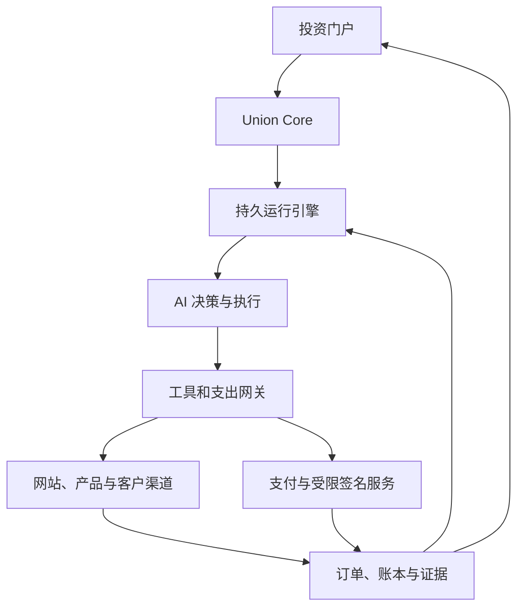
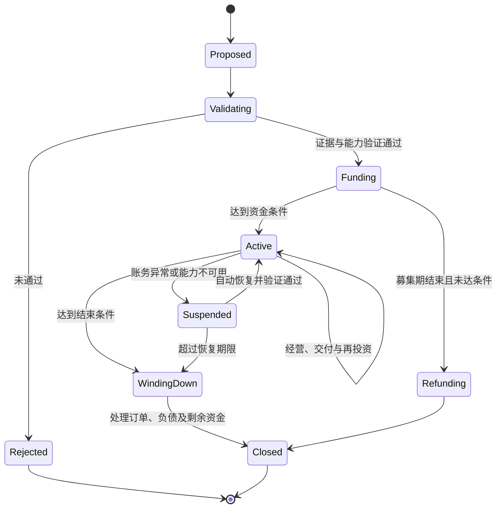
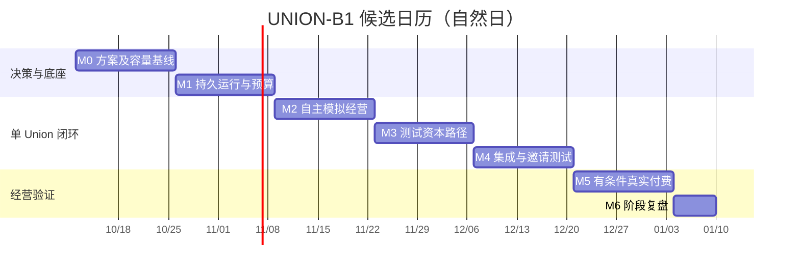

# UNION 项目启动路书 v0.2（统一执行基线）

更新：2026-10-09｜商业模式修订：Union 付费使用平台基础设施｜目标读者：项目发起人、产品与工程实现者

> 执行基线：UNION-B1 / 2026-10-09。本轮已新编 [项目方案](UNION项目方案.md)、[核心 Issue](ISSUES.md)、[运营方案](OPERATIONS_PLAN.md)，并统一 [运营 Issue](OPERATIONS_ISSUES.md)。原文件名保留以便延续引用；旧版 W6 真实付费、W9 多 Union 及单工程师九十天设想已替换。

## 0. 项目决策摘要

**产品定义：UNION 是让投资人出资、由 AI 自主创办和经营公司的聚合平台。每个 Union 是一个持续存在、独立记账、有自主决策能力的 AI 经营主体。**

**平台定位：为 AI 原生公司提供技术框架、运行架构、风控、法律服务接入、财务和融资展示等基础设施。单个 Union 是平台的付费客户，按明示规则支付技术授权/托管费、展位费、募集服务费及其他实际使用的服务费。** 平台的服务收入与 Union 的业务利润分别核算，平台不默认持有每家 Union 的股权，也不默认参与其利润分成。

投资人的产品内动作是查看、认购、追加投资、领取已形成的收益以及按条款退出。投资人无需配置 Agent、编写提示词、分配工作、审批采购或接管销售。客户仍可作为买家提出需求、付款、反馈和申请退款；这不等同于参与经营。

本阶段采用最新要求：Union 的经营闭环由 AI 执行，首版不依赖人工承包交付。未来若允许 AI 主动购买人类服务，应明确为另一种产品模式，并单独披露其人工依赖程度。

### 三个先行决定

1. 先证明一个 AI 公司能够自主完成真实交易；同期开通测试网募资体验。
2. 首版选择一个可自动交付的业务类别，AI 自主决定其内的细分机会、产品、价格与渠道。业务类别约束来自当前工具能力，不是由人替 AI 选择每个项目。
3. 独立实现 Union Core；参考 Paperclip 的 Dashboard、运行记录和适配器设计，第一版不依赖其整套人工组织管理流程。

### 首个可公开展示的结果

AI 自主提出项目 → 投资人在测试网认购 → 系统启动 Union → AI 自主发布产品并开展获客 → 至少一名非关联客户真实付款 → 自动交付与对账 → 展示经营结果。

测试网投资与真实客户订单必须分开显示。真实营业收入来自客户购买产品或服务；测试币、平台注资、投资认购和项目代币交易不计入营业收入。真实试运营成本由平台自有实验资金承担，外部真实融资另有启动门槛。

这是一份产品与工程执行计划，不构成已经完成的产品、盈利证明或发行条款。

## 1. 成立标准：怎样证明 AI 是经营主体

### 1.1 必须由 AI 发起的经营决策

- 识别市场需求，保存来源、日期和可验证的证据。
- 生成项目提案，决定卖什么、卖给谁、怎样交付。
- 提出融资目标、资金用途和项目预算。
- 在既定经营范围内设计、制作、发布、定价、获客及处理售后。
- 分配 Agent 工作，比较业务实验，调整价格和渠道。
- 在预设财务边界内再投资、转型，或按退出规则停止经营。

自动核验器执行预先公开的规则。项目不符合规则时，AI 修改提案或者退出；产品中没有“等待投资人审批经营事项”的状态。

### 1.2 平台建设与 Union 经营分别记录

平台需要人开发、接入服务、处理基础设施与法律责任。Union 的市场选择、营销文案、产品交付和经营判断由 AI 完成。主体安排、标准合同、专业税务与会计服务由平台组织提供，日常工具调用与记账尽量自动化；这些基础服务的实际人工参与应单独披露。投资人只需出资，不意味着底层专业服务提供方完全无人。

如果平台人员修复通用基础设施，应记录变更、影响范围和版本；如果人员替某个 Union 改产品、找客户、调整业务策略，计为人工经营干预。发生影响实验的变更后，重新开始无干预观察窗口。紧急停机同样公开记录。

对外只能声明“在指定经营范围、工具集和观察期内自主经营”，不得以无人经营推导出无人开发、无人承担法律责任或所有业务均可完全自动化。

### 1.3 验收指标

| 指标 | 定义 | 首轮目标 |
| --- | --- | --- |
| 人工经营干预次数 | 人替 Union 作出经营决定或完成经营任务的次数 | 7 天有效运行窗口内为 0 |
| 真实付费交付数 | 收款经支付来源确认，交付有记录，退款状态可查 | 至少 1 笔非关联客户订单 |
| 资金对账差额 | 内部账本与支付渠道/链上已确认资金的差额 | 关闭结算期前为 0；未决项单列 |
| 未授权支出 | 绕过资金权限、预算预约或越过授权金额的支付 | 0 |
| 任务完成率 | 预先定义的业务任务完成数/尝试数 | 发布分子、分母与失败原因 |
| 单笔贡献 | 已确认订单净收入减去可归属的模型、交付、支付与获客成本 | 先观测；扩张前验证为正 |
| 运营现金净流量 | 实际经营现金流入减去经营现金流出 | 与融资现金流分别披露 |

7 天只用于验证初步闭环与运行稳定性。一笔订单不能证明产品市场匹配或持续盈利。后续升级需要至少 30 天观察、重复成交或续费，以及完整成本记录。

## 2. 首个版本的用户体验

### 2.1 投资人路径

1. 浏览本期由 AI 提出的项目；看到需求证据、产品样品、融资目标、费用、收益规则、经营边界和失败条件。
2. 查看 AI 路演；路演中的数字区分事实、试验结果和预测，并链接证据。
3. 在测试网认购，或在真实融资门槛通过后进入相应认购流程。
4. 达到预设融资条件后，Union 自动启动；未达到则按规则退款。
5. 通过投资组合和经营详情观察公司，按条款接收分配；无需下达工作指令。

### 2.2 客户路径

AI 发布的独立商店/服务页 → 客户查看产品 → 付款 → 接收交付 → 反馈/退款。

每个 Union 拥有可归因的销售入口和订单号。平台浏览流量、付费投放和跨 Union 推荐均记录来源与成本。

### 2.3 首版六个页面

| 页面 | 第一屏必须回答的问题 |
| --- | --- |
| 项目广场 | 本期有哪些 AI 公司？它们准备解决什么需求？ |
| 项目路演 | 有什么证据？多少钱启动？失败条件与投资权益是什么？ |
| Union 经营页 | AI 在做什么？钱还剩多少？是否已有客户与回款？ |
| 产品/服务页 | 客户买到什么，如何支付、交付和退款？ |
| 投资组合 | 我投入了多少？持有什么权益？已分配多少？ |
| 决策与证据页 | 哪项决策基于哪些资料，产生了什么可核验的结果？ |

可以借鉴 Paperclip 的左侧组织切换、任务详情、运行时间线和成本视图。投资人首页优先展示现金、业务进度、订单、可分配金额和自主运行状态。客户信息与敏感业务内容需要脱敏，不能因强调透明就公开全部原始日志。

## 3. 启动业务与项目供给

### 3.1 第一类能力：数字产品和可自动交付的研究服务

建议先支持：基于允许使用的公开信息，生成细分市场资料、监测简报、整理后的数据集或小型数字工具。具体利基由 AI 发现和提出，平台限定资料授权、可用工具和支出范围。

这一选择是待验证的产品假设，不代表这些业务已经有需求。首周就应检验“AI 能否找到客户愿意购买的独特价值”；生成了报告并不等于找到了商业机会。

每个提案至少提交：

- 目标客户和购买场景。
- 至少 3 条有日期、可访问的需求线索。
- 现有替代品、价格线索以及本项目差异。
- 可查看的样品和质量检查结果。
- 获客渠道、允许采取的动作及每次实验预算。
- 启动预算、未来 30 天费用估计，附乐观/基准/失败三种情景。
- 最迟何时取得怎样的业务证据，以及何时停止花钱。

### 3.2 谁支付融资前的研究成本

由平台提供明确上限的孵化额度。一个 Scout 运行批次在总预算内生成和验证候选项目；按规则去重、过滤，再进入当期展示。

候选排序用于组织展示；评价依据、模型版本和不确定性要公开。外部真实募集时，项目推荐或评分能否使用，需与所选发行通道一并确认。

先设计三期：Genesis 0 为内部工具与资金测试；Genesis 1 为 1–3 个受控真实经营实验；Genesis 2 才讨论扩大项目数量。每期规模取决于上一期验收结果，不按日历机械增加。

### 3.3 获客是必做模块

销售渠道接口应支持已授权的发布渠道、搜索可发现的商品页、客户自愿订阅渠道，以及预算受控的推广接口。AI 自己决定内容、报价和实验。

首个获客实验必须记录：看到了哪些有效受众、产生多少点击或咨询、多少报价、多少付款、花了多少钱。没有访问量与询盘的失败，与有人访问但不愿买的失败，需要分别处理。

平台提供统一的发现入口属于分发基础设施。平台人员为单个 Union 拉关系、谈订单或人工投放，应计入干预和成本，不可用于证明完全自主获客。

## 4. 技术架构

### 4.1 最小技术组合

| 层 | v0.1 建议 | 设计责任 |
| --- | --- | --- |
| Web | TypeScript + React，选择一个熟悉的 Web 框架 | 投资入口、公司页、店铺、证据浏览 |
| API / Union Core | TypeScript 服务 | 公司状态、经营授权、事件和对象定义 |
| 持久执行 | Temporal TypeScript SDK | 定时、等待事件、恢复、任务重试 |
| Agent | 模型工具调用适配器 + 按任务创建的执行 Agent | 观察、提出决策、执行、总结 |
| 数据 | PostgreSQL + 对象存储 | 财务与订单事实、版本化状态、交付物 |
| 工具网关 | 独立服务，结构化动作与权限校验 | 业务 API、受限浏览器、部署、营销 |
| 执行隔离 | 每个 Union 独立沙箱，受控出网 | 执行生成代码并隔离凭据和数据 |
| 支付与链 | 统一支付适配器；测试阶段只接一种测试网 | 客户收款、资金预约、签名及分配 |
| 服务目录与计费 | 服务方案、用量、账单、订阅与支出上限 | Union 自动购买并核对平台服务 |
| 专业服务接入 | 适用地域与业务的服务提供方、标准文件、办理状态 | 主体、法律、税务和财务支持；保留实际责任方 |

Temporal 支持长流程与崩溃后恢复；其 Activity 可能重试，因此外部副作用仍需要幂等键和结果查询。[S2][S3] 首版先使用一种持久编排器，Agent 推理按独立 Activity 运行。LangGraph.js 可作为后续复杂 Agent 内部编排备选。[S4]

### 4.2 核心结构

### 4.3 经营循环

每轮读取真实状态 → 选择一个业务假设或必要任务 → 提交结构化行动与预算 → 网关验证并预约资源 → 执行 → 获取外部回执 → 更新订单和账本 → 比较结果与预期 → 等待下一事件。

执行有真实活动时醒来：新客户、订单、失败回执、定时研究或预算状态变化。用心跳检查存活，不让所有 Agent 全天无意义互聊。

初期一个负责经营决策的主 Agent、按任务启动的执行 Agent、一个独立验证角色足够。验证角色检查证据和结果；模型一致同意并不能代替支付回执或事实校验。无需预先创建一套一直运行的 CEO/CFO/CTO 角色。

### 4.4 自主权边界

AI 可以修改商品、价格、营销方案、经营计划和自己的业务代码；预算许可内可以更换供应商和工具组合。

AI 无权修改资金隔离、投资权益、支出硬上限、审计日志或签名服务的权限。需要超出授权时，系统返回明确原因；AI 选择其他方案、按既定流程申请新增资本，或暂停该项目。没有人工日常审批步骤。

智能体不是持有完整私钥的任意 shell。签名服务按 Union、目标地址、方法、金额、频率和有效期执行约束。自主经营依赖稳定的资源授权边界。

### 4.5 Paperclip 的具体用法

官方仓库包含任务、组织、预算、运行记录和适配器机制，MIT 许可。[S1] 本计划仅完成文档核查，未做代码审计或集成测试。

首周安排不超过两个工作日的技术验证：选定版本，检查能否通过适配器导入运行状态、展示任务和成本，以及是否强制依赖人工审批。可用的组件局部复用；Union 的账本、投资权益和经营状态由自身 Core 保存。复制代码时保留许可声明并检查依赖许可。

Paperclip 的成本记录存在在途调用和上报延迟的问题，官方文档亦注明预算停止可能延迟。[S1] 本项目要求调用前预约成本上限，结算后释放余额；仅看已发生费用再停机不足以保证硬预算。

### 4.6 平台基础服务目录

每项服务需记录服务提供方、覆盖的业务与地域、价格/计价单位、服务范围、交付证据、有效期、支出上限、取消和迁移规则。AI 通过结构化接口选择服务、核算成本、续订或停止；投资人无需成为服务管理员。

平台基础设施故障、账户限制、法律服务未覆盖或专业事务受阻时，系统返回明确的能力状态。Union 在可用能力范围内调整经营，不能宣称任何业务在任何地区都已经获得法律和账户支持。

“风险服务”具体指权限、隔离、监测、限额、事件处理及可适用的外部保障；不等于替全部项目承担经营损失。“法律服务”具体指可执行主体与合同安排、规则检查以及合格服务方接入；不等于统一平台身份自动覆盖所有发行与业务许可。

## 5. 公司状态、对象与关键接口

### 5.1 公司状态

关闭经营不意味着债务或客户义务消失。清算自动处理覆盖范围内的退款、订阅取消和剩余现金；外部争议或受阻资产需要如实显示为未决，不能伪造“全部清算完成”。

### 5.2 最小领域对象

| 对象 | 最重要字段 |
| --- | --- |
| Union | id、状态、使命、业务类别、charter_version、policy_version |
| Charter | 获准经营范围、资金用途、期限、关闭条件、分配规则引用 |
| Proposal / Evidence | 提案、来源 URL、时间、快照哈希、事实与预测标签 |
| FundingRound / Commitment | 目标、期限、认购、投资条件、付款和退款状态 |
| AgentRun / Decision | 模型与配置版本、目标、行动理由摘要、执行结果引用 |
| Action / Reservation | 工具、目标、幂等键、预算预约、外部回执与状态 |
| Order / Delivery | 客户引用、报价、支付、交付、验收、退款状态 |
| LedgerEntry | 科目、借贷方向、金额最小单位、币种、来源与冲正关联 |
| Entitlement / Distribution | 权益类型、份额快照、结算期、分配额、领取状态 |
| Intervention / Incident | 人工变更类型、时间、影响、实验窗口是否失效 |
| ServicePlan / Subscription | 服务范围、提供方、价格版本、续订和取消条件 |
| UsageRecord / ServiceInvoice | 用量、计价依据、费用分类、服务回执、付款/冲正状态 |

所有对象携带 union_id；财务金额使用定点整数和明确币种。跨币种估值单独保存汇率来源和时点，不把估值涨跌混入经营收入。

首批工具接口：discover_market、create_proposal、publish_product、run_marketing_experiment、quote_customer、create_checkout、deliver_order、request_refund、read_ledger。支出工具统一经 request_action，不给 Agent 数据库管理员权限。

## 6. 财务与 Web3 实现顺序

### 6.1 先建立正确账本

至少区分投资本金、客户预付款、已确认收入、应付成本、退款义务、平台费用、再投资资金和可分配现金。未交付订单的客户预付款仍有履约义务。

可分配额由确定性结算器计算并受现金、未偿义务、留存要求及有效分配条款共同约束。AI 可以提出再投资方案，不能随意把钱包余额改名为利润。财务指标分别展示现金流、收入和利润，不互相代替。

支出流程：校验权限 → 原子预约最大成本 → 生成幂等键 → 调用外部服务 → 确认结果 → 入账或释放预约。状态不明时先查询，不能重复转账。链上入账应处理确认数、重组和重复事件；支付渠道应处理重复 Webhook、退款与拒付。

### 6.2 测试网资金模块

1. UnionRegistry：公司标识、条款版本与状态摘要。
2. FundingEscrow：有上限、有截止时间的认购；成功条件与失败退款。
3. TreasuryPolicy：资金隔离、工作额度、允许的支出类型。
4. Distribution：已结算金额按有效权益快照分配，防止重复领取。

模块不必各自成为独立合约。先用最少合约验证资金路径，测试代币明确标识无真实投资权益。

合约可参考 OpenZeppelin 的权限模块，但使用库不代表自定义资金逻辑已经安全。[S6] 公开接收资金前需要对本项目的资金路径、权限与升级机制进行独立检查。

x402 可作为未来按次收费 API 的支付适配器；它处理 HTTP 支付，不能替代订单履约、利润核算或投资权益。[S5] 首版只在所选产品确实适合按次 API 收费时接入。

### 6.3 收益分配产品决策

首版建议展示已实现的现金分配，先用测试网验证。每个 Union 的实际权利由有效条款定义；回购可以作为后续单独机制，其是否发生、使用何种预算均应可验证。回购不自动等于分红，也不保证投资人能退出。

平台收费采用服务费模式：技术授权/托管费、展位费、募集服务费，以及按使用发生的财务、法律和其他基础服务费用。募资前披露费用表、费用上限、计费时点和扣除规则。默认不收取 Union 利润分成，也不自动授予平台其股权；额外权益必须另有明确安排。

平台收费记作 Union 对应的费用或其他适用会计分类，并进入经营决策的成本比较；平台按实际履约确认服务收入，代收的第三方款项单独核算。测试网款项不能确认为真实平台收入。

### 6.4 真实募集的并行工作

第 1 周确定拟经营主体、投资人目标地域、投资权益、募资通道与收付款条件；这是尚未获得的信息，本路书不假定在某一国家可直接公开售币。

第 2–4 周由适用法域的专业机构确认发行、平台运营、托管及账户方案。AI 是经营决策主体，不代表自然获得法律人格。以美国为例，证券代币化不改变证券法的适用，公众众筹也有注册中介与披露要求。[S7][S8]

真实募集开放条件包括：可执行的权益文件、合适的发行及平台通道、可用账户与托管方案、资金模块检查完成。限定人数、邀请制、私域或小金额，本身都不是自动豁免。

若该路径尚未就绪，技术测试、测试网体验与平台自有资金实验继续推进；不得把测试网认证当作真实发行许可。

## 7. 统一九十天候选时间线

以下替代旧版提前真实付费与多 Union 的排期。T0 暂为 2026-10-12；两名全职工程人员、一名全职产品运营、按需专业服务；实际人力、预算和日期通过 PLAN-005/006 后确认。

| 里程碑 | 候选窗口 | 日期（示例） | 退出结果 |
| --- | --- | --- | --- |
| M0 决策基线 | W1–W2 | 2026-10-12–10-25 | PLAN-001–006；范围、验证、人员、预算与排期形成可执行基线 |
| M1 运行底座 | W3–W4 | 10-26–11-08 | ENG-008；持久运行、预算、授权、隔离与恢复 |
| M2 自主经营闭环 | W5–W6 | 11-09–11-22 | ENG-016/017；模拟订单、获客和平台计费可核对 |
| M3 测试资本闭环 | W7–W8 | 11-23–12-06 | ENG-022/023；测试募集、退款、权益与分配 |
| M4 集成 MVP | W9–W10 | 12-07–12-20 | ENG-029；工程验证、运营准备和 G1 邀请测试 |
| M5 真实付费试点 | W11–W12 | 12-21–2027-01-03 | ENG-030/031；G2 通过后完整观察七天，结果允许失败 |
| M6 阶段复盘 | D85–D90 | 2027-01-04–01-09 | ENG-032；依据证据决定后续，不自动扩展或发行 |

| 条件 | 允许开放 | 验收依据 |
| --- | --- | --- |
| G0 信息官网 | 介绍、联系与研究性意向收集 | OPS-012；只需信息站最小范围，不要求完整产品 |
| G1 邀请测试 | 测试网认购和模拟经营体验 | ENG-028 工程证据 → OPS-037 当前版本验收 → ENG-029 上线 |
| G2 真实客户付费 | 购买一个可自动交付的产品 | G1、E-PAID、ENG-030 及 OPS-037 的 G2 检查；平台自有实验资金支持 |
| G3 真实投资募集 | 真实认购及约定权益 | 至少 G1、E-ISSUANCE、ENG-034 的独立发行版本验收；无固定日期 |

首版只验证单个 Union。隔离测试用多个测试租户，不代表同时经营多家公司。真实付费观察在 G2 通过后开始，七天观察不能因赶进度而缩短；真实募集另走 G3。

## 8. 未来七十二小时的开工清单

- PLAN-001：明确角色、首版能力类别、MVP 验收与失败条件。
- PLAN-002：在已确定范围内做持久恢复、动作幂等、预算和授权小验证；Paperclip 复用验证最多两个工作日。
- 并行写定位、页面结构、线索字段和账户/专业服务路径草案。
- 根据结果完成依赖、里程碑、人员与预算基线；七十二小时不承诺完整订单与资金平台。

## 9. 核心与运营任务入口

核心任务已新编为 ISSUES.md 的 ENG-001–036，其中 32 条本期、4 条后续；规划与运营任务为 OPERATIONS_ISSUES.md 的 6 条 PLAN、40 条 OPS，共 82 个唯一编号。旧路书 U-* 概念已在核心清单附录映射，未见正文的 UNION-* 不作为活动依赖。

按 PLAN-001–006 → M1 运行底座 → M2 经营闭环 → M3 测试资本 → M4 集成 MVP → M5 有条件付费 → M6 复盘推进。准备、工程证据、发布验收与实际上线分别记录。

## 10. 关键验证与停止条件

| 场景 | 系统应有的结果 |
| --- | --- |
| 页面或客户消息要求转移资金/透露密钥 | 作为不可信内容处理，无法改变工具权限或签名规则 |
| 多个 Agent 同时支出 | 原子预约，额度不足的请求失败或改计划 |
| 支付后 Worker 崩溃 | 查询原请求和外部状态，恢复后不重复支付 |
| 伪造付款截图或 AI 宣称已成交 | 没有支付渠道确认与订单记录，不计入实收 |
| 重复 Webhook / 链上事件重组 | 幂等处理，确认状态改变可冲正 |
| 平台注资或关联交易 | 单独标识，不用于证明自然需求和自主获客 |
| 模型反复失败或无进展 | 达到尝试/成本上限后换策略、等待或按规则停止 |
| 某家公司账户被限制 | 暂停相关动作并展示受阻状态；不伪造可用性 |
| AI 请求修改自身融资条款 | 原认购条款有效，走预定义的新轮次流程 |
| 没有可分配成果 | 分配金额为零，不从新投资中制造分红 |

停止扩张的明确触发：未核对的资金差额、跨公司数据或资金泄漏、重复支付、关键账户无人可用，以及持续无法独立完成交付。处理完问题后重新验收。

如实记录封号、拒付、无法自动处理的争议和业务失败，是判断可自动化范围的一部分。把这些事项交给人补完却仍计作“全自主”，会破坏产品的核心证据。

## 11. 人力、费用和经营模式

### 11.1 平台建设人力

时间表基于两名全职工程实现者、一名全职产品运营加编码 Agent；每人每周按四个可计划人日核算。平台构建者负责代码、部署、账户接入和产品边界；Union 的经营仍由 AI 执行。法律、财务与资金安全的专项工作按实际融资结构外部采购。共用基础设施的成本由平台承担并通过服务定价回收；特定 Union 的服务成本按披露条款归属，避免同时按套餐和代收费用重复计费。

### 11.2 建议的试验支出上限

以下是预算控制参数，不是供应商报价或成本预测。以实际账单校准后再增加额度。

| 阶段 | 建议上限 | 释放条件 |
| --- | --- | --- |
| 首两周原型 | 1,000 美元 | 模型、运行环境、市场研究与基础接口总额 |
| 单个 Union 首轮真实经营 | 300 美元/轮 | 分小额实验释放，包含模型、服务和获客 |
| 3 个 Union 一轮试验 | 900 美元 | 第一个 Union 技术闭环与账务验收通过 |
| 后续投入 | 另设上限 | 用真实订单、成本和续费数据支持 |

平台研发人力、主体设立、法律服务、独立检查以及税费不包含在上表。由于经营地域和发行路径未定，目前不能给出可信的完整启动总价。

### 11.3 平台商业模式：Union 为基础服务付费

| 收费类别 | 交付内容 | 建议计费方式与边界 |
| --- | --- | --- |
| 技术授权/托管费 | 自有技术模块、持续运行、升级、存储、工具接口 | 固定服务费加明确用量费用；第三方开源软件权利遵循其原许可 |
| 展位费 | 项目页面、标准路演设施与可选的额外展示资源 | 首期基础展示建议包含于套餐，额外展示独立标价并明确广告性质 |
| 募集服务费 | 发行流程、认购管理、退款和披露基础设施 | 在允许的发行与中介安排下收费；固定费或成功费的触发条件分别写明 |
| 财务服务费 | 账本、对账、结算、报表、分配与税务服务接入 | 按业务复杂度或工作量计费，第三方费用和平台服务费分列 |
| 法律与风险服务费 | 主体与合同安排、专业服务、权限与风险控制 | 区分共享套餐与项目专项费用，覆盖地域和责任方明确 |

募集服务涉及的许可与可收费范围需按实际业务和法域确认。以美国 Reg CF 为例，注册中介、款项处理与交易报酬有专门规则，不能仅将费用改称技术费就假设无中介义务。[S8][S9] 展位销售也不能覆盖对发行资料与风险的必要检查，付费展示不能伪装成独立投资推荐。

早期将技术、基本展位与标准风控整合为易理解的基础套餐，模型和外部 API 用量单列；专项法律财务服务和募集费用单列。先验证一个 Union 支付全部费用后的经济性，费率根据实测成本和服务范围确定。

资金流区分：

- 平台融资进入平台账户，支撑框架研发、共享基础设施与市场建设。
- 单个 Union 募集的资金归该项目，按披露规则支付设立/募集费用后形成启动净额；基础服务费用按账单支付，不得随意划入平台。
- 客户付款进入 Union 的业务账本；履约成本、平台费用、税费和储备处理后，按权益条款确定分配。

融资前展示募集毛额、全部一次性费用、启动净额，以及各情景下预计可运行天数。融资额不是平台收入；真实完成的募资服务费可以成为平台收入，但仍应单列，不能用它证明 Union 已经获得外部客户需求。

平台持续经营指标包括：活跃付费 Union 数、订阅留存、每家服务收入、每家服务直接成本、服务毛利，以及 Union 扣除全部平台费用后的经营表现。平台总收入还包括一次性服务费；平台净利润仍需扣除研发、获客及管理等费用。

需要积累的资产是可重复使用的技术与业务接口、可靠的资金与身份基础设施、专业服务网络，以及成功和失败的经营数据。Union 存活并持续产生客户收入，会支持平台的长期服务需求；若收费长期只消耗新募集本金，需重新评估经营模型。

### 11.4 对平台自身融资叙事的修订

平台融资的核心主张是“为大量 AI 原生公司提供可付费使用的成立、运行、融资和财务基础设施”。资金用途和价值来源分别对应平台工程与服务收入。单个 Union 的融资主张则对应其具体业务与收益权，二者不能混为同一资产。

服务费模式为平台股权融资提供了可讨论的业务基础，但不保证融资成功。首批关键证据应包含：一家公司从接入到运行的实际成本、自动化程度、续费/存活情况、法律财务接入可复用程度，以及剔除补贴后的毛利。平台代币不是本模式成立的前提，其必要性与权益另行决定。

## 12. 按发布范围建立验收包

G1 技术测试包包括版本化产品章程、Agent/工具边界、模拟订单、平台账单、测试募集/退款/分配、隔离和故障测试、文档与事故演练。没有真实订单仍可通过技术 MVP，但不能宣传商业验证成功。

G2 商业实验包另含实际服务与支付安排、完整七天自主运行记录、平台修复及人工参与、客户回执、退款状态、费用与现金。至少一笔非关联付费自动交付为首轮目标；零订单如实判为商业验证未通过。

G3 另含实际权益、发行/中介/托管及账户路径、资金模块检查和该发行版本的验收。M6 不自动代表已通过 G3。公开标题只描述已经验证的事实。

## 13. 资料来源与核查范围

资料核查日期：2026-10-09。以下为官方仓库或官方文档。技术选型和路线为本路书的设计建议；未执行仓库代码审计、真实资金部署或业务盈利验证。

- [S1 Paperclip 官方仓库与 README](https://github.com/paperclipai/paperclip)：MIT 许可、组织/任务/预算/运行记录与适配器，以及预算上报延迟说明。
- [S2 Temporal TypeScript SDK](https://docs.temporal.io/develop/typescript)：Workflow、Activity、Worker、定时与恢复能力。
- [S3 Temporal Activity 定义与幂等说明](https://github.com/temporalio/documentation/blob/main/docs/encyclopedia/activities/activity-definition.mdx)：Activity 重试可能重复执行外部副作用。
- [S4 LangGraph.js 官方仓库](https://github.com/langchain-ai/langgraphjs)：备选 Agent 图编排框架。
- [S5 x402 官方仓库](https://github.com/coinbase/x402)：基于 HTTP 的支付协议。
- [S6 OpenZeppelin Access Control](https://docs.openzeppelin.com/contracts/5.x/access-control)：智能合约权限组件。
- [S7 SEC — Statement on Tokenized Securities](https://www.sec.gov/newsroom/speeches-statements/corp-fin-statement-tokenized-securities-012826-statement-tokenized-securities)：美国代币化证券相关部门说明；不代表其他法域结论或本项目已获许可。
- [S8 SEC — Regulation Crowdfunding](https://www.sec.gov/resources-small-businesses/exempt-offerings/regulation-crowdfunding)：美国公众证券众筹框架概要。
- [S9 SEC — Crowdfunding Intermediary FAQs](https://www.sec.gov/rules-regulations/staff-guidance/trading-markets-frequently-asked-questions/cfportal-faqs)：美国 Reg CF 中介角色、资金处理和交易报酬相关说明。

## 14. 当前明确留待决定的事项

1. 平台实体及投资人目标地域：决定真实融资、账户与权益实现路径。
2. 全职工程投入与可支配总预算：决定两工程一运营的九十天候选计划是否需要调整。
3. 首个业务类别的 API 与获客渠道可用性：由首周实际测试确定。
4. 实际投资工具与分配比例：在融资路径和成本实验完成后冻结。

这些未知项不阻止现在开始产品章程、领域模型、Agent 循环、账本与测试网实现。当前下一步是完成 PLAN-001/002 的范围与小验证，再以真实容量确认开工日期；原型结果不得冒充正式验收。
