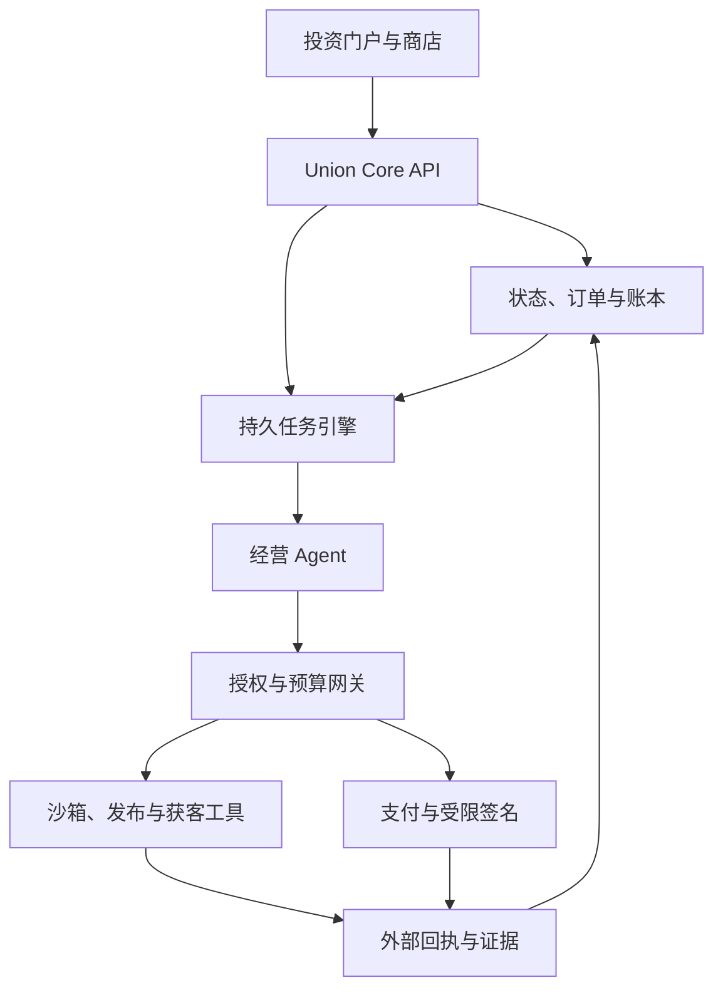
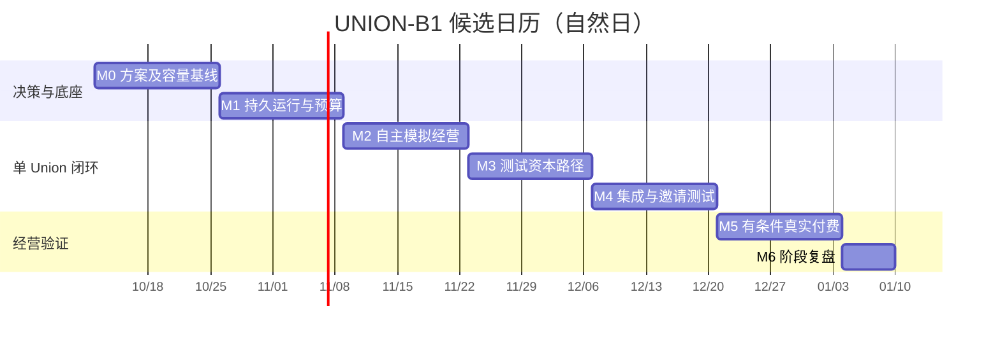

# UNION 项目方案

> 基线：UNION-B1 / 2026-10-09｜版本：v1.0 编制版｜状态：可用于技术验证和开工准备；实现、主体安排及人员预算尚未验收。
> 本文为新编方案，不是从缺失文件中恢复的原稿。与 ISSUES.md、OPERATIONS_PLAN.md、OPERATIONS_ISSUES.md 同批对齐。旧启动路书用于背景参考，其提前付费和多 Union 排期由本基线替代。

## 1. 产品定义与不变原则

UNION 是为 AI 自主公司提供成立、运行、展示、融资和财务基础服务的聚合平台。每个 Union 是持续存在、有独立状态、预算、账本和经营目标的 AI 公司实例。AI 主动寻找机会、提出业务、制作产品、获客、交付和调整策略；投资人只出资、查看结果及依约领取分配。

平台为 Union 提供技术授权/托管、展位、募集工具、风险控制及法律财务服务接入，并按公开规则收费。平台收入与 Union 的业务收入、利润及资金分别核算；平台默认不持有每家 Union 股权、不自动参与其利润分成。平台自身融资和单 Union 融资是两个独立用途和账本。

“AI 是主体”描述经营决策与执行。平台建设、通用设施维护和专业服务需要实际责任方；这些服务的参与、成本和范围公开记录。投资人不承担 CEO、CFO、CTO 或日常审批工作。客户提出需求、付款和反馈属于购买行为，不属于帮助经营。

## 2. 首版业务范围与成功标准

默认业务能力类别：基于允许使用的公开信息，制作可自动交付的细分市场简报、资料包或小型数字工具。具体机会、产品和价格由 AI 在能力范围内选择。M0 验证该类产品是否有差异化价值、合法可用的数据源、可用渠道及支付通路；类别失败可更换，但仍限制为一个类别。

| 纳入技术 MVP | 暂不纳入 |
| --- | --- |
| 一家经营 Union；一个主 Agent 与临时执行 Agent | 多行业通用经营、多个实际经营 Union |
| 机会证据、样品、项目提案、单渠道实验 | 人工承包市场、人工销售与交付排班 |
| 一个数字产品模板、一个支付适配器 | 多支付商、多币种经营结算、复杂订阅组合 |
| 自动交付、退款、账本、平台服务账单 | 平台币、自由转让市场、做市、回购 |
| 单 EVM 测试网认购、失败退款、份额与分配 | 主网真实发行、跨链、公开交易 |
| 最小项目广场、公司页、店铺、投资组合及证据页 | 全套模板市场、复杂 BI、大规模社区运营 |

隔离测试必须使用至少两个测试租户；这不扩大为多家 Union 的商业运营。项目广场首版可以只有一个项目，数据结构支持批次，不建设复杂发行排队系统。

技术 MVP 的完成定义：M1–M3 工程接口通过，M4 集成、权限/资金故障测试、文档与运营演练通过，G1 开放邀请测试。真实订单不是技术 MVP 的前置。

商业试点使用平台自有实验资金。G2 开放后观察连续七个自然日，争取至少一笔非关联客户真实付款并自动交付。零订单允许结束实验，但商业验证失败。真实收款、已确认收入、利润和分配分别展示，不能互相替代。

| 指标 | 首轮判定 |
| --- | --- |
| 人工经营干预 | 七天有效窗口为零；人工替代定价、获客、交付或策略调整使自主性窗口失效 |
| 付费交付 | 至少一笔非关联订单为初步需求证据；关联、补贴、测试和退款订单单列 |
| 对账 | 已核对结算期差额为零；在途与争议项单列，不能直接消除 |
| 权限与资金 | 无跨租户访问、未授权支出、重复支付或超预算 |
| 单位经济性 | 同时披露变动成本贡献和计入全部平台费用后的利润；一笔订单不证明稳定盈利 |
| 扩张资格 | 至少三十天观察、重复非关联成交或续费、可解释的获客成本及完整费用；M6 可决定继续观察 |

## 3. 用户体验与自主经营循环

投资人浏览 AI 项目和证据，查看费用、目标、失败规则及权益，测试认购后查看运行和分配，不配置 Agent。客户从 Union 商品页自主购买、获取交付并申请退款。平台管理员负责通用能力与事件，不在投资人页面设置经营审批按钮。

经营循环：读取订单、现金、能力和市场证据 → 提出一个结构化行动与成本上限 → 确定性授权及预算预约 → 执行 → 验证外部回执 → 更新事实 → 比较效果 → 等待事件或下一轮。状态不明先查询，无法继续则重试、改计划或暂停。

发现机会的研究成本由平台孵化额度承担，单独记录。AI 提交的提案必须含目标客户、至少三条可追溯需求线索、替代方案、可查看样品、质量检查、获客方法、预算和停止条件。AI 不得通过修改自身章程增加支出权限或投资权利。

## 4. 技术基线与架构

本轮确定以下默认选型，用于开始验证；M0 只针对真实阻塞更换，不无限比较框架。确切版本、模型供应商、托管供应商和 RPC 在 PLAN-002 锁定，写入 lockfile/ADR，本文不伪称已经完成兼容性验证。

| 模块 | 默认方案 | 边界与理由 |
| --- | --- | --- |
| Web/API | TypeScript、React 页面，模块化 API | 单仓库；页面与 API 共用领域类型；具体 Web 框架在团队熟悉的一个方案中冻结 |
| 持久执行 | Temporal TypeScript，独立 Worker | 业务等待/恢复用 Workflow；模型推理及外部 I/O 用 Activity；副作用自行做幂等 |
| 核心数据 | PostgreSQL，金额为最小单位整数 | 数据库保存订单、账本和动作事实，聊天记录不作为资金依据 |
| 证据与产物 | 对象存储，版本、哈希与访问凭据 | 保存来源、产品、回执和运行摘要，不公开敏感原文 |
| Agent | 单一模型接口、一个主 Agent、临时执行者 | 供应商可替换；结构化输出校验；不预建常驻多岗位组织 |
| 工具执行 | 独立授权网关、沙箱和凭据代理 | 业务工具不能直接写账本；未知工具不可任意调用 |
| 收款 | 一个支付适配器，先 Mock 后真实渠道 | 标准化支付/查询/退款与回调；不预设外部账户已经获准 |
| 链上 | 单 EVM 测试网；Solidity 合约与 TypeScript 接入 | M0 选定网络；仅测试资金、最小托管与份额，不开交易市场 |
| 界面复用 | Paperclip 的任务/运行/费用信息结构作参考 | 核心领域、账本及权益自行实现；代码复用验证最多两工作日，失败即停止集成 |

Temporal 提供 Workflow、Activity 与 Worker 的开发机制。[T1] PostgreSQL 行权限可限制记录访问，但高权限角色可绕过，因此应用连接不得使用超级用户或 BYPASSRLS。[T2] Paperclip 的组织/任务界面可作为参考，不据此推断具备本项目投资结构。[T3]

代码建议按 apps/web、apps/worker、apps/gateway、packages/domain、packages/adapters、packages/contracts、packages/testing 划分；这是模块边界，不要求首版部署七个微服务。签名凭据与不可信执行环境必须分离。

### 4.1 状态、事件和事务

Union 状态为 Proposed → Validating → Funding → Active，失败分支进入 Rejected/Refunding；经营异常进入 Suspended，结束进入 WindingDown，义务处理后 Closed。暂停时拒绝新义务但继续跟踪旧订单、退款和负债。

最小领域对象：Union/Charter、Proposal/Evidence、AgentRun/Decision、Action/Reservation、Order/Delivery、Payment/Refund、LedgerEntry、ServicePlan/Usage/Invoice、FundingRound/Commitment、Entitlement/Distribution、Incident/Intervention。全部业务记录携带 union_id、版本和来源关联。

用事务及 outbox 将本地状态和待发送事件一起提交；消费者用 inbox/幂等键去重。订单、账本与链上事务无法靠一个数据库事务原子提交，需“记录意图—外部执行—查询确认—补偿/冲正”。不承诺跨系统恰好一次投递，要求最终效果不重复。

动作记录至少包括 actor、union_id、policy_version、action_type、target、idempotency_key、payload_hash、currency、reserved_max、external_reference、status 和回执。未知状态不得释放资金后再次执行；先查外部结果，仍无法确认则暂停该动作。

### 4.2 权限与安全条件

AI 可修改产品、价格、渠道和经营计划；不可修改权益、资金隔离、审计证据、硬上限或网关权限。工具结果和网页内容作为不可信输入，不能提升权限。校验同时作用于 API、数据库、对象存储、沙箱与签名端，不能只在提示词里约束。

平台全局暂停是基础设施应急能力，并留痕；恢复必须校验未决资金与任务。普通订单不需要人工批准；超范围或专业服务受阻时显示受阻原因，不能暗中人工完成后计为自主成果。

## 5. 资金、收费与链上范围

分别记录平台孵化支出、Union 资本、客户预付款、已确认收入、退款义务、供应商/平台费用、准备金及可分配金额。客户付款不自动等于收入，钱包余额不自动等于利润。

服务目录要有服务提供者、覆盖范围、价格版本、计价单位、费用上限、交付证据、续订/取消和未支付后的处理。首版实现一份基础技术套餐和模型/外部 API 用量；展位、募集及法律财务服务先有明确费目和状态，不伪造尚未履约的收费收入。

建议首轮基本展位包含于套餐，额外展示以后单独定价；募集费只在对应业务路径和触发条件明确后启用。统一账单禁止套餐和同一项代收成本重复收费。专项外部服务、补贴和减免分开。

结算器先计算有效条款下的可分配利润，再受已结算可用现金、退款/税费/应付义务及留存要求约束。任何条件未满足时分配为零或暂缓。不能从新投资本金制造经营收益。会计分类和实际权利由适用主体与专业服务方落实，本文不预定某个国家的具体税法处理。

测试网只验证公司登记、募集托管、失败退款、测试份额快照和防重复分配。首版不需要可自由交易的 Union Token；数据与界面明确为无真实投资权益的测试份额。用户最初提出的“每 Union 代币与回购”保留为未来产品议题，列入 ENG-034/035，不能静默作为首版已实现。

真实募集从 W1 研究主体、目标投资人地域、权益、发行/中介与托管安排。真实付费另行落实服务主体、收款账户、退款、争议和财务安排。专业机构输出具体路径，未满足时保留测试入口；不以邀请制、小金额或换收费名称推断可发行。

## 6. 里程碑、发布条件与时间图

| 里程碑 | 候选窗口 | 日期（示例） | 退出结果 |
| --- | --- | --- | --- |
| M0 决策基线 | W1–W2 | 2026-10-12–10-25 | PLAN-001–006；范围、验证、人员、预算与排期形成可执行基线 |
| M1 运行底座 | W3–W4 | 10-26–11-08 | ENG-008；持久运行、预算、授权、隔离与恢复 |
| M2 自主经营闭环 | W5–W6 | 11-09–11-22 | ENG-016/017；模拟订单、获客和平台计费可核对 |
| M3 测试资本闭环 | W7–W8 | 11-23–12-06 | ENG-022/023；测试募集、退款、权益与分配 |
| M4 集成 MVP | W9–W10 | 12-07–12-20 | ENG-029；工程验证、运营准备和 G1 邀请测试 |
| M5 真实付费试点 | W11–W12 | 12-21–2027-01-03 | ENG-030/031；G2 通过后完整观察七天，结果允许失败 |
| M6 阶段复盘 | D85–D90 | 2027-01-04–01-09 | ENG-032；依据证据决定后续，不自动扩展或发行 |

| 条件 | 允许开放 | 验收依据 |
| --- | --- | --- |
| G0 信息官网 | 介绍、联系与研究性意向收集 | OPS-012；只需信息站最小范围，不要求完整产品 |
| G1 邀请测试 | 测试网认购和模拟经营体验 | ENG-028 工程证据 → OPS-037 当前版本验收 → ENG-029 上线 |
| G2 真实客户付费 | 购买一个可自动交付的产品 | G1、E-PAID、ENG-030 及 OPS-037 的 G2 检查；平台自有实验资金支持 |
| G3 真实投资募集 | 真实认购及约定权益 | 至少 G1、E-ISSUANCE、ENG-034 的独立发行版本验收；无固定日期 |

T0 暂用 2026-10-12，D90 为 2027-01-09。日期为自然日，工程工时为人日，两者不混用。假日、实际 T0、人员可用性与外部办理日历必须在 M0 确认。若截至 2026-12-28 尚不能开始完整七天观察，M5 验收应顺延；不能缩短观察期以赶表。

## 7. 资源、预算与排期可信度

候选九十天基于两名全职工程实现者 E1/E2、一名全职产品运营 O、按需法律/财务/安全专业服务。编码 Agent 是工具，不把模型并发当作额外全职员工。每名全职角色每周最多排四人日，余量应对沟通和不确定性。E1 主运行/业务/账本，E2 主界面/接入/链上；互相复核资金及权限变更。

| 阶段 | E1 核心人日 | E2 核心人日 | 规划/运营协作额外人日 E1 / E2 | 产品运营分配上限 | 容量说明 |
| --- | ---: | ---: | --- | ---: | --- |
| M0 | 0 | 0 | 2.5 / 2.5 | 8 | 技术小验证含在 PLAN-002，不重复建 ENG 任务 |
| M1 | 7 | 6 | 0.5 / 1.5 | 8 | 两工程角色分别占用 7.5 / 7.5 人日 |
| M2 | 6 | 7 | 0.5 / 0.5 | 7 | 分别 6.5 / 7.5 人日 |
| M3 | 5 | 6.5 | 0.5 / 0.5 | 6 | 分别 5.5 / 7 人日 |
| M4 | 4.5 | 3 | 1 / 1 | 8 | 分别 5.5 / 4 人日，余量用于缺陷与联调 |
| M5 | 2 | 2 | 0.5 / 0.5 | 7 | 观察七天是自然日等待，不折算为七个人日 |
| M6 | 1 | 0 | 0.5 / 0.5 | 2 | 阶段复盘；若经营观察未结束则另排正式结项 |
| 合计 | 25.5 | 24.5 | 6 / 7 | 46 | 工程共 63 人日；运营为容量上限，含持续例行工作 |

ENG-001–032 共 50 个工程人日是本轮小范围的初始占位估算，另计 M0 验证及运营工程协作 13 人日。它不是代码审计后的报价，不包含未来发行和多 Union。PLAN-005 要根据实际验证重新估算，并检查每个双周阶段的单角色负荷，而不是只比较总人日。

一名工程师在 M1 的八个计划人日无法承担十三个核心人日，因此单工程师不能沿用本表；需顺延或减少范围。M1/M2 是较紧窗口，任何关键任务超出预算都应重排。运营 46 人日是首版范围与例行工作的容量上限，不代表原 40 条全部完成。

预算拆成平台研发人力、共享基础设施、模型/API、Union 孵化、真实业务获客、专业服务与检查、缓冲七类。币种和总额待发起人填写。可沿用旧路书的实验参数：前两周技术/研究开销封顶 1,000 美元、单 Union 首轮真实经营封顶 300 美元；二者仅为待确认的支出上限，不是实际支出授权或市场报价，不含人力与专业服务。

## 8. 决策记录与开工次序

| 决定 | 本次默认 | 最晚锁定 | 负责人/证据 |
| --- | --- | --- | --- |
| 首版经营模式 | AI 自主，人工承包业务延期 | 已沿用用户原则 | PLAN-001 |
| 业务类别 | 数字资料/简报/小工具能力中的一个类别 | W1 | 产品与技术验证，AI 提具体项目 |
| 模型/框架/版本 | 上述架构；单模型、单持久引擎 | W2 | PLAN-002 ADR 与小验证 |
| 支付/渠道/测试链 | 各选一个；模拟先行 | W2 | 账户/API 可用性与成本证据 |
| 日期/人力/预算 | 两工程一运营的候选九十天 | W2 | PLAN-005/006；缺人则重排 |
| 真实业务及发行地域 | 尚未确定 | G2/G3 前各自完成 | 实际服务方文件与可用账户 |
| 发行权益/回购 | 不属于首版真实发行 | 后续项目启动前 | ENG-034/035 独立基线 |

首七十二小时只完成可逆的范围定义、技术小验证和材料草案；不能同时承诺完整订单/资金平台。PLAN-001–006 通过后依 ISSUES.md 开始 M1；官网等按运营清单的最小范围推进。

## 9. 验证与变更管理

发布阻塞项：重复支付、未经授权支出、跨租户泄漏、无法解释的已结算差额、关键动作无可查询回执、测试与真实数据混淆。AI 自主性和获客失败属于实验结果，不能用人工补做掩盖。

所有任务状态默认未开始。本文编写完成不表示 PLAN-002 的验证、PLAN-005 的人力确认或任一工程验收已完成。每次改变范围、日期、权益或提供方，更新决策、任务依赖、容量和验收证据；保留历史，不能只修改甘特图。

文档职责：本文件管产品与技术基线；ISSUES.md 管核心实现和工程验收；OPERATIONS_PLAN.md 管人员、周安排、预算与发布执行；OPERATIONS_ISSUES.md 管 PLAN/OPS 任务明细。共同使用 UNION-B1；冲突必须通过 PLAN-006 形成新基线。

## 10. 技术依据

核查日期 2026-10-09。以下仅支持组件能力与技术注意事项；预算、工期、MVP 和组织安排为本项目设计。

- [T1 Temporal TypeScript 官方文档](https://docs.temporal.io/develop/typescript)
- [T2 PostgreSQL Row Security Policies](https://www.postgresql.org/docs/current/ddl-rowsecurity.html)
- [T3 Paperclip 官方仓库](https://github.com/paperclipai/paperclip)
