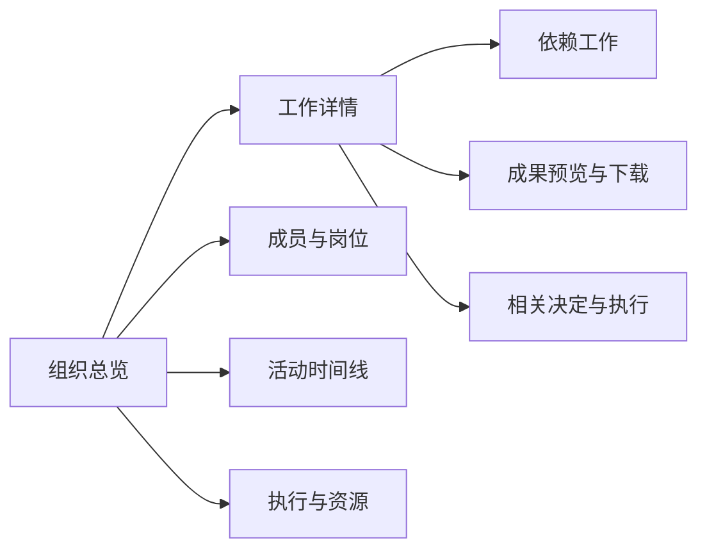

# ai-union 产品设计 v0.3

2026-10-16 更新：开发主分支 `dev`；小说公司首版已接入网页创建、模型 API 配置并绑定/连接测试、经营周期/章节/账本及缺失用量核对。操作入口按页面职责展示。最新范围和使用步骤见 [NOVEL_COMPANY.md](NOVEL_COMPANY.md)，下文旧迭代记录以此更新为准。

日期：2026-10-11（北京时间）。依据 [PRD](PRD.md)，交付 [单 HTML 高保真交互原型](../ai-union-dashboard-prototype.html)。本文件定义页面与交互；原型内全部数据为 fixture 或明确的设计情景，不连接运行时服务。

2026-10-12 实现更新：[实际工作台](../ai-union-console.html)已通过同源 HTTP 连接组织记录及命令服务，使用方式见 [CONSOLE.md](CONSOLE.md)。下文的原型情景仍指独立设计文件，不与实际服务混用。

2026-10-14：正式工作台采用 [React 工程](FRONTEND.md)，保留七页与全部操作流程，使用路径路由、组织/筛选参数和浏览器历史。视觉为浅色侧栏、紫色主操作、独立连接与来源标记，移动端使用横向导航；源样式与组件可独立维护。历史单 HTML 原型继续用于离线评审。

## 1. 三个产品入口

| 入口 | 使用目的 | 状态 |
| --- | --- | --- |
| 开发展示页 | 介绍项目、进展、模拟演示与架构 | 已交付 `ai-union-progress.html`。 |
| 组织操作工作台 | 创建与运行组织、暂停和调整、处理异常，观察协作与成果 | 实际本机会话、读写服务及运行控制已实现，fixture 验收通过；Dashboard 为其中的观察模块。设计原型继续保留。 |
| 受信 CLI | 初始化、有限运行、修章、配置资源和核对 | 已有本地入口，作为辅助与恢复工具；与网页共用派发锁及持久暂停意图。 |

## 2. 信息结构

桌面使用固定侧栏：总览、成员与岗位、工作、成果、活动、执行与资源、组织设置。页头显示当前组织与来源；页面始终保留连接、最后更新时间及刷新入口。主操作区提供新建、启动／继续、暂停派发、提交事件与待核对入口；设置页负责模型、资源、章程与操作回执。

## 3. 页面与交互规格

| 页面／部件 | 主要设计 | 交互与返回 |
| --- | --- | --- |
| 总览 | 目标与当前行动卡、下一步、四个计数、工作列表、成员摘要、成果与最近活动 | 点击任务、成员或成果打开详情；相关入口进入对应视图。 |
| 成员与岗位 | 成员身份、岗位职责、负责工作；协作关系来源于任务依赖 | 成员详情列出任务；可进入任务详情，稳定成员 ID 始终可见。 |
| 工作 | 文本搜索、状态筛选、成员筛选、状态标签及依赖关系 | 搜索与筛选组合生效；无匹配有清空入口；详情可沿依赖或成果继续查看。 |
| 成果 | 文件卡、版本与来源、校验说明 | 打开后以纯文本预览，内置文本可下载；原型校验仅复核公开 fixture，生产须校验实际文件。 |
| 活动 | 时间、类型、内容与引用；决定含接受／拒绝原因 | 切换事件／决定／执行类型；显示更多为有界列表；有关引用可打开详情。 |
| 执行与资源 | 调用额度条、执行记录、来源、已有 token 和未知费用说明 | 查看关联工作或决定；没有回执显示“未提供”，不能显示伪造的 0 元。 |
| 组织设置 | 模型设置、采用的目标与章程、调用上限、单次超时及管理操作回执 | 模型、资源、修章、核对均先填依据、预览，再明确提交；模型留空恢复 CLI 默认，启动时可覆盖；回执关联组织、请求、操作者和基准版本。 |
| 详情对话框 | 标题、来源、核心信息、依赖与上下游引用、返回 | Escape、关闭按钮和点击遮罩关闭；原生 dialog 管理焦点，关闭回到触发点。 |

## 4. 状态与文案

| 状态 | 页面文案与行为 |
| --- | --- |
| 正常执行 | “协作进行中”，展示正在执行的工作；仅在真实服务取得有效宿主活性依据时采用，原型始终附“模拟”。 |
| 持久记录 running、活性不足 | “执行活性未确认”；不自动宣称正在执行或需要重派。 |
| 已确认未知结果 | “执行待核对”，显示原因与关联执行；页面不重试。 |
| 等待依赖 | 标明前置任务与尚缺成果，提供依赖详情入口。 |
| 等待事件 | “等待新事件”，展示已有成果与后续安排；没有期限时显示“未安排复查”。 |
| 额度耗尽 | “额度已用尽”，禁用启动；有权限的发起人可进入资源设置，预览调整，不重置历史占用。 |
| 无成员／任务 | “组织尚未形成”，提供阶段解释；指标显示事实上的 0，已有未知回执不转换为 0。 |
| 首次连接失败 | 无实时数据，显示失败原因与重试；不加载示例冒充组织。 |
| 连接中断 | 保留最后成功快照，显著标为过期；禁止依据旧快照提交写操作，保留输入；在途请求恢复后先查原回执。 |
| 恢复 | 新完整快照到达后更新数据和时间，再清除过期提示；不以旧状态版本阻止恢复。 |
| 搜索无匹配 | 保留条件，解释无匹配并给出“清空筛选”。 |
| 成果不可用 | 单独标出缺失或校验失败，禁止下载不可用内容；不清除任务交付历史。 |

正常执行、待核对、等待和连接状态采用独立图标与文字；颜色是辅助，不能作为唯一含义。断开场景不能继续显示“实时连接成功”。

## 4a. 操作流程

所有操作使用“填写 → 预览 → 明确提交 → 回执”。预览包含目标、影响、基准版本和有限资源；取消或关闭不提交。提交后按请求标识展示状态，受理不等于执行完成。

| 操作 | 表单与关键状态 |
| --- | --- |
| 创建并采用 | 名称、目标、采用人、章程正文和受支持规则、总调用上限及单次超时；创建独立组织，不自动调用。原型创建的是浏览器内的新模拟场景。 |
| 启动／继续 | 已配置执行器、本次最多执行步数、剩余调用；真实执行器费用未知须明确接受。原型中的任何选择仍为模拟，真实调用始终为 0。 |
| 暂停派发 | 展示在途执行，确认后显示“暂停已请求”；收到在途回执后才显示“已暂停”。页面不承诺远程取消，未知结果进入核对。 |
| 提交事件 | 事件类型、内容、来源及模拟标记；记录事件不等于采纳建议或直接生成正式任务。 |
| 调整资源 | 展示上限与超时的新旧值、已占用及理由；新上限不能低于已占用。运行中先暂停，不隐藏改变执行条件。 |
| 修章 | 展示正文与规则差异、旧章程权限、版本及理由；仅支持已有规则字段，不从自然语言推导工具授权。 |
| 核对 | 已确认 unknown 的指定运行、核对依据、确认未执行／放弃；不退款、不自动重试，不对活性未确认的 running 执行此动作。 |

提交前再次检查权限、连接、组织、版本和运行条件；发现冲突时保留输入并重新预览。生产接口须独立执行所有校验。原型的观察者情景用于评审交互，浏览器内角色切换不构成生产鉴权。

原型验证工具可模拟在途回执，推进有限的 fixture 步骤；所有成员、决定与成果来自固定测试数据，不证明 AI 已自行形成组织。操作回执只保存在当前页面内，刷新文档会重置；不产生持久审计证据。

## 5. 刷新设计与 review 结论

实际服务模式：每 4 秒自动请求（满足不超过 5 秒的要求）、可见时恢复立即刷新，手动按钮可立即发起；请求有超时，避免积压。数据比较包含组织 ID、服务实例及请求／快照顺序。组织版本即使不变，事件、决定、调用和回执也须更新。旧响应不影响当前内容、连接状态或最后成功时间。

原型模式：刷新只重新生成模拟快照时间，不访问网络。设计工具提供同版本新增事件、旧响应到达和异常情景切换，以便审阅更新与状态文案；这些工具不是生产操作。仅有视觉演示不能证明生产刷新、活性检测或数据一致性已实现。

review 的两项修订：观察层必须区分活跃执行和遗留 running／unknown，不能直接沿用 `status()` 对所有在途记录的核对判定；验收必须包含版本不变时新增事件与启动决定执行，以及同版本响应乱序。

## 6. 视觉与响应式

继承现有 ai-union 标识与紫色，改为适合长期查看的工作台：浅灰背景、白色面板、深色正文、紫色主操作。绿色表示已校验／完成，琥珀色表示等待或注意，红色表示失败或核对；模拟来源使用独立浅紫标记。

| 设计项 | 规格 |
| --- | --- |
| 基础颜色 | 背景 `#F7F8FC`，正文 `#202333`，辅助 `#707789`，主色 `#6558DD`，边界 `#E6E9F1`。 |
| 字体 | 系统无衬线与中文字体；正文 13–14px，主要页标题 26–28px，不依赖远程字体。 |
| 空间与面板 | 4／8／12／16／24／32px 节奏；面板 12–16px 圆角，低对比阴影；主内容最大宽度控制长行。 |
| 桌面 | 224px 侧栏，页头及双列总览；视图与详情保持上下文。 |
| 手机 | 侧栏变顶部品牌与水平导航；总览单列、指标两列；列表保留关键信息并通过详情查看其余字段。 |
| 可访问性 | 所有按钮有名称、选中项 aria 状态、明显 focus-visible、原生表单与 dialog、状态说明、减少动画偏好；验证键盘与 320px 宽度。 |

不加入虚构营收、增长曲线、在线人数、真实模型 token 或未经来源证明的活性状态。涉及视觉占位的数据均附设计模拟标识。

## 7. 设计与开发交付

- PRD、本文与原型共同提供可审阅基线；如产品反馈改变范围，先同步规格与设计再实现该变化。
- 原型以一个 HTML 文件交付，内置资源与公开 fixture；可编辑源文件在 `design/dashboard/`，生成脚本在 `scripts/build_dashboard_prototype.py`。
- 七视图导航、任务筛选、跨详情链接、成果下载、活动分类、操作表单、预览取消、权限情景、暂停过程、核对及手机布局须在实际浏览器中检查。
- 设计证据放在 `evidence/design/`。生产 Dashboard 的读写边界、活性与同版本刷新另按 A01–A10 验收；不把设计检查计作运行数据验收。

设计检查结果与截图见 `evidence/design/`。实际工作台已完成本地 fixture 的 A01–A10 和 C01–C10，记录及桌面／手机截图见 [004 验收](../evidence/004-organization-console/README.md)；真实模型及经营闭环仍独立验收。

## 8. 与业务软件的关系

工作台聚合组织目标、成员、运行控制与异常处理；ERP／CRM／MES 的专业页面和业务记录按实际需要复用。未来业务动作详情应链接到来源系统的对象与回执，不在本工作台复制第二套客户、订单或总账。当前没有这些系统的真实连接，设计中不显示已连接的虚构卡片。分层与候选类别见 [软件复用与适配](software-reuse.md)。

## 8. 工程化前端验收补充

正式 URL 分别为 `/overview`、`/members`、`/tasks`、`/artifacts`、`/activity`、`/resources`、`/settings`。切换页面保留组织；工作筛选和活动分页可在刷新后恢复。表单打开时固定初值，轮询保留输入与焦点；关闭不提交。快速连续修改筛选必须合并当前 URL 条件，不恢复已经清空的值。

断网立即标记过期，保留快照并禁用操作；恢复只读取和查询原回执，不排队自动提交命令。切换组织后需要新的完整快照才能操作。七页在 Python 同源构建中验证，原型和实际工程分别留证据；见 [005](../evidence/005-frontend-engineering/README.md)。
