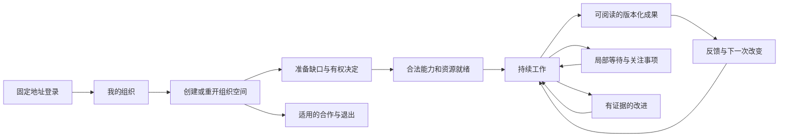

# ai-union V1 产品体验与交互契约

版本：U-110 v1，2026-11-13。依据：[Main Chapter V1](UNION_CHARTER_v1.0.md)、[PRD](PRD.md)、[产品审计](reviews/2026-11-11-kanban-charter-product-audit.md)及用户要求的“先纠正 Kanban，再派单执行”。

本文拥有完整用户体验契约；[FRONTEND](FRONTEND.md)拥有路由、组件、接口消费和实施责任。当前代码核查基线为 `d27d543`。目标流程不表示能力已实现；工程、真实模型、用户和持续运行分别取证，运行态只查 Kanban。旧设计可在该提交追溯，不再约束重构产品。

## 1. 产品结果与取舍

用户应能建立有明确目的和责任边界的 AU，在合法资源范围内持续推进工作、交付可读成果、吸收反馈、处理异常并改进。用户不用成为内部命令操作员、资料路径搬运者或每轮执行的调度员。

保留 React/TypeScript/Vite、正常登录和已验证的核心能力，重建信息结构、默认入口与完整旅程。旧 AU 迁移、旧导航、旧控制台布局没有保留义务；历史数据、原请求、权限和未完成责任不得因换界面被删除。

| 方案 | 结论与依据 |
| --- | --- |
| 在旧治理控制台加按钮、换样式 | 不采用；仍缺完整旅程，重演 U-109 审计中的日常人工接力 |
| 缩成聊天页或一次报告生成器 | 不采用；不能表达连续责任、治理、等待、反馈、资源和组合义务 |
| 以组织空间和持续工作为主轴，接入既有正确内核 | 采用用户已授权的重构方向；一套交互契约，逐片接通，未支持范围明确呈现 |

单 Agent AU 是完整合法路径，不为界面造第二成员、行业角色或层级。多成员、组合和改进随实际需要与有效授权启用。平台账户、付款和宿主权限不替代核心身份或 AU 治理依据。

## 2. 信息架构与默认入口

登录由同源核心身份边界处理。无可访问 V1 AU 时进入组织列表与创建入口；合法深链接优先，其他情况只恢复同主体最近访问且仍有权限的 V1 AU，否则返回列表。不得默选列表第一项、其他主体的 AU 或 legacy 组织。

| 入口 | 路径契约 | 用户在这里完成什么 |
| --- | --- | --- |
| 我的组织 | `/organizations`；`/` 导向这里或合法最近空间 | 选择/创建 V1 AU，看目的与准备缺口；账户操作独立 |
| 组织概况 | `/au/:auId` | 看目标进展、当前责任工作、最近成果、需谁处理的事项与真实能力边界 |
| 工作 | `/au/:auId/work`、`/au/:auId/work/:workId` | 提出目标、观察连续进展、补充输入、追溯责任与原执行 |
| 成果 | `/au/:auId/results`、`/au/:auId/work/:workId/results/:resultId` | 阅读正文、版本/来源/采用依据，下载和针对版本反馈 |
| 关注事项 | `/au/:auId/attention` | 按影响范围处理授权、保留决定和恢复，看等待对象与唤醒条件 |
| 能力与资源 | `/au/:auId/resources` | 连续完成模型、工具、业务资料和预算准备，核对用量与未知费用 |
| 治理与成员 | `/au/:auId/governance` | 看当前有效规则/任职，作有权决定、撤权和交接 |
| 改进 | `/au/:auId/improvement` | 看问题、试用、效果比较和采用/撤回，复用原工作与成果 |
| 合作 | `/au/:auId/collaboration` | 适用时处理承诺、履行、争议与组织变更，不从视觉层级推导权限 |

概况聚合摘要，不另存权威事实。工作详情聚合输入、执行事实、成果和事项；成果可单独阅读，不必先进入治理页。导航围绕对象，不是内部操作步骤清单。

移动端直接保留概况、工作、成果、关注，其余在可键盘操作的展开导航；不靠横向溢出隐藏操作。内部 ID、协议和 JSON 放到按权限开放的诊断详情，不要求用户理解它们才能工作。

旧 `/overview`、`/tasks`、`/artifacts`、`/models`、`/members`、`/resources`、`/activity`、`/settings` 在 U-111/U-115 迁移期仅解析链接：合法 V1 作用域 replace 到新入口；无作用域回列表。旧 AU 链接解释支持范围，不挂载旧页面、不读取旧业务投影、不迁移或新建替代 AU。最终保留的是链接解析，不是第二套界面。



## 3. 关键界面与动作层级

以下线框表达信息和责任，不是已实现截图，不建立独立 HTML 演示。

```text
组织空间：研究助理 AU                           我的组织 / 账户
概况  工作  成果  关注事项  能力与资源  治理与成员  改进  合作

目的：持续整理授权资料中的变化，交付有来源的研究结果
当前：一项推进中；一项等待资料；最近交付可阅读
下一步：资料负责人处理访问申请                  [查看事项]

正在承担的工作                        最近成果
目的 / 责任 / 已确认进展               标题 / 版本 / 交付依据 / 阅读
等待原因 / 影响范围 / 自动处理         反馈落实情况 / 下一版关联
[提出工作目标]                         [查看全部成果]

资源摘要：授权范围、余量、占用、实际用量、费用未知项
```

```text
工作详情：本月研究摘要           责任：研究成员       目标与边界
状态：正在读取授权资料           最近确认事实 / 更新时间

进展与依据                      成果正文 / 版本 / 来源
已收存的输入                    无成果时解释阶段
实际执行与工具事实              候选 / 已采用 / 已交付分别标记
等待与恢复                      [阅读] [下载] [反馈]（按权限）

[补充输入] [请求停止]（实际能力允许时）
需我决定：原因 / 范围 / 后果 / 有效依据            [处理决定]
高级详情：原请求、执行、用量、审计；常规路径不用操作内部状态
```

每页只有与当前任务相符的主要动作。资源未就绪时可以保存草稿或表达意图，不伪装已开始；“开始工作”在有效资源/授权校验后才产生执行意图。未实现动作显示具体缺口和负责入口，不提供假成功按钮。

确认用于新授权、高影响或适用保留事项；授权内普通工具步骤、预约/记账、原请求核对和执行推进不反复要求人确认。恢复留在原工作上下文，不要求复制请求 ID 到调试页。

## 4. 完整旅程与人机职责

VJ01–VJ10 是本契约的细化旅程，PRD 的 J01–J07 保持原编号与含义。下表明确对应关系；角色用于解释权限，不规定 AU 组织结构。

| 旅程 | PRD 对应 | 用户决定与正常结果 | AU/核心承担的动作 | 失败、unknown、撤权和重启 |
| --- | --- | --- | --- | --- |
| VJ01 安装与进入 | J01 | 固定地址首次认领/正常登录，选择或创建合法 V1 AU；无私有平台账户也可用 | 稳定主体、会话、按权限列组织、恢复合法深链接 | 配置/端口错误可诊断；401重新登录；拒绝读取清除旧内容；账户重置不接管其他治理身份 |
| VJ02 创建与准备 | J02 | 输入目的、成功依据、约束；核对治理绑定、适用规则和资源计划；进入同一空间 | 保存稳定 ID、原创建意图/回执和具体缺口；不推理、不暗授资源 | 拒绝保留草稿；unknown查原创建；刷新/重启重开同一 AU；不换 ID 重建；治理未绑定禁止自主业务 |
| VJ03 能力就绪 | J03 | 从缺口选择模型、工具、业务资料与预算，作需要的新授权，返回原目标 | 保存/测试/采用含义分别可知；检查当前治理、修订和资料范围，给出可用能力/余量 | 保存不推理，测试有界；失败不静默换模型；unknown查原操作；撤权影响后续使用，重开保留引用 |
| VJ04 目标到交付 | J03 | 表达结果和约束，选择必要资料，有权启动后取得可读成果 | 选择/建立责任与定义绑定，持久工作意图，预约、执行、观察、按有效规则采用/交付 | 失败责任仍在；预算不足说明范围；unknown先核对，刷新不重派；撤权后禁止新动作与无效采用 |
| VJ05 反馈与新输入 | J04 | 对指定成果版本反馈，或在原工作补充事实/目标，看到实际下一版差异 | 收存与采用分开；授权路由；采用、消费事件、下一步意图可靠关联 | 重复不重复采用；采用失败不消费；长工作/重启仍可输入；过期/撤权输入不扩权 |
| VJ06 等待与恢复 | J05 | 事项说明对象、原因、责任、唤醒条件和下一步；人只处理必要新授权/保留事项/补救 | 原请求核对、有限退避、局部恢复、执行所有权校验；独立工作继续 | 停止请求和远端停止/撤销分开；unknown保留预约；旧执行不覆盖；监督独立于被监督执行 |
| VJ07 治理与交接 | J05 | 有权者按旧有效程序修订/撤权/提名/交接；必要时后继者独立确认 | 分清初始根/当前治理/最终决定方；版本传播；交接同一 AI Work 的责任、资料与未决事实 | 预览不生效；unknown查原决定；失能按有效程序处理；账户/主机恢复不是治理后门 |
| VJ08 改进 | F19 / J04 | 看实际问题、试用范围/版本/效果/成本；高影响或新授权才增加决定 | 授权内低影响试用、必要检查/撤回；许可与效果分开；继续承担原工作 | 无改善/证据不足可保持候选；不得自改评级/检查依据/失败；需独立判断而不可得时不采用 |
| VJ09 合作与变更 | J07 | 适用时确认双方承诺、范围、验收、变化和退出 | 同构外部契约；治理/协作/部署分离；局部自治及授权投影 | 发送不算接受；争议/失联/部分完成可追踪；离线撤权边界明确；重组处理责任/资源/资料/身份/访问去向 |
| VJ10 维护与持续 | J06 | 有权维护者核对版本、兼容、备份、恢复并实施 | 外部维护机制、已知可用版本、原责任/未知请求；不双派发 | 不兼容先拒绝；代码回退不是业务回滚；不可逆变化另决；持续窗口记录结果/成本/故障/人的参与 |

当前创建协议没有独立结构化字段的成功依据/约束，先作为明确有来源的目标/章程内容表达，不在浏览器私造权威字段。需要结构化采用时由原领域/应用所有者冻结协议。准备态资源计划不是余额。

## 5. 状态、权限与恢复的共同合同

### 5.1 分开显示事实

| 维度 | 界面语义 | 禁止推断 |
| --- | --- | --- |
| 治理/准备 | 未绑定、准备中、受支持治理有效、具体缺口 | 本地治理有效不等于自主业务或预算已授权 |
| 工作 | 收存目标、待准入、可推进、推进中、等待、候选、已采用、已交付、结束/交接 | 模型自述、线程退出或HTTP200不能直接完成工作 |
| 执行 | 原Execution/attempt、当前所有权、最近进度/活性及时间 | 无输出不是死进程，断连不是远端停止 |
| 命令 | 待提交、受理/拒绝、处理中、待核对、已确认 | 200拒绝不是成功；404/回执单独403不证明未执行或整个AU失权 |
| 外部结果 | 已确认、未确认、部分完成、明确失败 | 本地取消不是远端取消、退款或副作用撤销 |
| 能力证据 | 实现范围、受控、指定真实profile、用户验收、持续窗口 | 单次测试/构建不证明全部模型或自主组织能力 |
| 资源 | 计划、授权、预约、消耗、结算、待核对 | 调用数不是金额封顶；未知费用不填0；重投/嵌套不增余额 |

这是视图词汇，不私增后端枚举。每个标签须有事实依据，或由负责实现卡增加可核对投影；不能将当前硬编码 `execution=not_started`、`autonomous_business=false` 简单反转。

### 5.2 身份与权限

界面作用域绑定当前 principal、service instance、AU；工作/成果再绑定 Work、Execution/step、result/version。读取、新动作、成果采用、本人原回执查询分别判定，服务端每次重验当前授权/版本。

切换主体/服务/AU时中止旧读取，清除旧受保护内容和下载，拒绝迟到响应；不删除服务端责任或回执。仅新动作资格不足仍保留合法读取和原请求核对。单独不能取得回执时重验身份/AU读取，不臆断整组织失权。

### 5.3 写入与恢复

- 一次用户意图提交前保留非秘密原引用及作用域；无法保存恢复引用则不提交。秘密、资料正文、目标全文和会话不进浏览器持久缓存。
- 当前身份/版本/连接修订/权限/能力变化时先刷新供核对，不静默换资源或扩权；正式采用与后续意图由领域/应用可靠关联。
- 确定拒绝保留输入/理由；传输不确定只查原 ID。重开、轮询、重连、重复点击或重挂载均不自动重放未知写入。
- 正常工作由服务端持久意图推进，不用浏览器连续 POST `start_work → start_attempt → run_loop → adopt → deliver` 替代组织责任；接续不能依赖页面存活。关闭页面、正常退出或浏览器会话到期不等于撤销已合法采用的运行授权；后续执行仍按当前治理、Mandate、资源与执行身份重验，真正撤权须阻止新动作和无效采用。
- 长工作保留新输入/观察，通用短读取超时不决定作业寿命；取消请求、送达、远端事实、未决占用分开显示。
- 等待/离线保留非秘密草稿和焦点，敏感输入仅在当前内存；恢复读取不自动授权新写入。后端已授权持久意图的恢复按原执行合同进行。

## 6. 资料、成果与费用

业务资料由有权接口提供名称、来源、范围、版本/摘要与使用许可。用户选择资料，不输入宿主绝对路径、目录别名或私有配置文件。缺发现/导入能力时 U-112 先补单一授权所有者和受控引用合同；不能用空下拉框或要求普通用户 SSH 配置代替完成。

S02 验证文本与正式业务资料分开标注；测试读取成功不表示 S03 已取得该文件/目录授权。行动与结果采用边界重验资料引用/版本/范围；组合和交接只传必要资料，不复制全部记忆。

成果身份是 AU/Work/result 的组合，result ID 仅在所属 Work 内唯一。详情路径保留 workId；缺失、歧义或越界明确拒绝，不能静默选另一成果。成果默认可阅读正文，保留原 Work、版本、来源、采用/交付依据和访问范围；下载是同一成果的另一呈现，不能只给摘要或JSON。候选和正式成果分开，反馈绑定版本，第二版可比较。外部/模型内容不在浏览器执行，阅读/下载均核验完整性及当前权限。

资源页分开显示授权、预约、实际尝试/用量和待核对。新金额带货币及整数最小单位，未知价格保留原用量依据；路由、监督、评审和改进均入账。调用额度不被表述为任意费用授权。

## 7. 治理与自治衔接

从“谁需要决定什么”进入治理，不把21种命令大表单作为首页。有效规则、保留事项、继任/退出与支持范围可读；不声称自然语言章程全部可执行。

外部资料和输入不因展示而取得指令权；正式行动只能经过可信命令路径。对外沟通显示所代表组织，不虚构人类。涉及个人资料或人工参与度量时说明目的、必要告知、最少采集和保留期限，不能默认转成对个人的持续监控；多租户身份、数据、凭据与资源隔离按实际边界验证。

授权内普通工作有机器推进路径。新能力/范围和保留事项形成持久关注事项，只阻塞相关工作。人的参与按补救介入、日常业务劳动、保留治理、自愿参与或不确定分类；测试中人手采用文字不算自治成果。

治理身份移交与工作责任交接是不同动作。U-114需处理 AI Work/Member/Mandate/Agent Definition 绑定、在途资格、原预约和必要资料，不能只更新旧 `state.work` 而遗漏 `state.work_runtime`。未知外部结果继续沿原引用核对；交接不自动扩权或清空责任。

## 8. 当前基础与实现责任

这是固定源码核查与合同分工，不是运行态看板。开工重验当前源码；未合并分支和宿主现状不可由本文推断。

| 交付卡 | 现有基础 | 必须补齐的完整结果 |
| --- | --- | --- |
| U-111/#65 新入口 | 核心登录、create_v1、准备态读取/回执 | 默认组织空间、作用域选择、创建重开、React与服务器SPA路由；旧AU不被默选 |
| U-112/#66 能力就绪 | models.v1配置/授权/验证、宿主资料适配器 | 连续准备及业务资料发现/选择或导入的公开受控合同；测试资料不冒充许可 |
| U-113/#67 工作成果 | start_work/start_attempt/run_loop、原事件/回执、正文和采用/交付 | 持久完整工作意图、真实状态、正文/版本/来源；无需手工结束或结算 |
| U-114/#68 治理交接 | S05治理、任职/撤权、文字责任 | 按实际决定组织界面；AI Work工程交接/撤权传播；U-096另验持续窗口 |
| U-115/#69 旧前端退役 | 旧路由/profile分流、页面/断言清单 | 调用者迁完后移除旧可达UI/孤儿代码/失效断言；不删数据和历史证据 |
| U-087–090/#41–44 反馈 | 版本化成果与授权基础 | 输入事件、反馈采用、第二版和事实纠正；U-090真实效果 |
| U-091–096/#45–50 连续性 | 原请求、执行、预约、观察；U-092在制责任保留 | 独立工作、重启恢复、长作业新输入、持久唤醒、外部监督、真实持续责任 |
| U-073/#26 改进 | Work/成果/版本/证据可复用 | 试用与效果/成本评估、采用/撤回；独立判断不足保留候选 |
| U-075/#28及子卡 profile | 已有限验证协议与原事件 | 逐profile真实内容、输入、取消/恢复/用量；不从少数样本泛化 |
| U-076/#29 合作 | 019/025契约需核对当前实现 | C系列适用的承诺、封装、撤权、离线、争议和重组交接 |
| U-071/#30及子卡 公开接入 | 版本化创建/读取、U-101独立客户端 | 工作命令和核心独立性，无内部表旁路/平台强制门槛 |
| U-074/#27 维护持续 | 候选构建/兼容/恢复机制 | 新V1安装到两版成果、持续窗口、备份升级恢复；旧U-107发布不算新验收 |

U-111–115的原8小时估计按新接缝复评；需要时按完整结果拆子卡，不按技术层拆成无法验收的按钮。保留父卡完整目标、owner/WIP及真实依赖。U-112资料边界、U-113持久意图、U-114 AI工作交接各先冻结字段/事务，不以页面先行掩盖后端缺口。

本次复评将 U-112 拆为 U-119 模型/工具/资源流程与 U-120 业务资料接入，将 U-113 拆为 U-121 持久工作意图与 U-122 成果阅读下载，将 U-114 拆为 U-123 治理决定与 U-124 AI Work 交接。父卡保留上述完整结果；子卡完成不能自动关闭父卡或整体验收。实际前置与状态只读在线 Kanban，文件和共享事实责任见 [FRONTEND §6](FRONTEND.md#6-文件所有权与交付顺序)。

## 9. 整体验收

| 编号 | 操作和可见结果 | 关键反例 | 责任 |
| --- | --- | --- | --- |
| UX-01 | 干净核心登录、创建、刷新/重启重开同一AU | 保存零推理；丢响应不重建；旧数据不回旧UX；无平台可用 | U-111/U-074 |
| UX-02 | 从准备缺口完成模型/资料/预算，回原目标 | 测试有界；实际工作能读所选资料；越界/撤权/版本变化拒绝 | U-112 |
| UX-03 | 从无Work到执行和可阅读/下载的有来源成果 | 不预置Work/正文；无人手finish/预约/结算；关页/退出/会话到期不丢运行责任；重开不重派；同AU两Work同resultId直达/刷新/返回/下载隔离；状态真实 | U-113受控/U-085真实 |
| UX-04 | 原版反馈后取得实际第二版，运行中可补充输入 | 去重、采用失败不消费、资料/工作归属，纠正只复查相关工作 | U-087–090/U-093 |
| UX-05 | A未知时B继续，重启找回A责任和请求 | 先核对、停止不谎称撤销、旧执行拒绝、输入/唤醒/独立监督持久 | U-086/U-091–096 |
| UX-06 | 有权治理及AI责任交接后同一工作继续 | 后继者按规则独立确认；旧权拒绝；未决预约/必要资料保持 | U-114/U-096 |
| UX-07 | 试用产生可比较效果并采用/撤回 | 无改善/未知可见；不可自改评级/删失败；总成本/目标/原责任可追踪 | U-073 |
| UX-08 | 两AU接受/履行承诺，处理失联/争议/重组 | 同构/封装/关系分离/离线撤权；发送不算接受 | U-076 |
| UX-09 | 独立新环境持续交付并备份/升级/恢复 | 无私有平台；固定窗口/资源；不双派发，不隐藏人工劳动/失败 | U-074及真实前置 |
| UX-10 | 声明路由/返回路径可达，只挂载新体验 | 空/错/离线/unknown/撤权；键盘及四宽度；旧UI不再可达 | U-115及每个改动卡 |

每张界面卡验证320/390/1024/1440、可见焦点、标签/错误关联、键盘主流程、长名称/正文、空/错/等待/断网。轮询不重挂载正在输入的表单、不抢焦点；动态状态适当告知辅助技术，不能只靠颜色。正文可读行宽，表格局部滚动，减少动态偏好不丢信息。

浏览器及HTTP/SQLite证明相应控制范围；真实profile、业务质量、屏幕阅读器/实体设备和持续窗口分别说明未覆盖范围。重要结论按需独立复核，不以截图、构建、测试数或完成卡数替代整体验收。

## 10. 规范追踪与旧合同处置

40条和X-01(a–f)/X-02(a–e)继续由[追踪表](../specs/053-union-rewrite/charter-traceability.md)维护，并映射本设计VJ/UX。按Chapter §10.2条件适用，不将未启用假报通过，也不删去组合、改进、持续目标。

[ADR-0003](decisions/0003-react-console.md)选择React栈，不要求旧导航/布局保留。旧S03登记、页面执行、成果交付中“用户分步登记/准备/运行/采用/交付”“旧责任工作区必须可用”的交互约束由本设计目标替代；对应实现前在原合同标记具体替换范围。身份、授权、原请求、版本、预约、unknown等保障继续有效，新owner通过等价或更强反例后才能退役旧路径，不能整体删测试冒充完成。

本设计不写领域表、不产生治理/执行资格、不扩大支出/部署授权。产品完成须回到上述整体验收，不能止于U-110文档或U-111入口。
