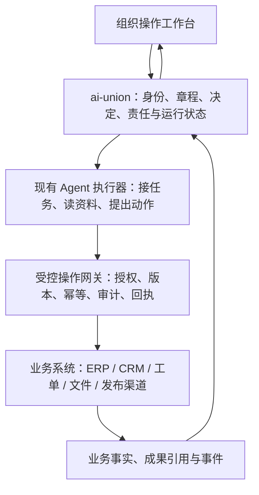

# AI 组织的软件复用与适配

日期：2026-10-11（北京时间）。来源：用户提出 ERP、CRM、MES 等人类管理系统哪些可被 AI 复用、哪些需要 AI 适配。本文件是产品架构依据；软件名称为候选示例，不表示当前仓库已接入、采购或部署。

## 1. 结论

业务事实、交易规则和基础设施优先复用现有软件。AI 需要专门设计的是成员身份、授权、组织决定、执行监督、上下文、恢复和用量管理；实现这些能力时也可以复用流程引擎、数据库与 Agent 执行器。

“需要 AI 适配”通常意味着增加受控接口与运行语义，不意味着重写整个 ERP、CRM 或 MES。操作前端负责让人采用目标、启动组织、配置边界、处理异常和看结果；业务系统继续管理其专业领域的数据。

## 2. 各类系统的处理

| 类别与示例 | 可复用的内容 | 需要适配给 AI 的部分 | 本项目位置 |
| --- | --- | --- | --- |
| ERP／财务：Odoo、ERPNext | 账簿、采购、订单、费用、库存、组织主数据及既有业务校验 | 结构化动作接口、成员到业务身份映射、审批与保留权、幂等和回执；金额必须以真实业务凭证为准 | 有实际经营需求时接入，不在组织原型中另建总账。 |
| CRM：Salesforce、HubSpot、Odoo CRM 等 | 客户、线索、联系人、商机、沟通历史与销售阶段 | 限定客户范围的上下文、可执行动作的权限、沟通／承诺的授权、外部反馈归因 | 需要经营客户或受众关系时接入；Agent 执行内容与 CRM 事实分别保存。 |
| MES／制造系统 | 工单、工序、物料、质检、设备和追溯事实 | 调度或分析指令的受控接口、状态事件、异常接管；设备实时控制沿用已有设备及工艺约束 | 当前内容工作室没有制造现场需求，暂不接 MES。 |
| HR／人事与身份系统 | 组织目录、岗位档案、访问控制及审计基础设施 | AI 成员要记录能力、模型与执行器配置、评测、上下文交接和撤权；工资、休假等人类劳动规则不能直接作为 AI 管理模型 | 建设成员／任职管理，复用身份基础设施；推理成本进入资源台账，不称为 AI 工资。 |
| 项目／工单／BPM：GitHub Issues、Jira、流程引擎 | 任务展示、状态、协作、通知，以及确定流程的执行 | AI 动作包、依赖成果、长执行／未知结果、模型判断与正式状态提交的对应关系 | 可作为外部工作系统；组织决定与业务任务通过 ID 关联。 |
| 文件／知识：对象存储、文档系统、Wiki、检索服务 | 文件、版本、搜索、备份及已有访问控制 | 按岗位／任务选资料，记录来源与版本，区分输入资料和可执行指令，长期记忆与会话分离 | 首版文本资产先沿用本地实现，按真实需求替换存储。 |
| BI／日志／可观测性 | 业务统计、日志检索、告警和历史报表 | 以组织、成员、决定、工作、执行为维度关联；模拟与真实、未知与已确认分别显示 | 复用通用技术，不把业务指标、模型用量和真实能力验收混为一项。 |
| 运行基础设施：数据库、队列、Temporal 等耐久流程工具 | 事务、事件、定时器、队列、重试机制和进程监督 | 区分安全可重试的读取与有外部副作用的动作；恢复依据执行回执而非猜测 | 可复用工程组件，是否引入由规模和实际恢复需求决定。 |
| Agent 执行器／框架：现有 Codex CLI、Agent SDK／图式执行框架等 | 模型调用、工具调用、单 Agent 工作循环与可用回执 | 稳定成员与执行会话的分离、宿主授权、上下文清单、组织决定协议与资源限制 | 当前复用 Codex CLI 适配；框架选型不替代组织治理。 |

## 3. 必须按 AI 场景设计的能力

| 能力 | 为什么已有业务软件不能直接替代 |
| --- | --- |
| 成员身份与任职 | 一个成员可以换模型、执行器或会话；权限来自当前任职，旧任职撤回后不能继续提交。 |
| 授权与操作网关 | 模型提出操作，宿主核对身份、组织范围、工具、额度和生效版本；不能由模型自称已获批准。MCP／函数调用可承载接口，不能独立承担授权与审计。 |
| 组织决定循环 | 从目标、事件和成果决定下一步，支持有依据的改组与等待；决定要经过校验才能成为正式任务或业务动作。 |
| 执行、暂停与恢复 | 长运行、超时、进程失联、外部动作是否生效需要区分；未知结果必须核对，有副作用的动作不能盲目重试。 |
| 上下文与组织记忆 | 资料随责任和任务传递，并记录实际使用的来源与版本；会话结束不丢失正式责任、记忆与成果。 |
| 资源与评测 | 同时记录模型调用／token、工具成本与业务支出；未知金额保留未知。完成声明、真实文件、业务系统回执、对外结果分别验收。 |

这些是需要专门适配的产品能力，并不要求所有代码自行编写。

例如“AI 销售更新商机”：CRM 仍拥有客户和商机记录；ai-union 确认该成员有权操作这个客户，执行器提出更新，通过受控接口提交，保存 CRM 返回的对象与结果，再据此决定下一步。超时后先查询这次更新是否生效，避免再次提交。此处需要新增的是组织责任和执行协议，CRM 的客户模型及业务校验可以继续使用。

## 4. 推荐逻辑架构

此图是目标模块关系，不表示已存在上述业务集成。当前代码只有本地组织运行时、执行器适配、CLI 和设计原型。

ERP／CRM 等系统拥有相应业务事实；ai-union 保存授权依据、决定、任务、执行和外部对象引用。不要复制另一套客户、订单或财务真相，也不要把模型说明当作外部系统已经成功的证明。

每个外部动作至少关联组织、成员／任职、决定／工作、外部系统与对象、请求 ID、权限依据和结果状态。有幂等支持时使用外部系统的幂等键；没有时保留请求与查询依据，结果未知先核对。外部事件需要去重，并保留来源、时间和模拟标记。

## 5. 前端与实施顺序

操作工作台管理 AI 组织：创建、运行、暂停、事件、资源、修章和核对。ERP／CRM 的专业页面可通过明确的对象链接或嵌入集成复用；随着业务闭环成熟再聚合必要的概览。前端壳和表单组件也可复用，不把所有专业后台重写成 ai-union 页面。

1. 先完成 004 操作工作台与现有运行时的实际闭环，保留 003 的观察能力。
2. 真实 Agent 协作通过后，为首个真实交付选一个具体工具／渠道，验证“有权限的动作 → 外部回执 → 组织事件 → 后续决定”。
3. 出现客户管理、费用报销、订单或库存需求时，选择相应成熟系统接入；不为抽象的“AI 企业”预先部署全部 ERP／CRM／MES。
4. 评估候选软件时核对所需版本的 API、细粒度权限、事件接口、幂等／查询、审计、数据导出和部署成本，再确定产品。当前不做未经验证的“一键通用接入”承诺。

相关产品范围见 [PRD](PRD.md)，操作验收见 [004](../specs/004-organization-console/spec.md)。
