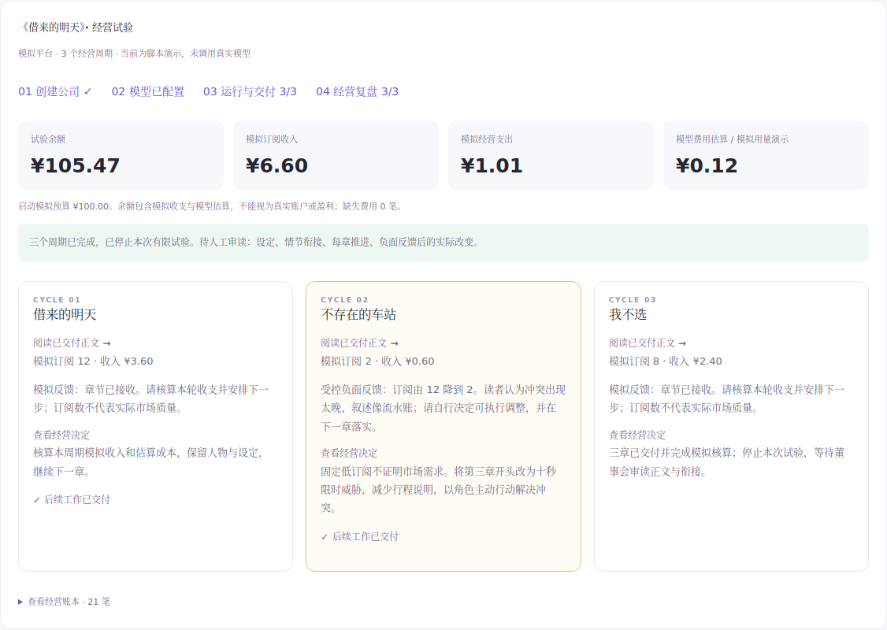

# 006 小说公司 · 验证记录

2026-10-16，基于 `dev` / `ed90a17`。完成代码、独立工程复核和本机模拟验收；真实模型调用 **0**，真实公司能力与作品质量仍待实际供应商试跑。

| 验证 | 结果 |
| --- | --- |
| Python 机制/服务回归 | 91 项通过，其中小说公司新增 13 项 |
| 本地 HTTP 模型执行链路 | 1 次连接测试 + 11 次组织执行，3 章、3 次复盘；本地替身明确标模拟 |
| 前端 | 14 项测试、TypeScript、Vite 构建通过 |
| 历史 Node/计划 | 9 项测试；82 项历史计划完整性检查通过 |
| 原工作台浏览器回归 | 61 项通过，包含按页面定位操作入口 |
| 小说公司浏览器流程 | 16 项通过，包含创建/API 配置并绑定/密钥去敏/连接测试/一次启动/正文/经营/刷新/390px 与 320px |
| 启动 | 5 项通过；`npm start` 构建、深链接、同源 CSP、会话和静态资源 |
| 独立复核 | [通过](../../docs/reviews/2026-10-16-novel-company.md)，初始三项问题已修复并回归 |

本地 HTTP 场景的模拟账本：启动 10000 分，订阅收入 660 分，服务器及模拟税费 101 分，模拟模型用量估算 12 分，余额 10547 分。所有金额 CNY；这些数字不能证明实际盈利。固定演示没有连接测试时仅 11 次调用，对应估算少 1 分。

负面反馈证据：第二章固定返回“冲突出现太晚、叙述像流水账”；经营决定安排 `chapter-3`，任务要求十秒限时威胁前置；实际执行保存对应正文。此处是脚本验证，不能据此认定真实模型已自主作出有效调整。

关键回归覆盖旧版本正文不能冒充反馈后新交付、用量缺失的董事会补录、事件 ID 冲突原子回滚、事件已消费时仍优先复盘、章程撤权、预算停止、重复调用/投稿不重复记账、重开持久状态。

- [操作指南](../../docs/NOVEL_COMPANY.md)
- [验证摘要](validation.json) · [浏览器检查](checks.json) · [经营快照](company.json)
- [桌面](novel-company-desktop.png) · [手机](novel-company-mobile.png)

环境：Linux、Python 3.12、Node 24.19.0。自动安装的默认 Chromium 构建下载未成功，验证使用官方 Playwright 1.51.1 下载的 Chromium Headless Shell 134，通过 `UNION_CHROMIUM_PATH` 选择；仓库依赖未降级。测试环境安装中文字体后重新检查截图。Windows 和远端 CI 结果需另查，不能由本机 Linux 通过推定。
